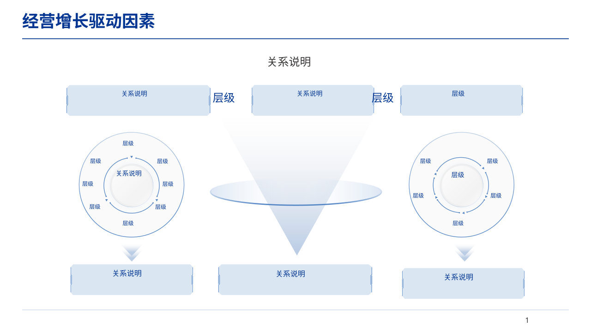

# 经营增长驱动因素

来源为立体结构逻辑图1122.pptx#9。

## 结构与适用场景

上GMV=人群×商品公式；左右生命周期环；中倒锥穿一环；下3驱动块

经营增长驱动框架

人群/商品生命周期与公式仅按材料重命名；非量化拆解时用关系标记

固定节点、圆弧、扇区、分面和连接表达定性关系。数量比较、趋势或占比使用数据驱动图表，源页中已登记的微图槽可接收实际数据。

## 预览



## 调用

将下列完整page对象放入schema_version=1、template_id=business-blue-v1的pages数组，替换各节点内容。nodes键对应原文本框或已明确拆分的语义分段，字段角色及source_ref、segment见下表。

```json
{
  "id": "spatial-09",
  "family": "source-spatial",
  "variant": "page-09",
  "content": {
    "title": "经营增长驱动因素",
    "nodes": {
      "shape_12": "关系说明",
      "shape_1080": "关系说明",
      "shape_1081": "层级",
      "shape_1082": "层级",
      "shape_1083": "层级",
      "shape_1084": "层级",
      "shape_1085": "层级",
      "shape_1086": "层级",
      "shape_1087": "层级",
      "shape_1088": "层级",
      "shape_1091": "层级",
      "shape_1092": "层级",
      "shape_1093": "层级",
      "shape_1096": "层级",
      "shape_1098": "层级",
      "shape_1099": "层级",
      "shape_1139": "关系说明",
      "shape_1146": "关系说明",
      "shape_1149": "层级",
      "shape_1155": "层级",
      "shape_1156": "层级",
      "shape_1166": "关系说明",
      "shape_1174": "关系说明",
      "shape_1182": "关系说明"
    }
  },
  "config": {
    "show_source": true,
    "show_page_number": true
  }
}
```

config支持show_source、show_page_number、image_fit与image_position。image_fit可选contain或cover，image_position为xMin/xMid/xMax与YMin/YMid/YMax组合的九个焦点，默认为xMidYMid。字体、颜色、全局区和固定字阶取自tokens，节点数与连接结构由variant确定。

## 字段合同

每个业务节点required=true、min=1，max按具体框体登记。字符按规范化后的Unicode码点计数，空格标点换行均计入。build会以实际字体测量宽高，字符数通过后仍可能需要调整文字。

| 字段 | 节点角色与源标签 | 最短/最长 | 字阶 | 框体px | 原框引用 | 分段 | 旋转° | 垂直锚点 |
|---|---|---|---|---|---|---|---|---|
| nodes.shape_12 | 上中节点，源标签“提供全域经营CP资产的沉淀管理与应用提效” | 1/59 | body | [321.0494, 120, 640.0609, 38.7734] | slide:12 |  | 0.0 | t |
| nodes.shape_1080 | 中左节点，源标签“消费者 / 生命周期 / DEEPLINK” | 1/66 | diagramCompact | [218.3469, 367.6678, 138.9763, 64.2391] | slide:1080 |  | 0.0 | t |
| nodes.shape_1081 | 中左节点，源标签“互动” | 1/12 | diagramMicro | [164.1961, 390.8238, 67.4985, 22.6161] | slide:1081 |  | 0.0 | t |
| nodes.shape_1082 | 中左节点，源标签“行动” | 1/12 | diagramMicro | [181.1032, 341.4922, 67.4985, 22.6161] | slide:1082 |  | 0.0 | t |
| nodes.shape_1083 | 中左节点，源标签“全域” | 1/12 | diagramMicro | [251.5912, 303.1088, 67.4985, 22.6161] | slide:1083 |  | 0.0 | t |
| nodes.shape_1084 | 中左节点，源标签“种草” | 1/12 | diagramMicro | [179.5435, 440.5454, 67.4985, 22.6161] | slide:1084 |  | 0.0 | t |
| nodes.shape_1085 | 下左节点，源标签“发现” | 1/12 | diagramMicro | [251.5912, 476.3193, 67.4985, 22.6161] | slide:1085 |  | 0.0 | t |
| nodes.shape_1086 | 中左节点，源标签“复购” | 1/12 | diagramMicro | [337.7765, 391.2138, 67.4985, 22.6161] | slide:1086 |  | 0.0 | t |
| nodes.shape_1087 | 中左节点，源标签“收购” | 1/12 | diagramMicro | [326.0785, 341.8922, 67.4985, 22.6161] | slide:1087 |  | 0.0 | t |
| nodes.shape_1088 | 中左节点，源标签“至爱” | 1/12 | diagramMicro | [322.1092, 440.9453, 67.4985, 22.6161] | slide:1088 |  | 0.0 | t |
| nodes.shape_1091 | 中右节点，源标签“货品 / 生命周期 / PLTV” | 1/51 | diagramCompact | [944.1732, 370.8472, 112.8608, 64.2391] | slide:1091 |  | 0.0 | t |
| nodes.shape_1092 | 中右节点，源标签“尾货 / 清仓期” | 1/18 | diagramMicro | [887.3529, 416.4195, 52.841, 35.5339] | slide:1092 |  | 0.0 | t |
| nodes.shape_1093 | 中右节点，源标签“趋势洞察” | 1/12 | diagramMicro | [895.7314, 341.4922, 67.4985, 22.6161] | slide:1093 |  | 0.0 | t |
| nodes.shape_1096 | 下右节点，源标签“成熟 / 打爆期” | 1/24 | diagramMicro | [966.2294, 476.3193, 67.4985, 35.5339] | slide:1096 |  | 0.0 | t |
| nodes.shape_1098 | 中右节点，源标签“新品 / 测试器” | 1/24 | diagramMicro | [1040.7167, 341.4922, 67.4985, 35.5339] | slide:1098 |  | 0.0 | t |
| nodes.shape_1099 | 中右节点，源标签“爬坡 / 成长期” | 1/20 | diagramMicro | [1052.5547, 416.4195, 59.0999, 35.5339] | slide:1099 |  | 0.0 | t |
| nodes.shape_1139 | 上左节点，源标签“LONG-TERM GMV / 品牌长效经营” | 1/44 | diagramCompact | [230.3748, 194.7673, 138.9763, 45.8222] | slide:1139 |  | 0.0 | t |
| nodes.shape_1146 | 上中节点，源标签“DEEPLINK / 深链人群资产” | 1/44 | diagramCompact | [610.0401, 194.5073, 138.9763, 45.8222] | slide:1146 |  | 0.0 | t |
| nodes.shape_1149 | 上右节点，源标签“PLTV / 货品长效价值” | 1/44 | diagramCompact | [931.9953, 194.5073, 138.9763, 45.8222] | slide:1149 |  | 0.0 | t |
| nodes.shape_1155 | 上中节点，源标签“=” | 1/11 | body | [439.9491, 197.9567, 120.6094, 38.7734] | slide:1155 |  | 0.0 | t |
| nodes.shape_1156 | 上中节点，源标签“X” | 1/11 | body | [784.0605, 197.9567, 120.6094, 38.7734] | slide:1156 |  | 0.0 | t |
| nodes.shape_1166 | 下左节点，源标签“驱动一：数据扩容 / 类型拓宽 量级扩充 高质提升” | 1/56 | caption | [183.5728, 582.4912, 203.3553, 47.6619] | slide:1166 |  | 0.0 | t |
| nodes.shape_1174 | 下右节点，源标签“驱动二数据应用 / 跨BP打通 公私域接” | 1/56 | caption | [901.7204, 590.6098, 203.3553, 47.6619] | slide:1174 |  | 0.0 | t |
| nodes.shape_1182 | 下中节点，源标签“达摩盘·数据资产经营管理平台 全新升级! / 经营诊断 货品洞察 人群洞察 内容洞察” | 1/84 | caption | [484.8015, 583.471, 309.0673, 47.6619] | slide:1182 |  | 0.0 | t |

全局title必填、2至32码点，使用统一标题框。section_name可选0至24码点，source可选0至64码点。所有可编辑文本通过独立原生carrier导出，页码为派生文字。

## 来源处理

原生PPTX源件保存于用户材料目录，分发包仅含用户资产衍生的几何、字段和说明。原始逐框文字、源框与标准化框在page-catalog.json的variant.fields中。

源标题引用为`slide:720`，原文为“领先的经营方法论”。模板默认标题依据真实结构设置。

密集全景中的diagramCompact为14px、diagramMicro为12px。适用于体系概览或附录局部标签，现场关键结论用统一标题与正常正文字阶表达。

源画布边界裁切已烘焙为可编辑Bezier几何，3D顶面、侧面与前面通过tokens配色的相对明暗保留。

