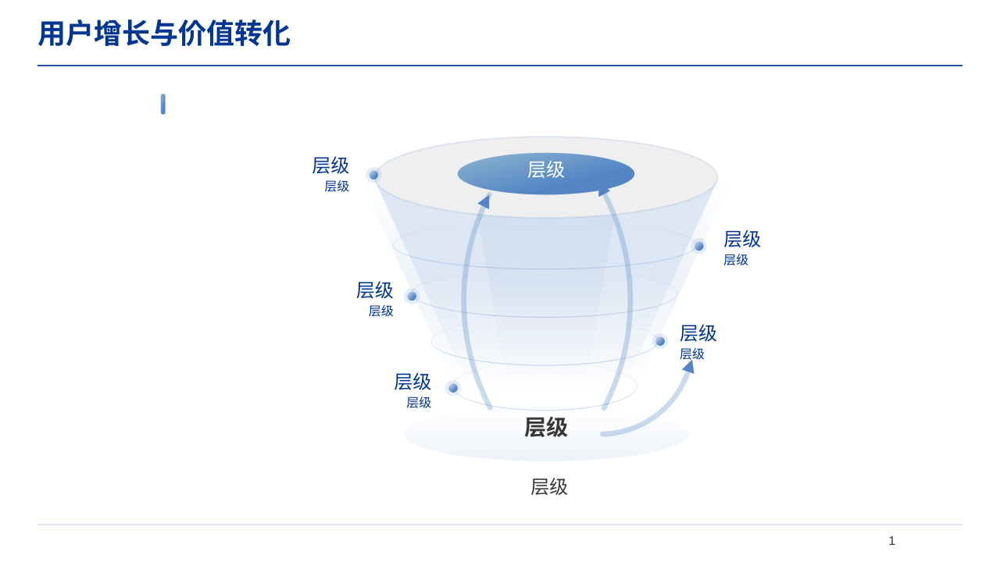

# 用户增长与价值转化

来源为立体结构逻辑图1122.pptx#10。

## 结构与适用场景

倒锥漏斗，顶流量入口；左右获取/激活/留存/推荐/盈利；底价值；向上回流曲线

平台运营漏斗与增长闭环

这是阶段框架，原面宽无真实比例；不能当真实转化率面积图

固定节点、圆弧、扇区、分面和连接表达定性关系。数量比较、趋势或占比使用数据驱动图表，源页中已登记的微图槽可接收实际数据。

## 预览



## 调用

将下列完整page对象放入schema_version=1、template_id=business-blue-v1的pages数组，替换各节点内容。nodes键对应原文本框或已明确拆分的语义分段，字段角色及source_ref、segment见下表。

```json
{
  "id": "spatial-10",
  "family": "source-spatial",
  "variant": "page-10",
  "content": {
    "title": "用户增长与价值转化",
    "nodes": {
      "shape_102": "层级",
      "shape_103": "层级",
      "shape_106": "层级",
      "shape_108": "层级",
      "shape_109": "层级",
      "shape_110": "层级",
      "shape_111": "层级",
      "shape_112": "层级",
      "shape_113": "层级",
      "shape_114": "层级",
      "shape_115": "层级",
      "shape_118": "层级",
      "shape_10": "层级"
    }
  },
  "config": {
    "show_source": true,
    "show_page_number": true
  }
}
```

config支持show_source、show_page_number、image_fit与image_position。image_fit可选contain或cover，image_position为xMin/xMid/xMax与YMin/YMid/YMax组合的九个焦点，默认为xMidYMid。字体、颜色、全局区和固定字阶取自tokens，节点数与连接结构由variant确定。

## 字段合同

每个业务节点required=true、min=1，max按具体框体登记。字符按规范化后的Unicode码点计数，空格标点换行均计入。build会以实际字体测量宽高，字符数通过后仍可能需要调整文字。

| 字段 | 节点角色与源标签 | 最短/最长 | 字阶 | 框体px | 原框引用 | 分段 | 旋转° | 垂直锚点 |
|---|---|---|---|---|---|---|---|---|
| nodes.shape_102 | 中右节点，源标签“推荐” | 1/5 | body | [926.2186, 293.7464, 62.0398, 35.7099] | slide:102 |  | 0.0 | t |
| nodes.shape_103 | 中右节点，源标签“分享用户 / 正向评价用户” | 1/40 | caption | [926.2186, 324.5053, 148.0777, 53.3995] | slide:103 |  | 0.0 | t |
| nodes.shape_106 | 中右节点，源标签“盈利” | 1/5 | body | [869.9564, 414.363, 62.0398, 35.7099] | slide:106 |  | 0.0 | t |
| nodes.shape_108 | 中右节点，源标签“获拍用户” | 1/20 | caption | [869.9564, 445.1219, 148.0777, 30.0802] | slide:108 |  | 0.0 | t |
| nodes.shape_109 | 上左节点，源标签“获取” | 1/5 | body | [385.2973, 199.4423, 62.0398, 35.7099] | slide:109 |  | 0.0 | t |
| nodes.shape_110 | 上左节点，源标签“有效用户” | 1/20 | caption | [299.2681, 230.2099, 148.0777, 30.0802] | slide:110 |  | 0.0 | t |
| nodes.shape_111 | 下中节点，源标签“核心价值” | 1/11 | heading | [628.2098, 532.7608, 141.7084, 41.3309] | slide:111 |  | 0.0 | t |
| nodes.shape_112 | 中中节点，源标签“激活” | 1/5 | body | [441.7335, 359.2667, 62.0398, 35.7099] | slide:112 |  | 0.0 | t |
| nodes.shape_113 | 中左节点，源标签“参拍用户” | 1/20 | caption | [355.7043, 390.0343, 148.0777, 30.0802] | slide:113 |  | 0.0 | t |
| nodes.shape_114 | 下中节点，源标签“留存” | 1/5 | body | [490.2168, 476.5943, 62.0398, 35.7099] | slide:114 |  | 0.0 | t |
| nodes.shape_115 | 下中节点，源标签“6个月内参拍2次以上用户” | 1/30 | caption | [330.462, 507.3532, 221.7946, 30.0802] | slide:115 |  | 0.0 | t |
| nodes.shape_118 | 下中节点，源标签“增长≠获客” | 1/12 | body | [633.2652, 611.1068, 139.8028, 35.7099] | slide:118 |  | 0.0 | t |
| nodes.shape_10 | 上中节点，源标签“流量入口” | 1/10 | body | [644.6117, 204.7675, 108.9047, 35.7099] | slide:10 |  | 0.0 | t |

全局title必填、2至32码点，使用统一标题框。section_name可选0至24码点，source可选0至64码点。所有可编辑文本通过独立原生carrier导出，页码为派生文字。

## 来源处理

原生PPTX源件保存于用户材料目录，分发包仅含用户资产衍生的几何、字段和说明。原始逐框文字、源框与标准化框在page-catalog.json的variant.fields中。

源标题引用为`slide:5`，原文为“定义AARRR”。模板默认标题依据真实结构设置。

密集全景中的diagramCompact为14px、diagramMicro为12px。适用于体系概览或附录局部标签，现场关键结论用统一标题与正常正文字阶表达。

源画布边界裁切已烘焙为可编辑Bezier几何，3D顶面、侧面与前面通过tokens配色的相对明暗保留。

