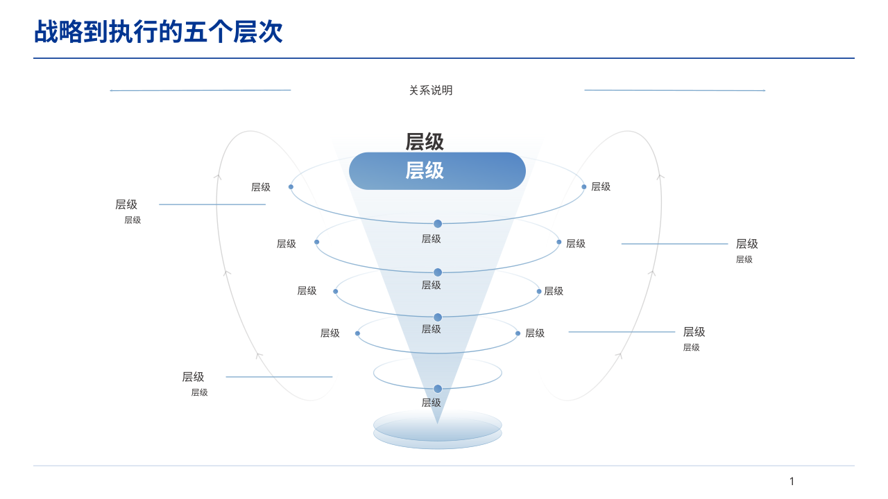

# 战略到执行的五个层次

来源为立体结构逻辑图1122.pptx#11。

## 结构与适用场景

战略规划至营销活动5层倒锥；各层椭圆；外左右立式循环与旁注

战略到执行层级

层级名称、层旁说明、外反馈关系独立；倒锥面积非定量

固定节点、圆弧、扇区、分面和连接表达定性关系。数量比较、趋势或占比使用数据驱动图表，源页中已登记的微图槽可接收实际数据。

## 预览



## 调用

将下列完整page对象放入schema_version=1、template_id=business-blue-v1的pages数组，替换各节点内容。nodes键对应原文本框或已明确拆分的语义分段，字段角色及source_ref、segment见下表。

```json
{
  "id": "spatial-11",
  "family": "source-spatial",
  "variant": "page-11",
  "content": {
    "title": "战略到执行的五个层次",
    "nodes": {
      "shape_57": "层级",
      "shape_74": "层级",
      "shape_75": "层级",
      "shape_76": "层级",
      "shape_77": "层级",
      "shape_78": "层级",
      "shape_79": "层级",
      "shape_80": "层级",
      "shape_81": "层级",
      "shape_82": "层级",
      "shape_83": "层级",
      "shape_84": "层级",
      "shape_85": "层级",
      "shape_94": "层级",
      "shape_102": "层级",
      "shape_104": "层级",
      "shape_105": "层级",
      "shape_107": "层级",
      "shape_108": "层级",
      "shape_110": "层级",
      "shape_111": "层级",
      "shape_56": "层级",
      "shape_4": "关系说明"
    }
  },
  "config": {
    "show_source": true,
    "show_page_number": true
  }
}
```

config支持show_source、show_page_number、image_fit与image_position。image_fit可选contain或cover，image_position为xMin/xMid/xMax与YMin/YMid/YMax组合的九个焦点，默认为xMidYMid。字体、颜色、全局区和固定字阶取自tokens，节点数与连接结构由variant确定。

## 字段合同

每个业务节点required=true、min=1，max按具体框体登记。字符按规范化后的Unicode码点计数，空格标点换行均计入。build会以实际字体测量宽高，字符数通过后仍可能需要调整文字。

| 字段 | 节点角色与源标签 | 最短/最长 | 字阶 | 框体px | 原框引用 | 分段 | 旋转° | 垂直锚点 |
|---|---|---|---|---|---|---|---|---|
| nodes.shape_57 | 上中节点，源标签“YOUR TITLE” | 1/16 | heading | [524.5697, 187.8622, 211.973, 40.4006] | slide:57 |  | 0.0 | t |
| nodes.shape_74 | 中中节点，源标签“营销战略” | 1/11 | diagramCompact | [594.7863, 336.2037, 72.2273, 17.5] | slide:74 |  | 0.0 | t |
| nodes.shape_75 | 中中节点，源标签“产品销售” | 1/11 | diagramCompact | [594.7863, 403.0345, 72.2273, 17.5] | slide:75 |  | 0.0 | t |
| nodes.shape_76 | 中中节点，源标签“相互保障” | 1/11 | diagramCompact | [594.7863, 466.4171, 72.2273, 17.5] | slide:76 |  | 0.0 | t |
| nodes.shape_77 | 下中节点，源标签“营销活动” | 1/11 | diagramCompact | [594.7863, 572.6796, 72.2273, 17.5] | slide:77 |  | 0.0 | t |
| nodes.shape_78 | 中中节点，源标签“营销战略” | 1/11 | diagramCompact | [757.2951, 472.3344, 72.2273, 17.5] | slide:78 |  | 0.0 | t |
| nodes.shape_79 | 中中节点，源标签“长期战略” | 1/11 | diagramCompact | [435.83, 472.3344, 72.2273, 17.5] | slide:79 |  | 0.0 | t |
| nodes.shape_80 | 中中节点，源标签“相互促进” | 1/11 | diagramCompact | [784.2879, 411.5981, 72.2273, 17.5] | slide:80 |  | 0.0 | t |
| nodes.shape_81 | 中中节点，源标签“市场推广” | 1/11 | diagramCompact | [816.1771, 343.1837, 72.2273, 17.5] | slide:81 |  | 0.0 | t |
| nodes.shape_82 | 上右节点，源标签“生命力” | 1/11 | diagramCompact | [852.2856, 260.9136, 72.2273, 17.5] | slide:82 |  | 0.0 | t |
| nodes.shape_83 | 中左节点，源标签“利润总额” | 1/11 | diagramCompact | [402.5552, 411.1397, 72.2273, 17.5] | slide:83 |  | 0.0 | t |
| nodes.shape_84 | 中左节点，源标签“无形资产” | 1/11 | diagramCompact | [372.8955, 343.4025, 72.2273, 17.5] | slide:84 |  | 0.0 | t |
| nodes.shape_85 | 上左节点，源标签“经济效益” | 1/11 | diagramCompact | [336.1203, 261.6845, 72.2273, 17.5] | slide:85 |  | 0.0 | t |
| nodes.shape_94 | 中右节点，源标签“营销战略” | 1/22 | caption | [1061.0082, 341.5471, 165.0716, 20.2003] | slide:94 |  | 0.0 | t |
| nodes.shape_102 | 中右节点，源标签“品牌营销的长期战略” | 1/25 | diagramMicro | [1061.0082, 366.6021, 136.287, 18.398] | slide:102 |  | 0.0 | t |
| nodes.shape_104 | 中右节点，源标签“防伪措施” | 1/22 | caption | [984.8012, 468.5413, 165.0716, 20.2003] | slide:104 |  | 0.0 | t |
| nodes.shape_105 | 下右节点，源标签“品牌营销的长期战略” | 1/25 | diagramMicro | [984.8012, 493.5963, 136.287, 18.398] | slide:105 |  | 0.0 | t |
| nodes.shape_107 | 下左节点，源标签“消费心理” | 1/22 | caption | [150.2649, 533.476, 165.0716, 20.2003] | slide:107 |  | 0.0 | t |
| nodes.shape_108 | 下左节点，源标签“品牌营销的长期战略” | 1/25 | diagramMicro | [179.0392, 558.5311, 136.287, 18.398] | slide:108 |  | 0.0 | t |
| nodes.shape_110 | 中左节点，源标签“营销战略” | 1/22 | caption | [53.9202, 284.7174, 165.0716, 20.2003] | slide:110 |  | 0.0 | t |
| nodes.shape_111 | 中左节点，源标签“品牌营销的长期战略” | 1/25 | diagramMicro | [82.6944, 309.7725, 136.287, 18.398] | slide:111 |  | 0.0 | t |
| nodes.shape_56 | 上中节点，源标签“战略规划” | 1/10 | heading | [561.9491, 229.2754, 137.2246, 35.0] | slide:56 |  | 0.0 | t |
| nodes.shape_4 | 上中节点，源标签“三维度拆解，了解现阶段各方面需求，拆解输出” | 1/58 | caption | [419.3072, 120, 423.1959, 20.2003] | slide:4 |  | 0.0 | t |

全局title必填、2至32码点，使用统一标题框。section_name可选0至24码点，source可选0至64码点。所有可编辑文本通过独立原生carrier导出，页码为派生文字。

## 来源处理

原生PPTX源件保存于用户材料目录，分发包仅含用户资产衍生的几何、字段和说明。原始逐框文字、源框与标准化框在page-catalog.json的variant.fields中。

源标题引用为`slide:3`，原文为“行业分析”。模板默认标题依据真实结构设置。

密集全景中的diagramCompact为14px、diagramMicro为12px。适用于体系概览或附录局部标签，现场关键结论用统一标题与正常正文字阶表达。

源画布边界裁切已烘焙为可编辑Bezier几何，3D顶面、侧面与前面通过tokens配色的相对明暗保留。

