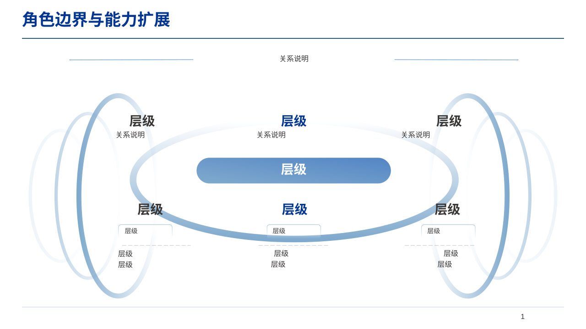

# 角色边界与能力扩展

来源为立体结构逻辑图1122.pptx#12。

## 结构与适用场景

中央水平椭圆；两端3重竖椭圆穿插；上角色边界、下探索机会3组

角色边界与能力扩展

三维穿插无明确因果箭头，适合边界/视角图；避免宣称成熟度数据

固定节点、圆弧、扇区、分面和连接表达定性关系。数量比较、趋势或占比使用数据驱动图表，源页中已登记的微图槽可接收实际数据。

## 预览



## 调用

将下列完整page对象放入schema_version=1、template_id=business-blue-v1的pages数组，替换各节点内容。nodes键对应原文本框或已明确拆分的语义分段，字段角色及source_ref、segment见下表。

```json
{
  "id": "spatial-12",
  "family": "source-spatial",
  "variant": "page-12",
  "content": {
    "title": "角色边界与能力扩展",
    "nodes": {
      "shape_14": "关系说明",
      "shape_26": "层级",
      "shape_27": "层级",
      "shape_28": "层级",
      "shape_29": "关系说明",
      "shape_31": "层级",
      "shape_32": "层级",
      "shape_34": "层级",
      "shape_35": "层级",
      "shape_36": "层级",
      "shape_37": "关系说明",
      "shape_39": "层级",
      "shape_41": "层级",
      "shape_43": "层级",
      "shape_44": "层级",
      "shape_45": "层级",
      "shape_46": "关系说明",
      "shape_50": "层级",
      "shape_51": "层级",
      "shape_55": "层级"
    }
  },
  "config": {
    "show_source": true,
    "show_page_number": true
  }
}
```

config支持show_source、show_page_number、image_fit与image_position。image_fit可选contain或cover，image_position为xMin/xMid/xMax与YMin/YMid/YMax组合的九个焦点，默认为xMidYMid。字体、颜色、全局区和固定字阶取自tokens，节点数与连接结构由variant确定。

## 字段合同

每个业务节点required=true、min=1，max按具体框体登记。字符按规范化后的Unicode码点计数，空格标点换行均计入。build会以实际字体测量宽高，字符数通过后仍可能需要调整文字。

| 字段 | 节点角色与源标签 | 最短/最长 | 字阶 | 框体px | 原框引用 | 分段 | 旋转° | 垂直锚点 |
|---|---|---|---|---|---|---|---|---|
| nodes.shape_14 | 上中节点，源标签“三维度拆解，了解现阶段各方面需求，拆解输出” | 1/61 | caption | [422.2233, 120, 439.4807, 20.9776] | slide:14 |  | 0.0 | t |
| nodes.shape_26 | 下中节点，源标签“外延与外延探索” | 1/14 | diagramCompact | [595.4753, 498.054, 91.7649, 17.5] | slide:26 |  | 0.0 | t |
| nodes.shape_27 | 中中节点，源标签“外延与探索” | 1/10 | heading | [578.1436, 443.5189, 131.0912, 35.0] | slide:27 |  | 0.0 | t |
| nodes.shape_28 | 上中节点，源标签“角色边界” | 1/8 | heading | [589.3843, 250.079, 104.8773, 35.0] | slide:28 |  | 0.0 | t |
| nodes.shape_29 | 中中节点，源标签“ROLE BOUNDARY” | 1/19 | caption | [559.9356, 286.5877, 142.386, 20.9776] | slide:29 |  | 0.0 | t |
| nodes.shape_31 | 下中节点，源标签“外延与探索” | 1/10 | caption | [598.3747, 546.2026, 72.8321, 20.0] | slide:31 |  | 0.0 | t |
| nodes.shape_32 | 下中节点，源标签“外延与机会点” | 1/12 | caption | [591.6346, 569.9066, 87.3941, 20.0] | slide:32 |  | 0.0 | t |
| nodes.shape_34 | 下左节点，源标签“外延与外延探索” | 1/14 | diagramCompact | [272.5562, 498.054, 91.7649, 17.5] | slide:34 |  | 0.0 | t |
| nodes.shape_35 | 中左节点，源标签“外延与探索” | 1/10 | heading | [262.7436, 443.5189, 131.0912, 35.0] | slide:35 |  | 0.0 | t |
| nodes.shape_36 | 上左节点，源标签“角色边界” | 1/8 | heading | [258.0915, 250.079, 104.8773, 35.0] | slide:36 |  | 0.0 | t |
| nodes.shape_37 | 中左节点，源标签“ROLE BOUNDARY” | 1/19 | caption | [252.2602, 286.5877, 142.386, 20.9776] | slide:37 |  | 0.0 | t |
| nodes.shape_39 | 下左节点，源标签“外延与探索” | 1/10 | caption | [257.821, 546.9491, 72.8321, 20.0] | slide:39 |  | 0.0 | t |
| nodes.shape_41 | 下左节点，源标签“外延与机会点” | 1/12 | caption | [257.821, 570.653, 87.3941, 20.0] | slide:41 |  | 0.0 | t |
| nodes.shape_43 | 下右节点，源标签“外延与外延探索” | 1/14 | diagramCompact | [933.3676, 498.054, 91.7649, 17.5] | slide:43 |  | 0.0 | t |
| nodes.shape_44 | 中右节点，源标签“外延与探索” | 1/10 | heading | [911.8166, 443.5189, 131.0912, 35.0] | slide:44 |  | 0.0 | t |
| nodes.shape_45 | 上右节点，源标签“角色边界” | 1/8 | heading | [928.4451, 250.079, 104.8773, 35.0] | slide:45 |  | 0.0 | t |
| nodes.shape_46 | 中右节点，源标签“ROLE BOUNDARY” | 1/19 | caption | [875.3897, 286.5877, 142.386, 20.9776] | slide:46 |  | 0.0 | t |
| nodes.shape_50 | 下右节点，源标签“外延与探索” | 1/10 | caption | [969.0047, 546.2026, 72.8321, 20.0] | slide:50 |  | 0.0 | t |
| nodes.shape_51 | 下右节点，源标签“外延与机会点” | 1/12 | caption | [955.5137, 569.9066, 87.3941, 20.0] | slide:51 |  | 0.0 | t |
| nodes.shape_55 | 中中节点，源标签“一位设计师，三层变化” | 1/25 | heading | [480.9801, 355.8327, 321.253, 35.0] | slide:55 |  | 0.0 | t |

全局title必填、2至32码点，使用统一标题框。section_name可选0至24码点，source可选0至64码点。所有可编辑文本通过独立原生carrier导出，页码为派生文字。

## 来源处理

原生PPTX源件保存于用户材料目录，分发包仅含用户资产衍生的几何、字段和说明。原始逐框文字、源框与标准化框在page-catalog.json的variant.fields中。

源标题引用为`slide:13`，原文为“行业分析”。模板默认标题依据真实结构设置。

密集全景中的diagramCompact为14px、diagramMicro为12px。适用于体系概览或附录局部标签，现场关键结论用统一标题与正常正文字阶表达。

源画布边界裁切已烘焙为可编辑Bezier几何，3D顶面、侧面与前面通过tokens配色的相对明暗保留。

