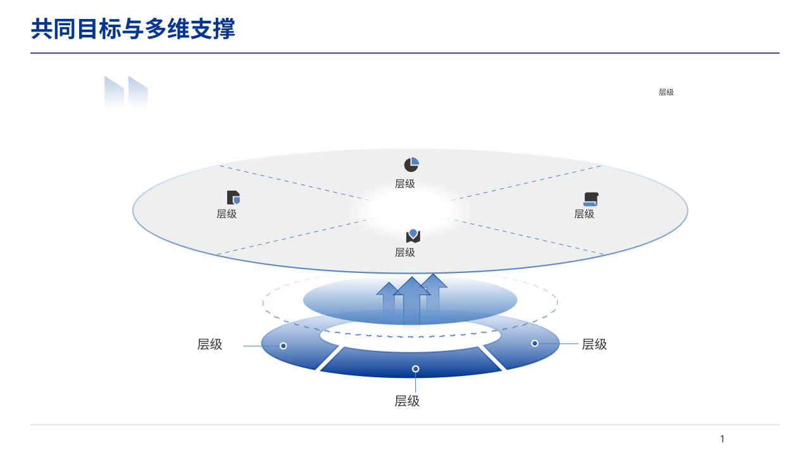

# 共同目标与多维支撑

来源为立体结构逻辑图1122.pptx#13。

## 结构与适用场景

上4分区椭圆盘，中3上箭头，下3扇区底座；上下两层连接

多类内容/数据支撑共同目标

保留上盘4类与底座3类数量差异，扇区非占比

固定节点、圆弧、扇区、分面和连接表达定性关系。数量比较、趋势或占比使用数据驱动图表，源页中已登记的微图槽可接收实际数据。

## 预览



## 调用

将下列完整page对象放入schema_version=1、template_id=business-blue-v1的pages数组，替换各节点内容。nodes键对应原文本框或已明确拆分的语义分段，字段角色及source_ref、segment见下表。

```json
{
  "id": "spatial-13",
  "family": "source-spatial",
  "variant": "page-13",
  "content": {
    "title": "共同目标与多维支撑",
    "nodes": {
      "shape_69": "层级",
      "shape_70": "层级",
      "shape_71": "层级",
      "shape_72": "层级",
      "shape_73": "层级",
      "shape_74": "层级",
      "shape_75": "层级",
      "shape_76": "层级"
    }
  },
  "config": {
    "show_source": true,
    "show_page_number": true
  }
}
```

config支持show_source、show_page_number、image_fit与image_position。image_fit可选contain或cover，image_position为xMin/xMid/xMax与YMin/YMid/YMax组合的九个焦点，默认为xMidYMid。字体、颜色、全局区和固定字阶取自tokens，节点数与连接结构由variant确定。

## 字段合同

每个业务节点required=true、min=1，max按具体框体登记。字符按规范化后的Unicode码点计数，空格标点换行均计入。build会以实际字体测量宽高，字符数通过后仍可能需要调整文字。

| 字段 | 节点角色与源标签 | 最短/最长 | 字阶 | 框体px | 原框引用 | 分段 | 旋转° | 垂直锚点 |
|---|---|---|---|---|---|---|---|---|
| nodes.shape_69 | 上右节点，源标签“UI/UX 2022” | 1/13 | diagramMicro | [1041.1592, 138.1877, 73.5629, 15.0] | slide:69 |  | 0.0 | t |
| nodes.shape_70 | 中中节点，源标签“平台型数据榜” | 1/12 | caption | [604.2168, 280.4876, 92.5387, 20.0] | slide:70 |  | 0.0 | t |
| nodes.shape_71 | 中中节点，源标签“发现型内容榜” | 1/12 | caption | [604.2168, 389.1135, 92.5387, 20.0] | slide:71 |  | 0.0 | t |
| nodes.shape_72 | 中左节点，源标签“私域型数据榜” | 1/12 | caption | [322.4848, 328.2257, 92.5387, 20.0] | slide:72 |  | 0.0 | t |
| nodes.shape_73 | 中右节点，源标签“特色型内容榜” | 1/12 | caption | [887.6345, 328.2257, 92.5387, 20.0] | slide:73 |  | 0.0 | t |
| nodes.shape_74 | 下左节点，源标签“契合学校营销共建” | 1/16 | compactBody | [227.7941, 533.2197, 149.8261, 25.0] | slide:74 |  | 0.0 | t |
| nodes.shape_75 | 下右节点，源标签“加强公域流量联动” | 1/16 | compactBody | [919.58, 533.2197, 149.8261, 25.0] | slide:75 |  | 0.0 | t |
| nodes.shape_76 | 下中节点，源标签“切实提升流量公域覆盖” | 1/20 | compactBody | [562.8694, 623.0, 187.2867, 25.0] | slide:76 |  | 0.0 | t |

全局title必填、2至32码点，使用统一标题框。section_name可选0至24码点，source可选0至64码点。所有可编辑文本通过独立原生carrier导出，页码为派生文字。

## 来源处理

原生PPTX源件保存于用户材料目录，分发包仅含用户资产衍生的几何、字段和说明。原始逐框文字、源框与标准化框在page-catalog.json的variant.fields中。

源标题引用为`slide:63`，原文为“三维拆解用研目标”。模板默认标题依据真实结构设置。

密集全景中的diagramCompact为14px、diagramMicro为12px。适用于体系概览或附录局部标签，现场关键结论用统一标题与正常正文字阶表达。

源画布边界裁切已烘焙为可编辑Bezier几何，3D顶面、侧面与前面通过tokens配色的相对明暗保留。

