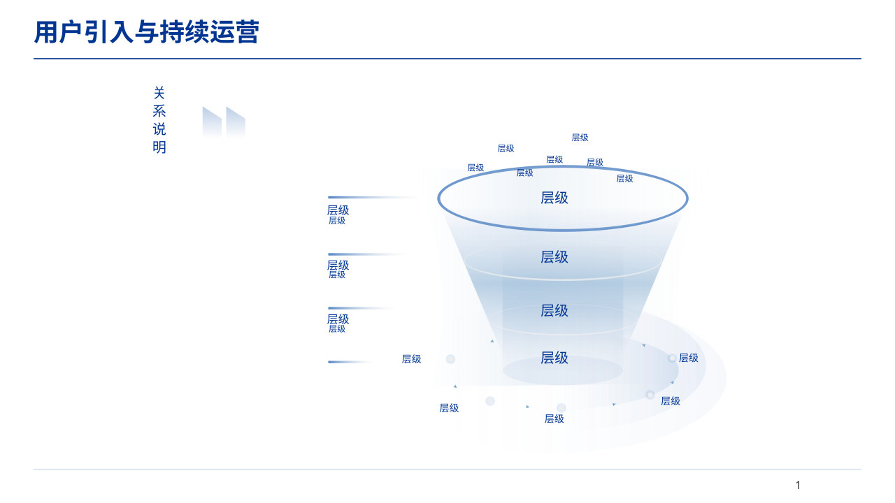

# 用户引入与持续运营

来源为立体结构逻辑图1122.pptx#14。

## 结构与适用场景

获客→识客→洗客→转化4层漏斗；上7渠道，底客户成长/忠诚/洞察回环；左3阶段说明

用户拉新到留存的运营路径

漏斗宽度源无实数比例，作为流程架构；渠道和客户生命周期层分别参数化

固定节点、圆弧、扇区、分面和连接表达定性关系。数量比较、趋势或占比使用数据驱动图表，源页中已登记的微图槽可接收实际数据。

## 预览



## 调用

将下列完整page对象放入schema_version=1、template_id=business-blue-v1的pages数组，替换各节点内容。nodes键对应原文本框或已明确拆分的语义分段，字段角色及source_ref、segment见下表。

```json
{
  "id": "spatial-14",
  "family": "source-spatial",
  "variant": "page-14",
  "content": {
    "title": "用户引入与持续运营",
    "nodes": {
      "shape_1096": "层级",
      "shape_1100": "层级",
      "shape_1104": "层级",
      "shape_1110": "层级",
      "shape_1111": "层级",
      "shape_1112": "层级",
      "shape_1113": "层级",
      "shape_1114": "层级",
      "shape_1115": "层级",
      "shape_1116": "层级",
      "shape_1117": "层级",
      "shape_1118": "层级",
      "shape_1119": "层级",
      "shape_1120": "层级",
      "shape_1121": "层级",
      "shape_1122": "层级",
      "shape_1123": "层级",
      "shape_1124": "层级",
      "shape_1125": "层级",
      "shape_1126": "层级",
      "shape_1127": "层级",
      "shape_1128": "层级",
      "shape_1131": "关系说明"
    }
  },
  "config": {
    "show_source": true,
    "show_page_number": true
  }
}
```

config支持show_source、show_page_number、image_fit与image_position。image_fit可选contain或cover，image_position为xMin/xMid/xMax与YMin/YMid/YMax组合的九个焦点，默认为xMidYMid。字体、颜色、全局区和固定字阶取自tokens，节点数与连接结构由variant确定。

## 字段合同

每个业务节点required=true、min=1，max按具体框体登记。字符按规范化后的Unicode码点计数，空格标点换行均计入。build会以实际字体测量宽高，字符数通过后仍可能需要调整文字。

| 字段 | 节点角色与源标签 | 最短/最长 | 字阶 | 框体px | 原框引用 | 分段 | 旋转° | 垂直锚点 |
|---|---|---|---|---|---|---|---|---|
| nodes.shape_1096 | 中中节点，源标签“CUSTORM” | 1/6 | diagramMicro | [471.4066, 307.9077, 37.1507, 15.0] | slide:1096 |  | 0.0 | ctr |
| nodes.shape_1100 | 中中节点，源标签“CUSTORM” | 1/6 | diagramMicro | [471.4066, 385.3917, 37.1507, 15.0] | slide:1100 |  | 0.0 | ctr |
| nodes.shape_1104 | 中中节点，源标签“CUSTORM” | 1/6 | diagramMicro | [471.4066, 462.8757, 37.1507, 15.0] | slide:1104 |  | 0.0 | ctr |
| nodes.shape_1110 | 下中节点，源标签“客户洞察” | 1/8 | diagramCompact | [774.3613, 589.7733, 55.2933, 19.3527] | slide:1110 |  | 0.0 | ctr |
| nodes.shape_1111 | 下右节点，源标签“客户忠诚度” | 1/10 | diagramCompact | [934.2206, 564.356, 68.1267, 19.3527] | slide:1111 |  | 0.0 | ctr |
| nodes.shape_1112 | 下右节点，源标签“客户成长” | 1/8 | diagramCompact | [966.48, 502.712, 55.2933, 19.3527] | slide:1112 |  | 0.0 | ctr |
| nodes.shape_1113 | 中中节点，源标签“吸引客户” | 1/8 | caption | [462.4746, 289.6567, 63.1913, 21.7213] | slide:1113 |  | 0.0 | ctr |
| nodes.shape_1114 | 中中节点，源标签“沉淀客户” | 1/8 | caption | [462.4746, 368.556, 63.1913, 21.7213] | slide:1114 |  | 0.0 | ctr |
| nodes.shape_1115 | 中中节点，源标签“识客” | 1/5 | compactBody | [783.4473, 353.6547, 45.4153, 28.8273] | slide:1115 |  | 0.0 | ctr |
| nodes.shape_1116 | 中中节点，源标签“洗客” | 1/5 | compactBody | [783.4473, 430.42, 45.4153, 28.8273] | slide:1116 |  | 0.0 | ctr |
| nodes.shape_1117 | 中中节点，源标签“提升转化” | 1/8 | caption | [462.4746, 445.7027, 63.1913, 21.7213] | slide:1117 |  | 0.0 | ctr |
| nodes.shape_1118 | 下中节点，源标签“转化” | 1/5 | compactBody | [783.4473, 497.9747, 45.4153, 28.8273] | slide:1118 |  | 0.0 | ctr |
| nodes.shape_1119 | 下中节点，源标签“吸纳新客户” | 1/10 | diagramCompact | [563.7553, 504.2887, 68.1267, 19.3527] | slide:1119 |  | 0.0 | ctr |
| nodes.shape_1120 | 下中节点，源标签“挖掘潜在客户” | 1/12 | diagramCompact | [611.1653, 574.3953, 80.96, 19.3527] | slide:1120 |  | 0.0 | ctr |
| nodes.shape_1121 | 上中节点，源标签“渠道” | 1/5 | diagramMicro | [717.6453, 202.9253, 27.6467, 18.1647] | slide:1121 |  | 0.0 | ctr |
| nodes.shape_1122 | 上中节点，源标签“内容” | 1/5 | diagramMicro | [787.3266, 218.9487, 27.6467, 18.1647] | slide:1122 |  | 0.0 | ctr |
| nodes.shape_1123 | 上中节点，源标签“社交” | 1/5 | diagramMicro | [674.386, 230.7187, 27.6467, 18.1647] | slide:1123 |  | 0.0 | ctr |
| nodes.shape_1124 | 上中节点，源标签“CRM” | 1/5 | diagramMicro | [743.752, 238.052, 29.6193, 18.1647] | slide:1124 |  | 0.0 | ctr |
| nodes.shape_1125 | 上中节点，源标签“官网” | 1/5 | diagramMicro | [823.6706, 187.54, 27.6467, 18.1647] | slide:1125 |  | 0.0 | ctr |
| nodes.shape_1126 | 上右节点，源标签“会议” | 1/5 | diagramMicro | [845.1206, 222.9893, 27.6467, 18.1647] | slide:1126 |  | 0.0 | ctr |
| nodes.shape_1127 | 上右节点，源标签“第三方” | 1/7 | diagramMicro | [881.6993, 246.192, 39.49, 18.1647] | slide:1127 |  | 0.0 | ctr |
| nodes.shape_1128 | 上中节点，源标签“获客” | 1/5 | compactBody | [783.4473, 268.94, 45.4153, 28.8273] | slide:1128 |  | 0.0 | ctr |
| nodes.shape_1131 | 上左节点，源标签“Project Planning” | 1/21 | compactBody | [217.8786, 120, 33.9827, 187.7187] | slide:1131 |  | 0.0 | t |

全局title必填、2至32码点，使用统一标题框。section_name可选0至24码点，source可选0至64码点。所有可编辑文本通过独立原生carrier导出，页码为派生文字。

## 来源处理

原生PPTX源件保存于用户材料目录，分发包仅含用户资产衍生的几何、字段和说明。原始逐框文字、源框与标准化框在page-catalog.json的variant.fields中。

源标题引用为`slide:86`，原文为“三维拆解用研目标”。模板默认标题依据真实结构设置。

密集全景中的diagramCompact为14px、diagramMicro为12px。适用于体系概览或附录局部标签，现场关键结论用统一标题与正常正文字阶表达。

源画布边界裁切已烘焙为可编辑Bezier几何，3D顶面、侧面与前面通过tokens配色的相对明暗保留。

