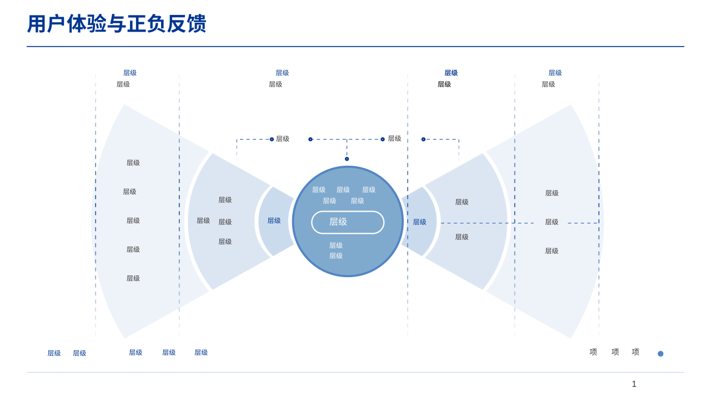

# 用户体验与正负反馈

来源为立体结构逻辑图1122.pptx#15。

## 结构与适用场景

中核心圆，左右扇形分层扩散，外围阶段竖线；左正反馈生命周期，右问题负反馈

正负反馈、用户体验诊断

左右语义并非对称同义，保留反馈/归因/定位角色；静态扇形非数值图

固定节点、圆弧、扇区、分面和连接表达定性关系。数量比较、趋势或占比使用数据驱动图表，源页中已登记的微图槽可接收实际数据。

## 预览



## 调用

将下列完整page对象放入schema_version=1、template_id=business-blue-v1的pages数组，替换各节点内容。nodes键对应原文本框或已明确拆分的语义分段，字段角色及source_ref、segment见下表。

```json
{
  "id": "spatial-15",
  "family": "source-spatial",
  "variant": "page-15",
  "content": {
    "title": "用户体验与正负反馈",
    "nodes": {
      "shape_22": "层级",
      "shape_23": "层级",
      "shape_24": "层级",
      "shape_25": "层级",
      "shape_26": "层级",
      "shape_27": "层级",
      "shape_28": "层级",
      "shape_29": "层级",
      "shape_30": "层级",
      "shape_31": "层级",
      "shape_32": "层级",
      "shape_33": "层级",
      "shape_34": "层级",
      "shape_35": "层级",
      "shape_36": "层级",
      "shape_37": "层级",
      "shape_38": "层级",
      "shape_39": "层级",
      "shape_40": "层级",
      "shape_41": "层级",
      "shape_42": "层级",
      "shape_43": "层级",
      "shape_44": "层级",
      "shape_45": "层级",
      "shape_46": "层级",
      "shape_47": "层级",
      "shape_48": "层级",
      "shape_49": "层级",
      "shape_50": "层级",
      "shape_51": "层级",
      "shape_52": "层级",
      "shape_53": "层级",
      "shape_54": "层级",
      "shape_55": "层级",
      "shape_56": "层级",
      "shape_57": "层级",
      "shape_58": "项",
      "shape_59": "项",
      "shape_60": "项",
      "shape_101": "层级",
      "shape_102": "层级",
      "shape_103": "层级",
      "shape_104": "层级",
      "shape_105": "层级"
    }
  },
  "config": {
    "show_source": true,
    "show_page_number": true
  }
}
```

config支持show_source、show_page_number、image_fit与image_position。image_fit可选contain或cover，image_position为xMin/xMid/xMax与YMin/YMid/YMax组合的九个焦点，默认为xMidYMid。字体、颜色、全局区和固定字阶取自tokens，节点数与连接结构由variant确定。

## 字段合同

每个业务节点required=true、min=1，max按具体框体登记。字符按规范化后的Unicode码点计数，空格标点换行均计入。build会以实际字体测量宽高，字符数通过后仍可能需要调整文字。

| 字段 | 节点角色与源标签 | 最短/最长 | 字阶 | 框体px | 原框引用 | 分段 | 旋转° | 垂直锚点 |
|---|---|---|---|---|---|---|---|---|
| nodes.shape_22 | 中左节点，源标签“正向影响” | 1/9 | diagramMicro | [227.9114, 287.4104, 50.2241, 16.1007] | slide:22 |  | 0.0 | t |
| nodes.shape_23 | 上左节点，源标签“认知阶段” | 1/9 | diagramMicro | [222.1163, 125.148, 50.2241, 16.1007] | slide:23 |  | 0.0 | t |
| nodes.shape_24 | 上中节点，源标签“探索阶段” | 1/9 | diagramMicro | [800.3308, 125.148, 50.2241, 16.1007] | slide:24 |  | 0.0 | t |
| nodes.shape_25 | 上左节点，源标签“产生创作动机” | 1/13 | diagramMicro | [209.879, 145.7495, 74.689, 16.1007] | slide:25 |  | 0.0 | t |
| nodes.shape_26 | 上中节点，源标签“尝试内容创造” | 1/13 | diagramMicro | [788.1031, 145.7495, 74.689, 16.1007] | slide:26 |  | 0.0 | t |
| nodes.shape_27 | 中左节点，源标签“高生命周期” | 1/11 | diagramMicro | [221.4692, 339.5662, 62.4614, 16.1007] | slide:27 |  | 0.0 | t |
| nodes.shape_28 | 中左节点，源标签“正面反馈” | 1/9 | diagramMicro | [227.9114, 391.722, 50.2241, 16.1007] | slide:28 |  | 0.0 | t |
| nodes.shape_29 | 中左节点，源标签“产品建议” | 1/9 | diagramMicro | [227.9114, 443.8777, 50.2241, 16.1007] | slide:29 |  | 0.0 | t |
| nodes.shape_30 | 下左节点，源标签“高续签率” | 1/9 | diagramMicro | [227.9114, 496.0335, 50.2241, 16.1007] | slide:30 |  | 0.0 | t |
| nodes.shape_31 | 中左节点，源标签“生命周期” | 1/9 | diagramMicro | [393.3901, 354.3726, 50.2241, 16.1007] | slide:31 |  | 0.0 | t |
| nodes.shape_32 | 中左节点，源标签“用户反馈” | 1/9 | diagramMicro | [393.3901, 394.3008, 50.2241, 16.1007] | slide:32 |  | 0.0 | t |
| nodes.shape_33 | 中中节点，源标签“转化” | 1/4 | diagramMicro | [481.601, 391.722, 25.7592, 16.1007] | slide:33 |  | 0.0 | t |
| nodes.shape_34 | 中左节点，源标签“迭代” | 1/4 | diagramMicro | [354.1091, 391.722, 25.7592, 16.1007] | slide:34 |  | 0.0 | t |
| nodes.shape_35 | 中左节点，源标签“商业续签率” | 1/11 | diagramMicro | [393.3901, 429.7087, 62.4614, 16.1007] | slide:35 |  | 0.0 | t |
| nodes.shape_36 | 中中节点，源标签“探索问题” | 1/9 | diagramMicro | [819.6477, 358.236, 50.2241, 16.1007] | slide:36 |  | 0.0 | t |
| nodes.shape_37 | 中右节点，源标签“低生命周期” | 1/11 | diagramMicro | [962.5932, 342.145, 62.4614, 16.1007] | slide:37 |  | 0.0 | t |
| nodes.shape_38 | 中右节点，源标签“负面反馈” | 1/9 | diagramMicro | [968.3883, 394.3008, 50.2241, 16.1007] | slide:38 |  | 0.0 | t |
| nodes.shape_39 | 中右节点，源标签“问题归因” | 1/9 | diagramMicro | [968.3883, 446.4565, 50.2241, 16.1007] | slide:39 |  | 0.0 | t |
| nodes.shape_40 | 中中节点，源标签“问题定位” | 1/9 | diagramMicro | [819.6477, 421.3445, 50.2241, 16.1007] | slide:40 |  | 0.0 | t |
| nodes.shape_41 | 中中节点，源标签“沉淀” | 1/4 | diagramMicro | [743.6741, 394.3008, 25.7592, 16.1007] | slide:41 |  | 0.0 | t |
| nodes.shape_42 | 中中节点，源标签“软性评估” | 1/9 | caption | [593.0019, 391.722, 65.6776, 21.2487] | slide:42 |  | 0.0 | t |
| nodes.shape_43 | 中中节点，源标签“了解社区” | 1/6 | diagramMicro | [562.0947, 336.1345, 37.3493, 15.0] | slide:43 |  | 0.0 | t |
| nodes.shape_44 | 上中节点，源标签“创作者动力” | 1/9 | diagramMicro | [497.0546, 244.174, 52.8029, 15.0] | slide:44 |  | 0.0 | t |
| nodes.shape_45 | 上中节点，源标签“消费者需求” | 1/9 | diagramMicro | [698.598, 243.5269, 52.8029, 15.0] | slide:45 |  | 0.0 | t |
| nodes.shape_46 | 中中节点，源标签“发现内容” | 1/6 | diagramMicro | [605.8766, 336.1345, 37.3493, 15.0] | slide:46 |  | 0.0 | t |
| nodes.shape_47 | 中中节点，源标签“关系价值” | 1/6 | diagramMicro | [581.4117, 356.0986, 37.3493, 15.0] | slide:47 |  | 0.0 | t |
| nodes.shape_48 | 中中节点，源标签“产生传作动机” | 1/10 | diagramMicro | [593.0019, 436.5826, 55.3721, 15.0] | slide:48 |  | 0.0 | t |
| nodes.shape_49 | 中中节点，源标签“尝试内容创作” | 1/10 | diagramMicro | [593.0019, 455.2525, 55.3721, 15.0] | slide:49 |  | 0.0 | t |
| nodes.shape_50 | 中中节点，源标签“社区心智” | 1/6 | diagramMicro | [631.6358, 356.0986, 37.3493, 15.0] | slide:50 |  | 0.0 | t |
| nodes.shape_51 | 中中节点，源标签“内容互动” | 1/6 | diagramMicro | [652.2373, 336.1345, 37.3493, 15.0] | slide:51 |  | 0.0 | t |
| nodes.shape_52 | 上中节点，源标签“探索阶段” | 1/9 | diagramMicro | [496.4171, 125.148, 50.2241, 16.1007] | slide:52 |  | 0.0 | t |
| nodes.shape_53 | 上中节点，源标签“探索阶段” | 1/9 | diagramMicro | [800.3308, 125.148, 50.2241, 16.1007] | slide:53 |  | 0.0 | t |
| nodes.shape_54 | 上右节点，源标签“探索阶段” | 1/9 | diagramMicro | [987.7052, 125.148, 50.2241, 16.1007] | slide:54 |  | 0.0 | t |
| nodes.shape_55 | 上中节点，源标签“尝试内容创造” | 1/13 | diagramMicro | [484.1798, 145.7495, 74.689, 16.1007] | slide:55 |  | 0.0 | t |
| nodes.shape_56 | 上中节点，源标签“尝试内容创造” | 1/13 | diagramMicro | [788.1031, 145.7495, 74.689, 16.1007] | slide:56 |  | 0.0 | t |
| nodes.shape_57 | 上右节点，源标签“尝试内容创造” | 1/13 | diagramMicro | [975.4776, 145.7495, 74.689, 16.1007] | slide:57 |  | 0.0 | t |
| nodes.shape_58 | 下右节点，源标签“Fb” | 1/2 | diagramCompact | [1061.1096, 628.0359, 18.6698, 19.9641] | slide:58 |  | 0.0 | t |
| nodes.shape_59 | 下右节点，源标签“In” | 1/2 | diagramCompact | [1100.601, 628.0359, 15.68, 19.9641] | slide:59 |  | 0.0 | t |
| nodes.shape_60 | 下右节点，源标签“Iw” | 1/3 | diagramCompact | [1137.0929, 628.0359, 21.2487, 19.9641] | slide:60 |  | 0.0 | t |
| nodes.shape_101 | 下左节点，源标签“By Mina” | 1/6 | diagramMicro | [85.6034, 631.0368, 34.1234, 15.0] | slide:101 |  | 0.0 | t |
| nodes.shape_102 | 下左节点，源标签“2021-2022” | 1/8 | diagramMicro | [131.3266, 631.0368, 43.7819, 15.0] | slide:102 |  | 0.0 | t |
| nodes.shape_103 | 下左节点，源标签“Behance” | 1/6 | diagramMicro | [232.4123, 629.7522, 34.7705, 15.0] | slide:103 |  | 0.0 | t |
| nodes.shape_104 | 下左节点，源标签“Dribbble” | 1/6 | diagramMicro | [292.2948, 629.7522, 36.0551, 15.0] | slide:104 |  | 0.0 | t |
| nodes.shape_105 | 下左节点，源标签“Vimeo” | 1/4 | diagramMicro | [350.2457, 629.7522, 25.7592, 15.0] | slide:105 |  | 0.0 | t |

全局title必填、2至32码点，使用统一标题框。section_name可选0至24码点，source可选0至64码点。所有可编辑文本通过独立原生carrier导出，页码为派生文字。

## 来源处理

原生PPTX源件保存于用户材料目录，分发包仅含用户资产衍生的几何、字段和说明。原始逐框文字、源框与标准化框在page-catalog.json的variant.fields中。

源标题引用为`None`，原文为“无独立源标题”。模板默认标题依据真实结构设置。

密集全景中的diagramCompact为14px、diagramMicro为12px。适用于体系概览或附录局部标签，现场关键结论用统一标题与正常正文字阶表达。

源画布边界裁切已烘焙为可编辑Bezier几何，3D顶面、侧面与前面通过tokens配色的相对明暗保留。

