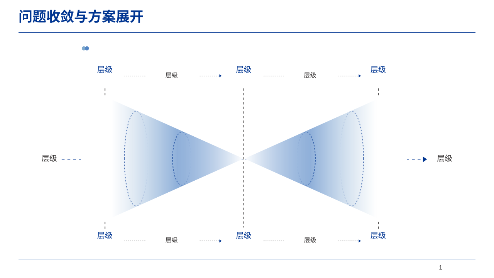

# 问题收敛与方案展开

来源为立体结构逻辑图1122.pptx#16。

## 结构与适用场景

沙漏状双锥；公司→聚焦特征→用户多样性；上下两条抽象/具体路径

研究收敛-方案发散

适合研究思考过程，不能视为真实漏斗损耗；阶段标签与方向需明确

固定节点、圆弧、扇区、分面和连接表达定性关系。数量比较、趋势或占比使用数据驱动图表，源页中已登记的微图槽可接收实际数据。

## 预览



## 调用

将下列完整page对象放入schema_version=1、template_id=business-blue-v1的pages数组，替换各节点内容。nodes键对应原文本框或已明确拆分的语义分段，字段角色及source_ref、segment见下表。

```json
{
  "id": "spatial-16",
  "family": "source-spatial",
  "variant": "page-16",
  "content": {
    "title": "问题收敛与方案展开",
    "nodes": {
      "shape_21": "层级",
      "shape_22": "层级",
      "shape_23": "层级",
      "shape_24": "层级",
      "shape_25": "层级",
      "shape_26": "层级",
      "shape_27": "层级",
      "shape_28": "层级",
      "shape_29": "层级",
      "shape_30": "层级",
      "shape_31": "层级",
      "shape_32": "层级"
    }
  },
  "config": {
    "show_source": true,
    "show_page_number": true
  }
}
```

config支持show_source、show_page_number、image_fit与image_position。image_fit可选contain或cover，image_position为xMin/xMid/xMax与YMin/YMid/YMax组合的九个焦点，默认为xMidYMid。字体、颜色、全局区和固定字阶取自tokens，节点数与连接结构由variant确定。

## 字段合同

每个业务节点required=true、min=1，max按具体框体登记。字符按规范化后的Unicode码点计数，空格标点换行均计入。build会以实际字体测量宽高，字符数通过后仍可能需要调整文字。

| 字段 | 节点角色与源标签 | 最短/最长 | 字阶 | 框体px | 原框引用 | 分段 | 旋转° | 垂直锚点 |
|---|---|---|---|---|---|---|---|---|
| nodes.shape_21 | 上左节点，源标签“品牌战略” | 1/5 | compactBody | [246.3092, 169.5003, 50.817, 48.837] | slide:21 |  | 0.0 | t |
| nodes.shape_22 | 中左节点，源标签“公司” | 1/5 | compactBody | [102.4316, 399.5568, 50.817, 25.0] | slide:22 |  | 0.0 | t |
| nodes.shape_23 | 中右节点，源标签“用户” | 1/5 | compactBody | [1126.7514, 399.5568, 50.817, 25.0] | slide:23 |  | 0.0 | t |
| nodes.shape_24 | 上中节点，源标签“拆解、收拢、提取” | 1/16 | caption | [383.5933, 186.2255, 122.0975, 20.0] | slide:24 |  | 0.0 | t |
| nodes.shape_25 | 下中节点，源标签“拆解、收拢、提取” | 1/16 | caption | [383.5933, 613.2548, 122.0975, 20.0] | slide:25 |  | 0.0 | t |
| nodes.shape_26 | 上中节点，源标签“扩展、应用” | 1/10 | caption | [765.0724, 186.2255, 76.5572, 20.0] | slide:26 |  | 0.0 | t |
| nodes.shape_27 | 下中节点，源标签“拆解、收拢、提取” | 1/16 | caption | [742.629, 613.2548, 122.0975, 20.0] | slide:27 |  | 0.0 | t |
| nodes.shape_28 | 下左节点，源标签“抽象发散” | 1/5 | compactBody | [246.3092, 599.163, 50.817, 48.837] | slide:28 |  | 0.0 | t |
| nodes.shape_29 | 上右节点，源标签“品牌战略” | 1/5 | compactBody | [954.4903, 169.5003, 50.817, 48.837] | slide:29 |  | 0.0 | t |
| nodes.shape_30 | 下右节点，源标签“丰富多样” | 1/5 | compactBody | [954.4903, 599.163, 50.817, 48.837] | slide:30 |  | 0.0 | t |
| nodes.shape_31 | 上中节点，源标签“感知特征” | 1/5 | compactBody | [606.0081, 169.5003, 50.817, 48.837] | slide:31 |  | 0.0 | t |
| nodes.shape_32 | 下中节点，源标签“聚焦具象” | 1/5 | compactBody | [606.0081, 599.163, 50.817, 48.837] | slide:32 |  | 0.0 | t |

全局title必填、2至32码点，使用统一标题框。section_name可选0至24码点，source可选0至64码点。所有可编辑文本通过独立原生carrier导出，页码为派生文字。

## 来源处理

原生PPTX源件保存于用户材料目录，分发包仅含用户资产衍生的几何、字段和说明。原始逐框文字、源框与标准化框在page-catalog.json的variant.fields中。

源标题引用为`slide:35`，原文为“Internationalization”。模板默认标题依据真实结构设置。

密集全景中的diagramCompact为14px、diagramMicro为12px。适用于体系概览或附录局部标签，现场关键结论用统一标题与正常正文字阶表达。

源画布边界裁切已烘焙为可编辑Bezier几何，3D顶面、侧面与前面通过tokens配色的相对明暗保留。

