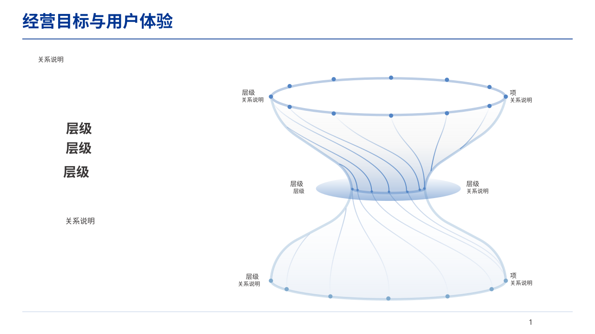

# 经营目标与用户体验

来源为立体结构逻辑图1122.pptx#17。

## 结构与适用场景

沙漏环面，上经营指标/企业，下体验指标/客户，中胜任力与体验团队；曲线联结

经营目标与用户体验对齐

源左Banner占比文案与图语义不完全对应；按实际关系配置

固定节点、圆弧、扇区、分面和连接表达定性关系。数量比较、趋势或占比使用数据驱动图表，源页中已登记的微图槽可接收实际数据。

## 预览



## 调用

将下列完整page对象放入schema_version=1、template_id=business-blue-v1的pages数组，替换各节点内容。nodes键对应原文本框或已明确拆分的语义分段，字段角色及source_ref、segment见下表。

```json
{
  "id": "spatial-17",
  "family": "source-spatial",
  "variant": "page-17",
  "content": {
    "title": "经营目标与用户体验",
    "nodes": {
      "shape_40": "关系说明",
      "shape_41": "层级",
      "shape_42": "层级",
      "shape_43": "关系说明",
      "shape_44": "层级",
      "shape_45": "层级",
      "shape_46": "层级",
      "shape_47": "层级",
      "shape_48": "项",
      "shape_49": "项",
      "shape_50": "层级",
      "shape_51": "关系说明",
      "shape_52": "层级",
      "shape_53": "关系说明",
      "shape_54": "关系说明",
      "shape_55": "关系说明",
      "shape_56": "关系说明"
    }
  },
  "config": {
    "show_source": true,
    "show_page_number": true
  }
}
```

config支持show_source、show_page_number、image_fit与image_position。image_fit可选contain或cover，image_position为xMin/xMid/xMax与YMin/YMid/YMax组合的九个焦点，默认为xMidYMid。字体、颜色、全局区和固定字阶取自tokens，节点数与连接结构由variant确定。

## 字段合同

每个业务节点required=true、min=1，max按具体框体登记。字符按规范化后的Unicode码点计数，空格标点换行均计入。build会以实际字体测量宽高，字符数通过后仍可能需要调整文字。

| 字段 | 节点角色与源标签 | 最短/最长 | 字阶 | 框体px | 原框引用 | 分段 | 旋转° | 垂直锚点 |
|---|---|---|---|---|---|---|---|---|
| nodes.shape_40 | 上左节点，源标签“Mo Card’s App” | 1/16 | diagramCompact | [80.8217, 120, 105.863, 17.5] | slide:40 |  | 0.0 | t |
| nodes.shape_41 | 上左节点，源标签“Proportion” | 1/12 | heading | [141.8729, 260.3194, 156.5199, 35.0701] | slide:41 |  | 0.0 | t |
| nodes.shape_42 | 中左节点，源标签“ADJUSTMENT” | 1/20 | heading | [141.2202, 302.6666, 256.5281, 48.7085] | slide:42 |  | 0.0 | t |
| nodes.shape_43 | 中左节点，源标签“调整Banner比例，在保证其他功能按钮不变的情况下，增大搜索占比，调整 Ban” | 1/135 | caption | [139.9246, 466.1712, 326.2592, 64.3537] | slide:43 |  | 0.0 | t |
| nodes.shape_44 | 中左节点，源标签“占比调整” | 1/12 | heading | [136.0279, 354.0833, 157.8155, 51.3095] | slide:44 |  | 0.0 | t |
| nodes.shape_45 | 上中节点，源标签“经营指标” | 1/8 | diagramCompact | [520.5035, 191.1271, 53.2579, 17.5] | slide:45 |  | 0.0 | t |
| nodes.shape_46 | 中中节点，源标签“胜任力” | 1/6 | diagramCompact | [630.2534, 387.9093, 40.2624, 17.5] | slide:46 |  | 0.0 | t |
| nodes.shape_47 | 中右节点，源标签“用户体验团队” | 1/12 | diagramCompact | [1003.039, 387.9093, 79.2292, 17.5] | slide:47 |  | 0.0 | t |
| nodes.shape_48 | 上右节点，源标签“企业” | 1/4 | diagramCompact | [1096.5593, 191.7797, 27.2768, 17.5] | slide:48 |  | 0.0 | t |
| nodes.shape_49 | 下右节点，源标签“客户” | 1/4 | diagramCompact | [1097.212, 585.9873, 27.2768, 17.5] | slide:49 |  | 0.0 | t |
| nodes.shape_50 | 下中节点，源标签“体验指标” | 1/8 | diagramCompact | [521.7991, 587.9356, 53.2579, 17.5] | slide:50 |  | 0.0 | t |
| nodes.shape_51 | 上中节点，源标签“Business KPIs” | 1/10 | diagramMicro | [519.1981, 207.4709, 54.5535, 15.0] | slide:51 |  | 0.0 | t |
| nodes.shape_52 | 中中节点，源标签“UX execution” | 1/9 | diagramMicro | [616.6151, 404.2532, 53.9008, 15.0] | slide:52 |  | 0.0 | t |
| nodes.shape_53 | 中右节点，源标签“Experience Management(XM)” | 1/21 | diagramMicro | [1003.039, 404.2532, 118.196, 15.0] | slide:53 |  | 0.0 | t |
| nodes.shape_54 | 上右节点，源标签“Business growth” | 1/12 | diagramMicro | [1096.5593, 208.1236, 67.5392, 15.0] | slide:54 |  | 0.0 | t |
| nodes.shape_55 | 下右节点，源标签“Customer Experience(CX)” | 1/18 | diagramMicro | [1097.212, 602.3312, 101.9664, 15.0] | slide:55 |  | 0.0 | t |
| nodes.shape_56 | 下中节点，源标签“UX indicators” | 1/10 | diagramMicro | [520.5035, 604.2795, 54.5535, 15.0] | slide:56 |  | 0.0 | t |

全局title必填、2至32码点，使用统一标题框。section_name可选0至24码点，source可选0至64码点。所有可编辑文本通过独立原生carrier导出，页码为派生文字。

## 来源处理

原生PPTX源件保存于用户材料目录，分发包仅含用户资产衍生的几何、字段和说明。原始逐框文字、源框与标准化框在page-catalog.json的variant.fields中。

源标题引用为`None`，原文为“无独立源标题”。模板默认标题依据真实结构设置。

密集全景中的diagramCompact为14px、diagramMicro为12px。适用于体系概览或附录局部标签，现场关键结论用统一标题与正常正文字阶表达。

源画布边界裁切已烘焙为可编辑Bezier几何，3D顶面、侧面与前面通过tokens配色的相对明暗保留。

