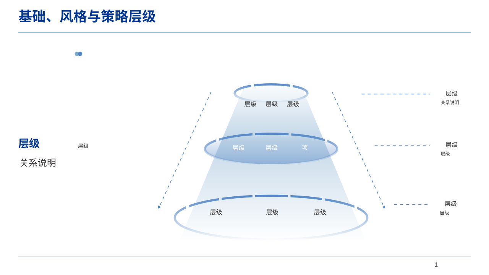

# 基础、风格与策略层级

来源为立体结构逻辑图1122.pptx#18。

## 结构与适用场景

3层圆锥台，上字体/图形/色彩，中复古/插画/3D，下运营策略；右3层引线；左说明

基础元素-风格-策略层级

保留圆锥台、椭圆截面、层内多节点与侧引线，不能改成3平面卡

固定节点、圆弧、扇区、分面和连接表达定性关系。数量比较、趋势或占比使用数据驱动图表，源页中已登记的微图槽可接收实际数据。

## 预览



## 调用

将下列完整page对象放入schema_version=1、template_id=business-blue-v1的pages数组，替换各节点内容。nodes键对应原文本框或已明确拆分的语义分段，字段角色及source_ref、segment见下表。

```json
{
  "id": "spatial-18",
  "family": "source-spatial",
  "variant": "page-18",
  "content": {
    "title": "基础、风格与策略层级",
    "nodes": {
      "shape_16": "层级",
      "shape_17": "层级",
      "shape_18": "层级",
      "shape_19": "层级",
      "shape_20": "关系说明",
      "shape_21": "层级",
      "shape_22": "层级",
      "shape_23": "层级",
      "shape_24": "层级",
      "shape_25": "层级",
      "shape_26": "层级",
      "shape_27": "层级",
      "shape_28": "层级",
      "shape_29": "层级",
      "shape_30": "项",
      "shape_31": "层级",
      "shape_32": "层级",
      "shape_33": "关系说明"
    }
  },
  "config": {
    "show_source": true,
    "show_page_number": true
  }
}
```

config支持show_source、show_page_number、image_fit与image_position。image_fit可选contain或cover，image_position为xMin/xMid/xMax与YMin/YMid/YMax组合的九个焦点，默认为xMidYMid。字体、颜色、全局区和固定字阶取自tokens，节点数与连接结构由variant确定。

## 字段合同

每个业务节点required=true、min=1，max按具体框体登记。字符按规范化后的Unicode码点计数，空格标点换行均计入。build会以实际字体测量宽高，字符数通过后仍可能需要调整文字。

| 字段 | 节点角色与源标签 | 最短/最长 | 字阶 | 框体px | 原框引用 | 分段 | 旋转° | 垂直锚点 |
|---|---|---|---|---|---|---|---|---|
| nodes.shape_16 | 上中节点，源标签“字体” | 1/5 | caption | [636.8229, 263.9744, 37.4157, 23.2987] | slide:16 |  | 0.0 | t |
| nodes.shape_17 | 上右节点，源标签“基础层” | 1/7 | caption | [1154.341, 236.4395, 55.7793, 23.2987] | slide:17 |  | 0.0 | t |
| nodes.shape_18 | 中右节点，源标签“风格层” | 1/7 | caption | [1154.341, 370.5873, 55.7793, 23.2987] | slide:18 |  | 0.0 | t |
| nodes.shape_19 | 下右节点，源标签“策略层” | 1/7 | caption | [1152.223, 525.2063, 55.7793, 23.2987] | slide:19 |  | 0.0 | t |
| nodes.shape_20 | 上右节点，源标签“basic elements” | 1/14 | diagramMicro | [1153.6315, 262.1296, 78.3685, 15.0] | slide:20 |  | 0.0 | t |
| nodes.shape_21 | 中右节点，源标签“style” | 1/4 | diagramMicro | [1153.6315, 396.2669, 26.8253, 15.0] | slide:21 |  | 0.0 | t |
| nodes.shape_22 | 下右节点，源标签“strategy” | 1/8 | diagramMicro | [1151.5134, 550.8858, 45.189, 15.0] | slide:22 |  | 0.0 | t |
| nodes.shape_23 | 中中节点，源标签“复古” | 1/5 | caption | [605.7614, 378.35, 37.4157, 23.2987] | slide:23 |  | 0.0 | t |
| nodes.shape_24 | 上中节点，源标签“图形” | 1/5 | caption | [692.6022, 263.9744, 37.4157, 23.2987] | slide:24 |  | 0.0 | t |
| nodes.shape_25 | 中中节点，源标签“插画” | 1/5 | caption | [692.6022, 378.35, 37.4157, 23.2987] | slide:25 |  | 0.0 | t |
| nodes.shape_26 | 下中节点，源标签“运营策略” | 1/10 | caption | [675.6577, 547.0965, 74.1324, 23.2987] | slide:26 |  | 0.0 | t |
| nodes.shape_27 | 下中节点，源标签“打破次元壁” | 1/12 | caption | [791.4419, 547.0965, 92.4854, 23.2987] | slide:27 |  | 0.0 | t |
| nodes.shape_28 | 下中节点，源标签“IP角色运营” | 1/12 | caption | [519.6196, 547.0965, 91.7865, 23.2987] | slide:28 |  | 0.0 | t |
| nodes.shape_29 | 上中节点，源标签“色彩” | 1/5 | caption | [748.3709, 263.9744, 37.4157, 23.2987] | slide:29 |  | 0.0 | t |
| nodes.shape_30 | 中中节点，源标签“3D” | 1/3 | caption | [784.3781, 378.35, 26.8253, 23.2987] | slide:30 |  | 0.0 | t |
| nodes.shape_31 | 中左节点，源标签“用户基数大” | 1/11 | heading | [48, 360.7065, 141.9106, 40.2433] | slide:31 |  | 0.0 | t |
| nodes.shape_32 | 中左节点，源标签“/ 2019数据显示” | 1/17 | diagramCompact | [204.0275, 374.8235, 109.43, 21.8902] | slide:32 |  | 0.0 | t |
| nodes.shape_33 | 中左节点，源标签“2019年中国在线直播行业用户 / 规模已增长至5.04亿人” | 1/72 | body | [50.8276, 413.51, 263.53, 127.0841] | slide:33 |  | 0.0 | t |

全局title必填、2至32码点，使用统一标题框。section_name可选0至24码点，source可选0至64码点。所有可编辑文本通过独立原生carrier导出，页码为派生文字。

## 来源处理

原生PPTX源件保存于用户材料目录，分发包仅含用户资产衍生的几何、字段和说明。原始逐框文字、源框与标准化框在page-catalog.json的variant.fields中。

源标题引用为`slide:14`，原文为“Internationalization”。模板默认标题依据真实结构设置。

密集全景中的diagramCompact为14px、diagramMicro为12px。适用于体系概览或附录局部标签，现场关键结论用统一标题与正常正文字阶表达。

源画布边界裁切已烘焙为可编辑Bezier几何，3D顶面、侧面与前面通过tokens配色的相对明暗保留。

