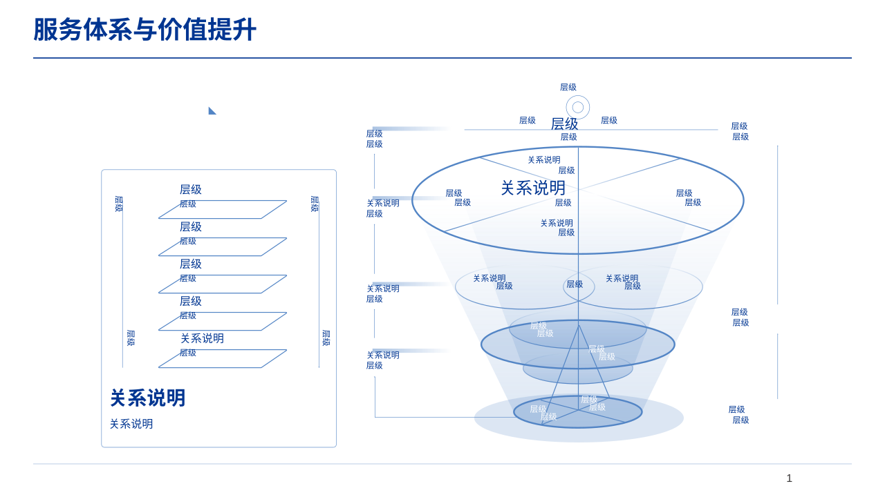

# 服务体系与价值提升

来源为立体结构逻辑图1122.pptx#19。

## 结构与适用场景

左5级服务分层；右倒锥4椭圆层，顶盘分4域，底项目实施；两侧价值尺度

服务体系从项目到价值

左右框架互有关联但原无逐项连线；嵌套扇区和级别条独立

固定节点、圆弧、扇区、分面和连接表达定性关系。数量比较、趋势或占比使用数据驱动图表，源页中已登记的微图槽可接收实际数据。

## 预览



## 调用

将下列完整page对象放入schema_version=1、template_id=business-blue-v1的pages数组，替换各节点内容。nodes键对应原文本框或已明确拆分的语义分段，字段角色及source_ref、segment见下表。

```json
{
  "id": "spatial-19",
  "family": "source-spatial",
  "variant": "page-19",
  "content": {
    "title": "服务体系与价值提升",
    "nodes": {
      "shape_84": "层级",
      "shape_85": "层级",
      "shape_86": "关系说明",
      "shape_2": "层级",
      "shape_9": "关系说明",
      "shape_4": "层级",
      "shape_10": "关系说明",
      "shape_11": "层级",
      "shape_12": "层级",
      "shape_13": "关系说明",
      "shape_14": "层级",
      "shape_15": "层级",
      "shape_16": "层级",
      "shape_17": "层级",
      "shape_18": "层级",
      "shape_19": "层级",
      "shape_20": "层级",
      "shape_21": "关系说明",
      "shape_22": "层级",
      "shape_23": "层级",
      "shape_24": "层级",
      "shape_25": "层级",
      "shape_26": "层级",
      "shape_27": "层级",
      "shape_28": "层级",
      "shape_29": "层级",
      "shape_30": "层级",
      "shape_31": "关系说明",
      "shape_32": "层级",
      "shape_33": "关系说明",
      "shape_34": "层级",
      "shape_35": "关系说明",
      "shape_36": "层级",
      "shape_37": "层级",
      "shape_38": "层级",
      "shape_39": "层级",
      "shape_40": "层级",
      "shape_41": "层级",
      "shape_42": "层级",
      "shape_43": "层级",
      "shape_44": "层级",
      "shape_45": "层级",
      "shape_46": "层级",
      "shape_47": "层级",
      "shape_48": "层级",
      "shape_49": "层级",
      "shape_50": "层级",
      "shape_51": "层级",
      "shape_52": "层级",
      "shape_53": "层级",
      "shape_55": "关系说明",
      "shape_56": "层级",
      "shape_57": "层级",
      "shape_58": "层级",
      "shape_59": "层级",
      "shape_60": "层级",
      "shape_61": "关系说明",
      "shape_62": "关系说明"
    }
  },
  "config": {
    "show_source": true,
    "show_page_number": true
  }
}
```

config支持show_source、show_page_number、image_fit与image_position。image_fit可选contain或cover，image_position为xMin/xMid/xMax与YMin/YMid/YMax组合的九个焦点，默认为xMidYMid。字体、颜色、全局区和固定字阶取自tokens，节点数与连接结构由variant确定。

## 字段合同

每个业务节点required=true、min=1，max按具体框体登记。字符按规范化后的Unicode码点计数，空格标点换行均计入。build会以实际字体测量宽高，字符数通过后仍可能需要调整文字。

| 字段 | 节点角色与源标签 | 最短/最长 | 字阶 | 框体px | 原框引用 | 分段 | 旋转° | 垂直锚点 |
|---|---|---|---|---|---|---|---|---|
| nodes.shape_84 | 上中节点，源标签“社会价值” | 1/9 | diagramMicro | [810.0793, 120, 51.8625, 19.0771] | slide:84 |  | 0.0 | t |
| nodes.shape_85 | 中中节点，源标签“设计中台” | 1/12 | diagramMicro | [802.7482, 287.3063, 66.5337, 23.483] | slide:85 |  | 0.0 | t |
| nodes.shape_86 | 上中节点，源标签“DESIGN PLATFORM” | 1/19 | body | [722.1247, 259.6899, 212.3828, 35.2291] | slide:86 |  | 0.0 | t |
| nodes.shape_2 | 上中节点，源标签“IV VALUE” | 1/12 | diagramMicro | [529.673, 187.424, 64.8531, 22.0114] | slide:2 |  | 0.0 | t |
| nodes.shape_9 | 中中节点，源标签“III ASSETS & TOOLS” | 1/21 | diagramMicro | [529.673, 287.9604, 114.8442, 22.0114] | slide:9 |  | 0.0 | t |
| nodes.shape_4 | 上中节点，源标签“价值外延” | 1/9 | diagramMicro | [529.673, 202.3677, 51.8625, 19.0771] | slide:4 |  | 0.0 | t |
| nodes.shape_10 | 中中节点，源标签“II METHODOLOGY” | 1/20 | diagramMicro | [529.673, 411.7981, 108.4216, 22.0114] | slide:10 |  | 0.0 | t |
| nodes.shape_11 | 中中节点，源标签“方法论” | 1/8 | diagramMicro | [529.673, 426.7418, 43.296, 19.0771] | slide:11 |  | 0.0 | t |
| nodes.shape_12 | 中中节点，源标签“资产&工具” | 1/10 | diagramMicro | [529.673, 303.2947, 57.6674, 19.0771] | slide:12 |  | 0.0 | t |
| nodes.shape_13 | 下中节点，源标签“I PROJECT IMPLEMENTATION” | 1/30 | diagramMicro | [529.673, 508.2011, 164.2267, 22.0114] | slide:13 |  | 0.0 | t |
| nodes.shape_14 | 下中节点，源标签“项目交付” | 1/9 | diagramMicro | [529.673, 523.1448, 51.8625, 19.0771] | slide:14 |  | 0.0 | t |
| nodes.shape_15 | 中右节点，源标签“PLUS LEVEL” | 1/14 | diagramMicro | [1057.7729, 445.828, 78.9157, 22.0114] | slide:15 |  | 0.0 | t |
| nodes.shape_16 | 中右节点，源标签“增值设计/表现层” | 1/15 | diagramMicro | [1059.5988, 461.117, 81.214, 19.0771] | slide:16 |  | 0.0 | t |
| nodes.shape_17 | 下右节点，源标签“BASIC LEVEL” | 1/15 | diagramMicro | [1053.6304, 586.9351, 82.5857, 22.0114] | slide:17 |  | 0.0 | t |
| nodes.shape_18 | 下右节点，源标签“基础设计/体验层” | 1/15 | diagramMicro | [1059.5988, 602.2331, 81.214, 19.0771] | slide:18 |  | 0.0 | t |
| nodes.shape_19 | 上右节点，源标签“HIGH LEVEL” | 1/14 | diagramMicro | [1057.4731, 176.4138, 78.7703, 22.0114] | slide:19 |  | 0.0 | t |
| nodes.shape_20 | 上右节点，源标签“视觉设计/价值层” | 1/15 | diagramMicro | [1059.29, 191.7118, 81.214, 19.0771] | slide:20 |  | 0.0 | t |
| nodes.shape_21 | 上中节点，源标签“CONSULTING&MANAGEMENT” | 1/24 | diagramMicro | [762.5409, 225.2875, 134.8752, 19.0771] | slide:21 |  | 0.0 | t |
| nodes.shape_22 | 上中节点，源标签“资产&管理” | 1/10 | diagramMicro | [807.6538, 240.5219, 57.6674, 19.0771] | slide:22 |  | 0.0 | t |
| nodes.shape_23 | 上中节点，源标签“价值创造” | 1/9 | diagramMicro | [810.7879, 192.0752, 51.8625, 19.0771] | slide:23 |  | 0.0 | t |
| nodes.shape_24 | 上中节点，源标签“专业价值” | 1/9 | diagramMicro | [751.0311, 168.038, 51.8625, 19.0771] | slide:24 |  | 0.0 | t |
| nodes.shape_25 | 上右节点，源标签“商业价值” | 1/9 | diagramMicro | [869.1275, 168.038, 51.8625, 19.0771] | slide:25 |  | 0.0 | t |
| nodes.shape_26 | 上中节点，源标签“VALUE” | 1/8 | compactBody | [796.7798, 169.0464, 74.9458, 30.8232] | slide:26 |  | 0.0 | t |
| nodes.shape_27 | 上中节点，源标签“BUSINESS” | 1/10 | diagramMicro | [644.5354, 273.489, 56.5954, 19.0771] | slide:27 |  | 0.0 | t |
| nodes.shape_28 | 中中节点，源标签“业务” | 1/6 | diagramMicro | [657.2262, 286.9429, 34.7385, 19.0771] | slide:28 |  | 0.0 | t |
| nodes.shape_29 | 上右节点，源标签“PRODUCT” | 1/10 | diagramMicro | [977.7399, 273.489, 56.5954, 19.0771] | slide:29 |  | 0.0 | t |
| nodes.shape_30 | 中右节点，源标签“产品” | 1/6 | diagramMicro | [990.4307, 286.9429, 34.7385, 19.0771] | slide:30 |  | 0.0 | t |
| nodes.shape_31 | 中中节点，源标签“DISCIPLINE&PROCESS” | 1/19 | diagramMicro | [780.8186, 316.9394, 103.5342, 19.0771] | slide:31 |  | 0.0 | t |
| nodes.shape_32 | 中中节点，源标签“纪律&流程” | 1/10 | diagramMicro | [807.3449, 330.3933, 57.6674, 19.0771] | slide:32 |  | 0.0 | t |
| nodes.shape_33 | 中中节点，源标签“EXPERIENCE ELEMENTS” | 1/20 | diagramMicro | [683.4981, 396.7908, 111.483, 19.0771] | slide:33 |  | 0.0 | t |
| nodes.shape_34 | 中中节点，源标签“体验要素” | 1/9 | diagramMicro | [717.7461, 407.9191, 51.8625, 19.0771] | slide:34 |  | 0.0 | t |
| nodes.shape_35 | 中右节点，源标签“CREATIVE ELEMENTS” | 1/18 | diagramMicro | [875.2413, 397.0269, 100.7817, 19.0771] | slide:35 |  | 0.0 | t |
| nodes.shape_36 | 中右节点，源标签“创意要素” | 1/9 | diagramMicro | [903.1393, 408.1462, 51.8625, 19.0771] | slide:36 |  | 0.0 | t |
| nodes.shape_37 | 中中节点，源标签“PLEASURE” | 1/10 | diagramMicro | [767.0195, 465.4502, 58.5849, 19.0771] | slide:37 |  | 0.0 | t |
| nodes.shape_38 | 下中节点，源标签“愉悦性” | 1/8 | diagramMicro | [776.7307, 476.5785, 43.296, 19.0771] | slide:38 |  | 0.0 | t |
| nodes.shape_39 | 下右节点，源标签“EASY TO UES” | 1/12 | diagramMicro | [850.9497, 499.2894, 69.2863, 19.0771] | slide:39 |  | 0.0 | t |
| nodes.shape_40 | 下右节点，源标签“易用性” | 1/8 | diagramMicro | [866.0116, 510.4086, 43.296, 19.0771] | slide:40 |  | 0.0 | t |
| nodes.shape_41 | 下右节点，源标签“RELIABLE” | 1/10 | diagramMicro | [840.3029, 572.3365, 55.0693, 19.0771] | slide:41 |  | 0.0 | t |
| nodes.shape_42 | 下右节点，源标签“可靠” | 1/6 | diagramMicro | [852.0762, 583.4558, 34.7385, 19.0771] | slide:42 |  | 0.0 | t |
| nodes.shape_43 | 下中节点，源标签“PRACTICAL” | 1/11 | diagramMicro | [766.4654, 586.3082, 61.3375, 19.0771] | slide:43 |  | 0.0 | t |
| nodes.shape_44 | 下中节点，源标签“实用” | 1/6 | diagramMicro | [781.6816, 597.4366, 34.7385, 19.0771] | slide:44 |  | 0.0 | t |
| nodes.shape_45 | 中中节点，源标签“方法” | 1/6 | diagramMicro | [819.4271, 405.3664, 34.7385, 19.0771] | slide:45 |  | 0.0 | t |
| nodes.shape_46 | 上左节点，源标签“STRATEGY” | 1/12 | caption | [259.9135, 266.1579, 87.782, 26.4173] | slide:46 |  | 0.0 | t |
| nodes.shape_47 | 中左节点，源标签“战略层” | 1/8 | diagramMicro | [259.9135, 289.0686, 43.296, 19.0771] | slide:47 |  | 0.0 | t |
| nodes.shape_48 | 中左节点，源标签“SCOPE” | 1/8 | caption | [259.9953, 320.0553, 63.0181, 26.4173] | slide:48 |  | 0.0 | t |
| nodes.shape_49 | 中左节点，源标签“范围层” | 1/8 | diagramMicro | [259.9953, 342.966, 43.296, 19.0771] | slide:49 |  | 0.0 | t |
| nodes.shape_50 | 中左节点，源标签“STRUCTURE” | 1/13 | caption | [259.9135, 373.9527, 98.6378, 26.4173] | slide:50 |  | 0.0 | t |
| nodes.shape_51 | 中左节点，源标签“结构层” | 1/8 | diagramMicro | [259.9135, 396.8634, 43.296, 19.0771] | slide:51 |  | 0.0 | t |
| nodes.shape_52 | 中左节点，源标签“SRAME” | 1/9 | caption | [259.9135, 427.8592, 65.3164, 26.4173] | slide:52 |  | 0.0 | t |
| nodes.shape_53 | 中左节点，源标签“框架层” | 1/8 | diagramMicro | [259.9135, 450.7699, 43.296, 19.0771] | slide:53 |  | 0.0 | t |
| nodes.shape_55 | 下左节点，源标签“REPRESENTATION” | 1/19 | caption | [259.9135, 481.7838, 139.6172, 26.4173] | slide:55 |  | 0.0 | t |
| nodes.shape_56 | 下左节点，源标签“表现层” | 1/8 | diagramMicro | [259.9135, 504.6945, 43.296, 19.0771] | slide:56 |  | 0.0 | t |
| nodes.shape_57 | 中左节点，源标签“ABSTRACT” | 1/10 | diagramMicro | [139.1872, 303.2993, 58.8938, 19.0771] | slide:57 |  | 90.0 | t |
| nodes.shape_58 | 中中节点，源标签“CONCEPT” | 1/10 | diagramMicro | [423.9312, 301.8321, 55.8324, 19.0771] | slide:58 |  | 90.0 | t |
| nodes.shape_59 | 下中节点，源标签“CONCRETE” | 1/11 | diagramMicro | [438.0029, 498.6535, 61.0286, 19.0771] | slide:59 |  | 90.0 | t |
| nodes.shape_60 | 下左节点，源标签“CONCRETE” | 1/11 | diagramMicro | [155.4799, 498.6625, 61.0286, 19.0771] | slide:60 |  | 90.0 | t |
| nodes.shape_61 | 下左节点，源标签“SERVICE LAYERING” | 1/23 | heading | [156.3793, 561.8169, 295.8588, 46.966] | slide:61 |  | 0.0 | t |
| nodes.shape_62 | 下左节点，源标签“PRODUCT DESIGN THINKING LINK” | 1/34 | caption | [157.3059, 605.6851, 246.7852, 26.4173] | slide:62 |  | 0.0 | t |

全局title必填、2至32码点，使用统一标题框。section_name可选0至24码点，source可选0至64码点。所有可编辑文本通过独立原生carrier导出，页码为派生文字。

## 来源处理

原生PPTX源件保存于用户材料目录，分发包仅含用户资产衍生的几何、字段和说明。原始逐框文字、源框与标准化框在page-catalog.json的variant.fields中。

源标题引用为`slide:6`，原文为“设计经验咨询”。模板默认标题依据真实结构设置。

密集全景中的diagramCompact为14px、diagramMicro为12px。适用于体系概览或附录局部标签，现场关键结论用统一标题与正常正文字阶表达。

源画布边界裁切已烘焙为可编辑Bezier几何，3D顶面、侧面与前面通过tokens配色的相对明暗保留。

