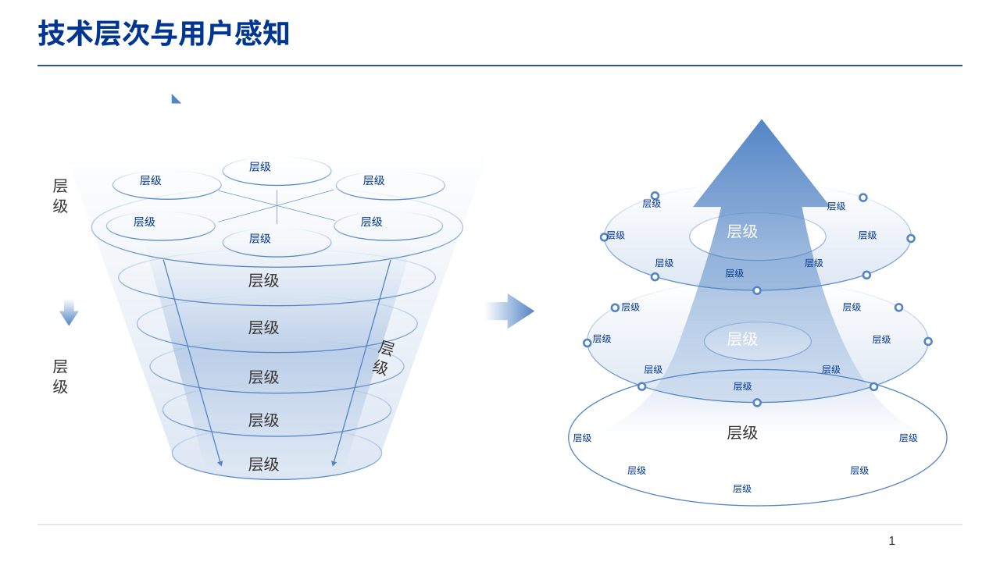

# 技术层次与用户感知

来源为立体结构逻辑图1122.pptx#20。

## 结构与适用场景

左5层倒锥操作/状态/数据/信息/逻辑；右上升锥箭头+强/可/无感知3环；中转换箭头

技术分层转为用户感知分级

两图分别是架构和体验分类，必须保留转换关系；环上实际触点可多项

固定节点、圆弧、扇区、分面和连接表达定性关系。数量比较、趋势或占比使用数据驱动图表，源页中已登记的微图槽可接收实际数据。

## 预览



## 调用

将下列完整page对象放入schema_version=1、template_id=business-blue-v1的pages数组，替换各节点内容。nodes键对应原文本框或已明确拆分的语义分段，字段角色及source_ref、segment见下表。

```json
{
  "id": "spatial-20",
  "family": "source-spatial",
  "variant": "page-20",
  "content": {
    "title": "技术层次与用户感知",
    "nodes": {
      "shape_11": "层级",
      "shape_12": "层级",
      "shape_14": "层级",
      "shape_15": "层级",
      "shape_16": "层级",
      "shape_17": "层级",
      "shape_18": "层级",
      "shape_19": "层级",
      "shape_20": "层级",
      "shape_21": "层级",
      "shape_22": "层级",
      "shape_23": "层级",
      "shape_24": "层级",
      "shape_25": "层级",
      "shape_26": "层级",
      "shape_27": "层级",
      "shape_28": "层级",
      "shape_29": "层级",
      "shape_30": "层级",
      "shape_31": "层级",
      "shape_32": "层级",
      "shape_33": "层级",
      "shape_34": "层级",
      "shape_35": "层级",
      "shape_50": "层级",
      "shape_51": "层级",
      "shape_52": "层级",
      "shape_53": "层级",
      "shape_54": "层级",
      "shape_55": "层级",
      "shape_56": "层级",
      "shape_57": "层级",
      "shape_58": "层级",
      "shape_59": "层级",
      "shape_60": "层级",
      "shape_61": "层级"
    }
  },
  "config": {
    "show_source": true,
    "show_page_number": true
  }
}
```

config支持show_source、show_page_number、image_fit与image_position。image_fit可选contain或cover，image_position为xMin/xMid/xMax与YMin/YMid/YMax组合的九个焦点，默认为xMidYMid。字体、颜色、全局区和固定字阶取自tokens，节点数与连接结构由variant确定。

## 字段合同

每个业务节点required=true、min=1，max按具体框体登记。字符按规范化后的Unicode码点计数，空格标点换行均计入。build会以实际字体测量宽高，字符数通过后仍可能需要调整文字。

| 字段 | 节点角色与源标签 | 最短/最长 | 字阶 | 框体px | 原框引用 | 分段 | 旋转° | 垂直锚点 |
|---|---|---|---|---|---|---|---|---|
| nodes.shape_11 | 上左节点，源标签“物 / 理 / 局 / 限” | 1/16 | compactBody | [67.3314, 227.6675, 39.1536, 105.4813] | slide:11 |  | 0.0 | t |
| nodes.shape_12 | 中左节点，源标签“用 / 户 / 触 / 点” | 1/16 | compactBody | [67.3314, 459.117, 39.1536, 105.4813] | slide:12 |  | 0.0 | t |
| nodes.shape_14 | 中左节点，源标签“操作层” | 1/8 | compactBody | [317.5861, 348.9369, 75.112, 31.9619] | slide:14 |  | 0.0 | t |
| nodes.shape_15 | 中左节点，源标签“状态层” | 1/8 | compactBody | [317.5861, 409.2599, 75.112, 31.9619] | slide:15 |  | 0.0 | t |
| nodes.shape_16 | 中左节点，源标签“数据层” | 1/8 | compactBody | [317.5861, 472.7782, 75.112, 31.9619] | slide:16 |  | 0.0 | t |
| nodes.shape_17 | 下左节点，源标签“信息层” | 1/8 | compactBody | [317.5861, 527.9672, 75.112, 31.9619] | slide:17 |  | 0.0 | t |
| nodes.shape_18 | 下左节点，源标签“逻辑层” | 1/8 | compactBody | [317.5861, 584.4323, 75.112, 31.9619] | slide:18 |  | 0.0 | t |
| nodes.shape_19 | 中中节点，源标签“效 / 率 / 逐 / 级 / 递 / 减” | 1/20 | compactBody | [466.4465, 435.5736, 37.828, 143.8435] | slide:19 |  | 17.127 | t |
| nodes.shape_20 | 中右节点，源标签“强感知” | 1/9 | compactBody | [930.3728, 286.0616, 83.105, 35.1571] | slide:20 |  | 0.0 | t |
| nodes.shape_21 | 中右节点，源标签“可感知” | 1/9 | compactBody | [930.3728, 423.9598, 83.105, 35.1571] | slide:21 |  | 0.0 | t |
| nodes.shape_22 | 下右节点，源标签“无感知” | 1/9 | compactBody | [930.3728, 543.9531, 83.105, 35.1571] | slide:22 |  | 0.0 | t |
| nodes.shape_23 | 上左节点，源标签“机械噪音” | 1/11 | diagramCompact | [178.8074, 223.8293, 72.451, 25.5715] | slide:23 |  | 0.0 | t |
| nodes.shape_24 | 上左节点，源标签“环境报警” | 1/11 | diagramCompact | [170.8936, 276.9211, 72.451, 25.5715] | slide:24 |  | 0.0 | t |
| nodes.shape_25 | 上左节点，源标签“设备性能” | 1/11 | diagramCompact | [318.9117, 206.3496, 72.451, 25.5715] | slide:25 |  | 0.0 | t |
| nodes.shape_26 | 中左节点，源标签“视觉干扰” | 1/11 | diagramCompact | [318.9117, 298.328, 72.451, 25.5715] | slide:26 |  | 0.0 | t |
| nodes.shape_27 | 上中节点，源标签“用户认知” | 1/11 | diagramCompact | [464.6941, 223.8293, 72.451, 25.5715] | slide:27 |  | 0.0 | t |
| nodes.shape_28 | 上中节点，源标签“界面受限” | 1/11 | diagramCompact | [461.7264, 276.9211, 72.451, 25.5715] | slide:28 |  | 0.0 | t |
| nodes.shape_29 | 上中节点，源标签“报警状态” | 1/11 | diagramMicro | [822.2898, 254.5448, 61.797, 22.3763] | slide:29 |  | 0.0 | t |
| nodes.shape_30 | 中中节点，源标签“设备异常状态” | 1/15 | diagramMicro | [776.1226, 295.1031, 83.105, 22.3763] | slide:30 |  | 0.0 | t |
| nodes.shape_31 | 中中节点，源标签“任务计时器” | 1/13 | diagramMicro | [838.4439, 330.7153, 72.451, 22.3763] | slide:31 |  | 0.0 | t |
| nodes.shape_32 | 中右节点，源标签“代办消息推送” | 1/15 | diagramMicro | [928.2855, 343.9017, 84.2723, 22.3763] | slide:32 |  | 0.0 | t |
| nodes.shape_33 | 中右节点，源标签“工单下达通知” | 1/15 | diagramMicro | [1029.9385, 330.7153, 83.105, 22.3763] | slide:33 |  | 0.0 | t |
| nodes.shape_34 | 上右节点，源标签“不良品牌” | 1/11 | diagramMicro | [1058.6261, 257.9972, 61.797, 22.3763] | slide:34 |  | 0.0 | t |
| nodes.shape_35 | 中右节点，源标签“过站状态” | 1/11 | diagramMicro | [1098.5216, 295.1031, 61.797, 22.3763] | slide:35 |  | 0.0 | t |
| nodes.shape_50 | 中中节点，源标签“工单进度” | 1/11 | diagramMicro | [795.185, 387.1408, 61.797, 22.3763] | slide:50 |  | 0.0 | t |
| nodes.shape_51 | 中中节点，源标签“过站信息” | 1/11 | diagramMicro | [758.5836, 427.7387, 61.797, 22.3763] | slide:51 |  | 0.0 | t |
| nodes.shape_52 | 中中节点，源标签“过站数据” | 1/11 | diagramMicro | [824.2683, 467.2484, 61.797, 22.3763] | slide:52 |  | 0.0 | t |
| nodes.shape_53 | 下右节点，源标签“消息推送” | 1/11 | diagramMicro | [938.6922, 488.685, 61.797, 22.3763] | slide:53 |  | 0.0 | t |
| nodes.shape_54 | 中右节点，源标签“人效数据” | 1/11 | diagramMicro | [1078.4304, 387.1408, 61.797, 22.3763] | slide:54 |  | 0.0 | t |
| nodes.shape_55 | 中右节点，源标签“数据录入” | 1/11 | diagramMicro | [1116.5157, 428.6883, 61.797, 22.3763] | slide:55 |  | 0.0 | t |
| nodes.shape_56 | 中右节点，源标签“首单检验” | 1/11 | diagramMicro | [1051.9884, 467.2484, 61.797, 22.3763] | slide:56 |  | 0.0 | t |
| nodes.shape_57 | 下右节点，源标签“批量扫码” | 1/11 | diagramMicro | [1150.8715, 554.8346, 61.797, 22.3763] | slide:57 |  | 0.0 | t |
| nodes.shape_58 | 下右节点，源标签“任务启动” | 1/11 | diagramMicro | [1088.3227, 596.491, 61.797, 22.3763] | slide:58 |  | 0.0 | t |
| nodes.shape_59 | 下右节点，源标签“扫码输入” | 1/11 | diagramMicro | [938.1283, 619.8466, 61.797, 22.3763] | slide:59 |  | 0.0 | t |
| nodes.shape_60 | 下中节点，源标签“弱网等待” | 1/11 | diagramMicro | [733.3781, 554.8346, 61.797, 22.3763] | slide:60 |  | 0.0 | t |
| nodes.shape_61 | 下中节点，源标签“后台报工” | 1/11 | diagramMicro | [803.0988, 596.491, 61.797, 22.3763] | slide:61 |  | 0.0 | t |

全局title必填、2至32码点，使用统一标题框。section_name可选0至24码点，source可选0至64码点。所有可编辑文本通过独立原生carrier导出，页码为派生文字。

## 来源处理

原生PPTX源件保存于用户材料目录，分发包仅含用户资产衍生的几何、字段和说明。原始逐框文字、源框与标准化框在page-catalog.json的variant.fields中。

源标题引用为`slide:6`，原文为“感知分成”。模板默认标题依据真实结构设置。

密集全景中的diagramCompact为14px、diagramMicro为12px。适用于体系概览或附录局部标签，现场关键结论用统一标题与正常正文字阶表达。

源画布边界裁切已烘焙为可编辑Bezier几何，3D顶面、侧面与前面通过tokens配色的相对明暗保留。

