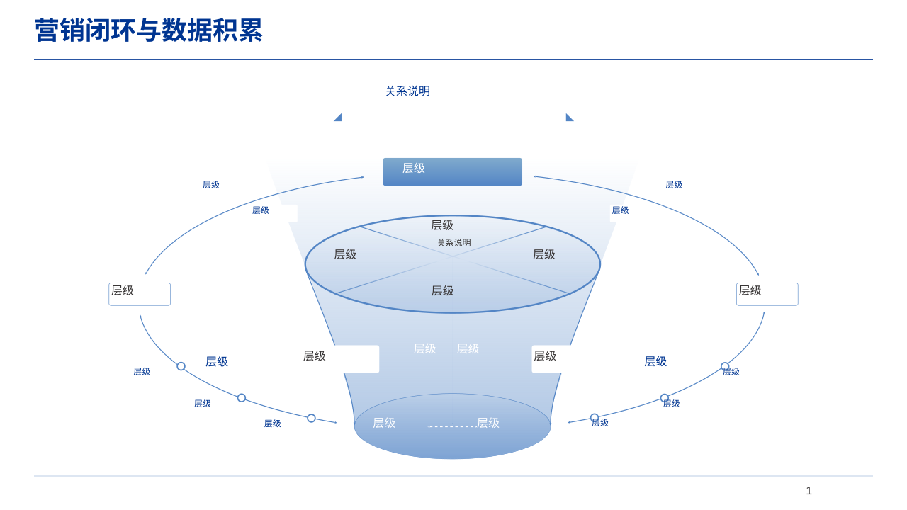

# 营销闭环与数据积累

来源为立体结构逻辑图1122.pptx#21。

## 结构与适用场景

中心倒锥全场景/内容/链路/数据；外大椭圆回路从品牌心智到交易转化；两翼资产沉淀

营销闭环与数据沉淀

保留中心整合能力、左右目标、环上阶段与反馈；原品牌方法论只作示例

固定节点、圆弧、扇区、分面和连接表达定性关系。数量比较、趋势或占比使用数据驱动图表，源页中已登记的微图槽可接收实际数据。

## 预览



## 调用

将下列完整page对象放入schema_version=1、template_id=business-blue-v1的pages数组，替换各节点内容。nodes键对应原文本框或已明确拆分的语义分段，字段角色及source_ref、segment见下表。

```json
{
  "id": "spatial-21",
  "family": "source-spatial",
  "variant": "page-21",
  "content": {
    "title": "营销闭环与数据积累",
    "nodes": {
      "shape_7": "关系说明",
      "shape_10": "层级",
      "shape_17": "层级",
      "shape_19": "层级",
      "shape_24": "层级",
      "shape_26": "层级",
      "shape_4": "层级",
      "shape_27": "层级",
      "shape_28": "层级",
      "shape_29": "层级",
      "shape_32": "层级",
      "shape_34": "层级",
      "shape_35": "层级",
      "shape_36": "层级",
      "shape_37": "层级",
      "shape_38": "层级",
      "shape_44": "层级",
      "shape_45": "层级",
      "shape_46": "层级",
      "shape_47": "层级",
      "shape_48": "关系说明",
      "shape_57": "层级",
      "shape_58": "层级",
      "shape_64": "层级",
      "shape_65": "层级",
      "shape_12": "层级",
      "shape_14": "层级"
    }
  },
  "config": {
    "show_source": true,
    "show_page_number": true
  }
}
```

config支持show_source、show_page_number、image_fit与image_position。image_fit可选contain或cover，image_position为xMin/xMid/xMax与YMin/YMid/YMax组合的九个焦点，默认为xMidYMid。字体、颜色、全局区和固定字阶取自tokens，节点数与连接结构由variant确定。

## 字段合同

每个业务节点required=true、min=1，max按具体框体登记。字符按规范化后的Unicode码点计数，空格标点换行均计入。build会以实际字体测量宽高，字符数通过后仍可能需要调整文字。

| 字段 | 节点角色与源标签 | 最短/最长 | 字阶 | 框体px | 原框引用 | 分段 | 旋转° | 垂直锚点 |
|---|---|---|---|---|---|---|---|---|
| nodes.shape_7 | 上中节点，源标签“Total Marketing Solution” | 1/25 | caption | [542.9197, 120, 180.1426, 26.1313] | slide:7 |  | 0.0 | t |
| nodes.shape_10 | 上中节点，源标签“营销科学优化决策” | 1/19 | caption | [567.9547, 228.8655, 143.246, 27.5871] | slide:10 |  | 0.0 | t |
| nodes.shape_17 | 中右节点，源标签“关系沉淀” | 1/11 | diagramMicro | [863.7113, 290.5095, 60.9791, 21.7731] | slide:17 |  | 0.0 | t |
| nodes.shape_19 | 上右节点，源标签“效率提升” | 1/11 | diagramMicro | [939.3555, 254.4846, 60.9791, 21.7731] | slide:19 |  | 0.0 | t |
| nodes.shape_24 | 上左节点，源标签“效率提升” | 1/11 | diagramMicro | [286.0635, 254.4846, 60.9791, 21.7731] | slide:24 |  | 0.0 | t |
| nodes.shape_26 | 中左节点，源标签“阵地经营” | 1/11 | diagramMicro | [356.0017, 290.5095, 60.9791, 21.7731] | slide:26 |  | 0.0 | t |
| nodes.shape_4 | 下左节点，源标签“从众型选择” | 1/13 | diagramMicro | [188.3137, 518.3409, 71.8611, 21.7731] | slide:4 |  | 0.0 | t |
| nodes.shape_27 | 下左节点，源标签“功能性消费” | 1/13 | diagramMicro | [273.9774, 563.5674, 71.8611, 21.7731] | slide:27 |  | 0.0 | t |
| nodes.shape_28 | 下左节点，源标签“带货型互动” | 1/13 | diagramMicro | [372.8235, 591.7206, 71.8611, 21.7731] | slide:28 |  | 0.0 | t |
| nodes.shape_29 | 下左节点，源标签“互动与沉淀” | 1/12 | caption | [290.1612, 502.1571, 90.0129, 26.1313] | slide:29 |  | 0.0 | t |
| nodes.shape_32 | 中左节点，源标签“品牌心智” | 1/11 | caption | [156.9436, 401.5677, 80.3349, 27.5871] | slide:32 |  | 0.0 | t |
| nodes.shape_34 | 中右节点，源标签“交易转化” | 1/11 | caption | [1042.7216, 401.5677, 80.3349, 27.5871] | slide:34 |  | 0.0 | t |
| nodes.shape_35 | 下中节点，源标签“选择圈层化” | 1/13 | diagramMicro | [835.1268, 590.4805, 71.8611, 21.7731] | slide:35 |  | 0.0 | t |
| nodes.shape_36 | 下右节点，源标签“消费娱乐化” | 1/13 | diagramMicro | [935.7701, 563.5674, 71.8611, 21.7731] | slide:36 |  | 0.0 | t |
| nodes.shape_37 | 下右节点，源标签“互动场景化” | 1/13 | diagramMicro | [1019.9959, 518.3409, 71.8611, 21.7731] | slide:37 |  | 0.0 | t |
| nodes.shape_38 | 下右节点，源标签“转化与反馈” | 1/12 | caption | [909.3871, 501.8425, 90.0129, 26.1313] | slide:38 |  | 0.0 | t |
| nodes.shape_44 | 中中节点，源标签“全内容” | 1/8 | caption | [471.418, 350.7787, 60.9791, 26.1313] | slide:44 |  | 0.0 | t |
| nodes.shape_45 | 中中节点，源标签“全链路” | 1/8 | caption | [752.0331, 350.7787, 60.9791, 26.1313] | slide:45 |  | 0.0 | t |
| nodes.shape_46 | 中中节点，源标签“全数据” | 1/8 | caption | [608.7871, 402.0978, 60.9791, 26.1313] | slide:46 |  | 0.0 | t |
| nodes.shape_47 | 中中节点，源标签“全场景” | 1/8 | caption | [608.194, 309.5419, 60.9791, 26.1313] | slide:47 |  | 0.0 | t |
| nodes.shape_48 | 中中节点，源标签“基于消费者决策全链路建立整合一体的增长能力” | 1/81 | diagramMicro | [565.3577, 336.3112, 150.5067, 49.9083] | slide:48 |  | 0.0 | t |
| nodes.shape_57 | 下中节点，源标签“兴趣驱动” | 1/11 | caption | [673.073, 588.7103, 80.3349, 27.5871] | slide:57 |  | 0.0 | t |
| nodes.shape_58 | 下中节点，源标签“物资满足” | 1/11 | caption | [526.2955, 588.7103, 80.3349, 27.5871] | slide:58 |  | 0.0 | t |
| nodes.shape_64 | 下中节点，源标签“兴趣 / 激发” | 1/12 | caption | [583.7521, 483.8705, 48.8749, 46.4577] | slide:64 |  | 0.0 | t |
| nodes.shape_65 | 下中节点，源标签“需求 / 创造” | 1/12 | caption | [644.6323, 483.8705, 48.8749, 46.4577] | slide:65 |  | 0.0 | t |
| nodes.shape_12 | 下中节点，源标签“数字资产沉淀” | 1/14 | caption | [753.399, 494.0337, 104.5343, 26.1313] | slide:12 |  | 0.0 | t |
| nodes.shape_14 | 下中节点，源标签“数字资产沉淀” | 1/14 | caption | [427.8628, 494.0337, 104.5343, 26.1313] | slide:14 |  | 0.0 | t |

全局title必填、2至32码点，使用统一标题框。section_name可选0至24码点，source可选0至64码点。所有可编辑文本通过独立原生carrier导出，页码为派生文字。

## 来源处理

原生PPTX源件保存于用户材料目录，分发包仅含用户资产衍生的几何、字段和说明。原始逐框文字、源框与标准化框在page-catalog.json的variant.fields中。

源标题引用为`slide:6`，原文为“巨量引擎全量增长方案”。模板默认标题依据真实结构设置。

密集全景中的diagramCompact为14px、diagramMicro为12px。适用于体系概览或附录局部标签，现场关键结论用统一标题与正常正文字阶表达。

源画布边界裁切已烘焙为可编辑Bezier几何，3D顶面、侧面与前面通过tokens配色的相对明暗保留。

