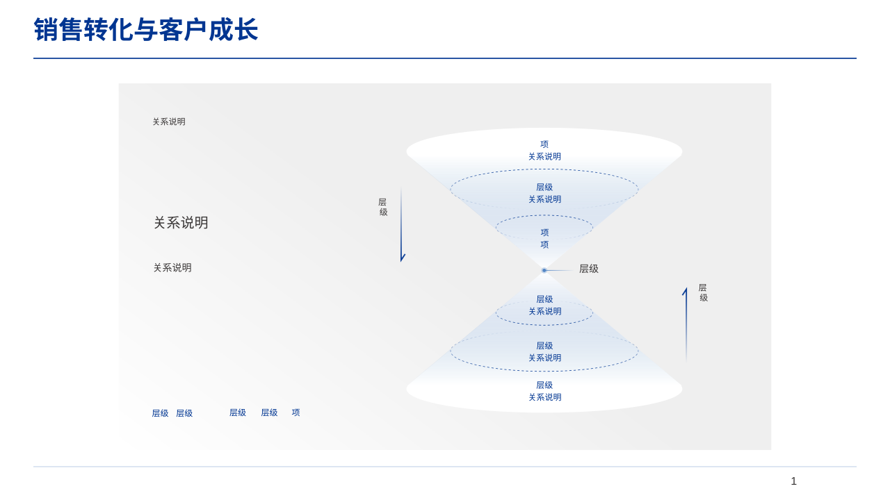

# 销售转化与客户成长

来源为立体结构逻辑图1122.pptx#22。

## 结构与适用场景

上下双漏斗以成交客户为腰；上商机→目标→线索，下活跃→忠诚→NPS；左右相反旅程箭头

销售漏斗与客户成功扩展

两漏斗方向不同且无量化宽度；阶段、腰部转化事件与续费指标需材料支撑

固定节点、圆弧、扇区、分面和连接表达定性关系。数量比较、趋势或占比使用数据驱动图表，源页中已登记的微图槽可接收实际数据。

## 预览



## 调用

将下列完整page对象放入schema_version=1、template_id=business-blue-v1的pages数组，替换各节点内容。nodes键对应原文本框或已明确拆分的语义分段，字段角色及source_ref、segment见下表。

```json
{
  "id": "spatial-22",
  "family": "source-spatial",
  "variant": "page-22",
  "content": {
    "title": "销售转化与客户成长",
    "nodes": {
      "shape_10": "层级",
      "shape_11": "层级",
      "shape_12": "层级",
      "shape_13": "层级",
      "shape_14": "项",
      "shape_15": "关系说明",
      "shape_16": "层级",
      "shape_17": "层级",
      "shape_18": "层级",
      "shape_19": "关系说明",
      "shape_20": "关系说明",
      "shape_21": "项",
      "shape_22": "层级",
      "shape_23": "项",
      "shape_24": "层级",
      "shape_25": "层级",
      "shape_26": "层级",
      "shape_27": "关系说明",
      "shape_28": "项",
      "shape_29": "关系说明",
      "shape_30": "关系说明",
      "shape_31": "关系说明",
      "shape_32": "关系说明"
    }
  },
  "config": {
    "show_source": true,
    "show_page_number": true
  }
}
```

config支持show_source、show_page_number、image_fit与image_position。image_fit可选contain或cover，image_position为xMin/xMid/xMax与YMin/YMid/YMax组合的九个焦点，默认为xMidYMid。字体、颜色、全局区和固定字阶取自tokens，节点数与连接结构由variant确定。

## 字段合同

每个业务节点required=true、min=1，max按具体框体登记。字符按规范化后的Unicode码点计数，空格标点换行均计入。build会以实际字体测量宽高，字符数通过后仍可能需要调整文字。

| 字段 | 节点角色与源标签 | 最短/最长 | 字阶 | 框体px | 原框引用 | 分段 | 旋转° | 垂直锚点 |
|---|---|---|---|---|---|---|---|---|
| nodes.shape_10 | 下左节点，源标签“By Mina” | 1/4 | diagramMicro | [218.5753, 588.8087, 25.9087, 15.0] | slide:10 |  | 0.0 | t |
| nodes.shape_11 | 下左节点，源标签“2021-2022” | 1/6 | diagramMicro | [253.2913, 588.8087, 33.242, 15.0] | slide:11 |  | 0.0 | t |
| nodes.shape_12 | 下左节点，源标签“Behance” | 1/4 | diagramMicro | [330.042, 587.8333, 26.4, 15.0] | slide:12 |  | 0.0 | t |
| nodes.shape_13 | 下左节点，源标签“Dribbble” | 1/5 | diagramMicro | [375.5087, 587.8333, 27.3753, 15.0] | slide:13 |  | 0.0 | t |
| nodes.shape_14 | 下左节点，源标签“Vimeo” | 1/3 | diagramMicro | [419.5087, 587.8333, 19.558, 15.0] | slide:14 |  | 0.0 | t |
| nodes.shape_15 | 中左节点，源标签“国际化战略 / 取得显著成果增长迅猛” | 1/48 | compactBody | [219.558, 310.1753, 216.0913, 61.6] | slide:15 |  | 0.0 | t |
| nodes.shape_16 | 中中节点，源标签“销售旅程” | 1/10 | diagramMicro | [545.038, 284.758, 13.44, 80.1753] | slide:16 |  | 0.0 | t |
| nodes.shape_17 | 中右节点，源标签“客户成功旅程” | 1/16 | diagramMicro | [1005.5713, 407.958, 13.44, 120.2667] | slide:17 |  | 0.0 | t |
| nodes.shape_18 | 中中节点，源标签“成交客户” | 1/9 | diagramCompact | [833.1087, 379.6, 57.2, 20.042] | slide:18 |  | 0.0 | t |
| nodes.shape_19 | 中左节点，源标签“全年入金客户目标上半年完成近八成全球入金客户数迎新里程碑；Q2季度新增入金客户创” | 1/252 | diagramCompact | [219.558, 378.1333, 269.8667, 109.5087] | slide:19 |  | 0.0 | t |
| nodes.shape_20 | 上左节点，源标签“autonomous / driving / capability” | 1/147 | diagramMicro | [218.5753, 168.8913, 269.8667, 48.4] | slide:20 |  | 0.0 | t |
| nodes.shape_21 | 上中节点，源标签“商机” | 1/4 | diagramMicro | [770.5333, 201.642, 24.9333, 17.1087] | slide:21 |  | 0.0 | t |
| nodes.shape_22 | 上中节点，源标签“目标客户” | 1/9 | diagramMicro | [758.8, 263.242, 48.8913, 17.1087] | slide:22 |  | 0.0 | t |
| nodes.shape_23 | 中中节点，源标签“线索” | 1/4 | diagramMicro | [771.0247, 328.758, 24.9333, 17.1087] | slide:23 |  | 0.0 | t |
| nodes.shape_24 | 中中节点，源标签“活跃使用客户” | 1/13 | diagramMicro | [747.0667, 424.5753, 72.842, 17.1087] | slide:24 |  | 0.0 | t |
| nodes.shape_25 | 下中节点，源标签“忠诚客户（续费）” | 1/18 | diagramMicro | [734.842, 491.558, 97.2913, 17.1087] | slide:25 |  | 0.0 | t |
| nodes.shape_26 | 下中节点，源标签“高NPS客户（转介绍）” | 1/22 | diagramMicro | [721.642, 548.2667, 123.2, 17.1087] | slide:26 |  | 0.0 | t |
| nodes.shape_27 | 上中节点，源标签“business opportunity” | 1/18 | diagramMicro | [732.8913, 219.079, 100.2247, 15.0] | slide:27 |  | 0.0 | t |
| nodes.shape_28 | 中中节点，源标签“Clue” | 1/3 | diagramMicro | [772.4913, 346.1877, 21.5087, 15.0] | slide:28 |  | 0.0 | t |
| nodes.shape_29 | 中中节点，源标签“Target customers” | 1/15 | diagramMicro | [741.6913, 280.679, 83.1087, 15.0] | slide:29 |  | 0.0 | t |
| nodes.shape_30 | 中中节点，源标签“active customers” | 1/15 | diagramMicro | [742.1753, 442.0123, 82.6247, 15.0] | slide:30 |  | 0.0 | t |
| nodes.shape_31 | 下中节点，源标签“loyal custtomers” | 1/15 | diagramMicro | [742.1753, 508.9877, 82.1333, 15.0] | slide:31 |  | 0.0 | t |
| nodes.shape_32 | 下中节点，源标签“high NPS customers” | 1/17 | diagramMicro | [735.3333, 565.7037, 96.3087, 15.0] | slide:32 |  | 0.0 | t |

全局title必填、2至32码点，使用统一标题框。section_name可选0至24码点，source可选0至64码点。所有可编辑文本通过独立原生carrier导出，页码为派生文字。

## 来源处理

原生PPTX源件保存于用户材料目录，分发包仅含用户资产衍生的几何、字段和说明。原始逐框文字、源框与标准化框在page-catalog.json的variant.fields中。

源标题引用为`None`，原文为“无独立源标题”。模板默认标题依据真实结构设置。

密集全景中的diagramCompact为14px、diagramMicro为12px。适用于体系概览或附录局部标签，现场关键结论用统一标题与正常正文字阶表达。

源画布边界裁切已烘焙为可编辑Bezier几何，3D顶面、侧面与前面通过tokens配色的相对明暗保留。

