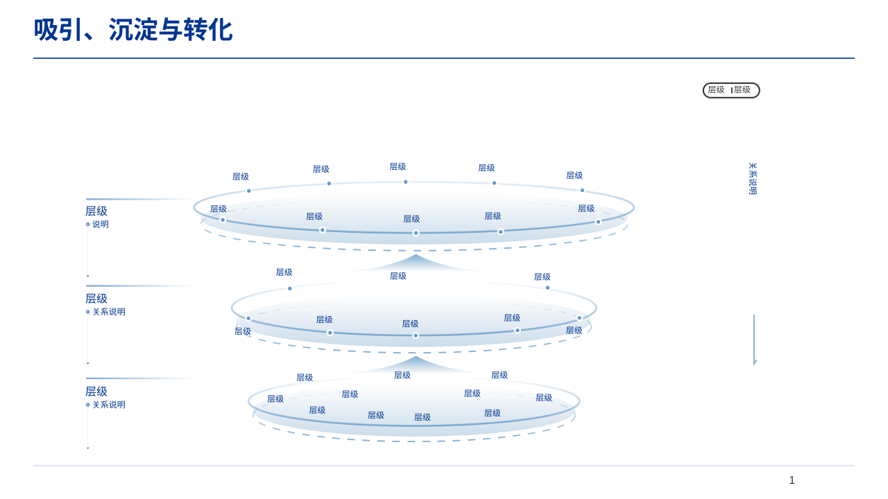

# 吸引、沉淀与转化

来源为立体结构逻辑图1122.pptx#23。

## 结构与适用场景

3个悬浮环盘，吸引/沉淀/转化3阶段；每环多个触点；中段连接箭头

三阶段服务运营体系

原页面大量智能家居重复例文；需按触点真实材料重配，保留层次与连接

固定节点、圆弧、扇区、分面和连接表达定性关系。数量比较、趋势或占比使用数据驱动图表，源页中已登记的微图槽可接收实际数据。

## 预览



## 调用

将下列完整page对象放入schema_version=1、template_id=business-blue-v1的pages数组，替换各节点内容。nodes键对应原文本框或已明确拆分的语义分段，字段角色及source_ref、segment见下表。

```json
{
  "id": "spatial-23",
  "family": "source-spatial",
  "variant": "page-23",
  "content": {
    "title": "吸引、沉淀与转化",
    "nodes": {
      "shape_49": "层级",
      "shape_50": "层级",
      "shape_51": "层级",
      "shape_52": "层级",
      "shape_53": "层级",
      "shape_54": "关系说明",
      "shape_55": "层级",
      "shape_56": "层级",
      "shape_57": "层级",
      "shape_58": "层级",
      "shape_59": "层级",
      "shape_60": "层级",
      "shape_61": "层级",
      "shape_62": "层级",
      "shape_63": "层级",
      "shape_64": "层级",
      "shape_65": "层级",
      "shape_66": "层级",
      "shape_70": "层级",
      "shape_71": "层级",
      "shape_72": "层级",
      "shape_73": "说明",
      "shape_74": "关系说明",
      "shape_75": "关系说明",
      "shape_76": "层级",
      "shape_77": "层级",
      "shape_78": "层级",
      "shape_79": "层级",
      "shape_80": "层级",
      "shape_81": "层级",
      "shape_82": "层级",
      "shape_83": "层级",
      "shape_84": "层级",
      "shape_85": "层级",
      "shape_86": "层级",
      "shape_87": "层级",
      "shape_121": "层级",
      "shape_122": "层级"
    }
  },
  "config": {
    "show_source": true,
    "show_page_number": true
  }
}
```

config支持show_source、show_page_number、image_fit与image_position。image_fit可选contain或cover，image_position为xMin/xMid/xMax与YMin/YMid/YMax组合的九个焦点，默认为xMidYMid。字体、颜色、全局区和固定字阶取自tokens，节点数与连接结构由variant确定。

## 字段合同

每个业务节点required=true、min=1，max按具体框体登记。字符按规范化后的Unicode码点计数，空格标点换行均计入。build会以实际字体测量宽高，字符数通过后仍可能需要调整文字。

| 字段 | 节点角色与源标签 | 最短/最长 | 字阶 | 框体px | 原框引用 | 分段 | 旋转° | 垂直锚点 |
|---|---|---|---|---|---|---|---|---|
| nodes.shape_49 | 上左节点，源标签“安全用电” | 1/8 | diagramMicro | [335.0121, 248.5404, 44.6885, 15.0] | slide:49 |  | 0.0 | t |
| nodes.shape_50 | 上中节点，源标签“智能家居” | 1/8 | diagramMicro | [450.9685, 237.6694, 44.6885, 15.0] | slide:50 |  | 0.0 | t |
| nodes.shape_51 | 上中节点，源标签“智能家居” | 1/8 | diagramMicro | [561.4894, 234.0458, 44.6885, 15.0] | slide:51 |  | 0.0 | t |
| nodes.shape_52 | 上中节点，源标签“智能家居” | 1/8 | diagramMicro | [689.5215, 235.8576, 44.6885, 15.0] | slide:52 |  | 0.0 | t |
| nodes.shape_53 | 上中节点，源标签“智能家居” | 1/8 | diagramMicro | [816.3488, 246.7285, 44.6885, 15.0] | slide:53 |  | 0.0 | t |
| nodes.shape_54 | 中右节点，源标签“study resercation system” | 1/31 | diagramMicro | [997.8386, 311.0019, 171.5158, 15.6994] | slide:54 |  | 90.0 | t |
| nodes.shape_55 | 中中节点，源标签“智能家居” | 1/8 | diagramMicro | [833.2621, 294.4428, 44.6885, 15.0] | slide:55 |  | 0.0 | t |
| nodes.shape_56 | 中中节点，源标签“智能家居” | 1/8 | diagramMicro | [698.5806, 305.3137, 44.6885, 15.0] | slide:56 |  | 0.0 | t |
| nodes.shape_57 | 中中节点，源标签“智能家居” | 1/8 | diagramMicro | [581.4194, 309.5443, 44.6885, 15.0] | slide:57 |  | 0.0 | t |
| nodes.shape_58 | 中中节点，源标签“智能家居” | 1/8 | diagramMicro | [441.3024, 305.9206, 44.6885, 15.0] | slide:58 |  | 0.0 | t |
| nodes.shape_59 | 中左节点，源标签“智能家居” | 1/8 | diagramMicro | [302.9973, 295.0497, 44.6885, 15.0] | slide:59 |  | 0.0 | t |
| nodes.shape_60 | 中左节点，源标签“在线直播” | 1/7 | diagramMicro | [338.0288, 471.702, 39.86, 15.0] | slide:60 |  | 0.0 | t |
| nodes.shape_61 | 下中节点，源标签“用电保险” | 1/6 | diagramMicro | [427.4149, 538.3979, 35.0315, 15.0] | slide:61 |  | 0.0 | t |
| nodes.shape_62 | 下左节点，源标签“AI智能终端” | 1/8 | diagramMicro | [385.1361, 569.1988, 43.4836, 15.0] | slide:62 |  | 0.0 | t |
| nodes.shape_63 | 下中节点，源标签“停电有利” | 1/6 | diagramMicro | [445.533, 585.5051, 35.0315, 15.0] | slide:63 |  | 0.0 | t |
| nodes.shape_64 | 下中节点，源标签“租房管家” | 1/6 | diagramMicro | [492.6403, 562.5494, 35.0315, 15.0] | slide:64 |  | 0.0 | t |
| nodes.shape_65 | 下中节点，源标签“一站式服务” | 1/11 | diagramMicro | [568.1297, 535.0603, 61.6018, 15.6994] | slide:65 |  | 0.0 | t |
| nodes.shape_66 | 中中节点，源标签“会展获客技能” | 1/13 | diagramMicro | [562.0873, 391.9267, 73.6776, 15.6994] | slide:66 |  | 0.0 | t |
| nodes.shape_70 | 中左节点，源标签“吸引用户” | 1/8 | caption | [123.0294, 296.1688, 59.183, 20.0] | slide:70 |  | 0.0 | t |
| nodes.shape_71 | 中左节点，源标签“沉淀用户” | 1/8 | caption | [123.0294, 422.3891, 59.183, 20.0] | slide:71 |  | 0.0 | t |
| nodes.shape_72 | 下左节点，源标签“提升转化” | 1/8 | caption | [123.0294, 556.4637, 59.183, 20.0] | slide:72 |  | 0.0 | t |
| nodes.shape_73 | 中左节点，源标签“Attract users” | 1/8 | diagramMicro | [132.6864, 317.3561, 46.5003, 15.0] | slide:73 |  | 0.0 | t |
| nodes.shape_74 | 中左节点，源标签“Sedimentation user” | 1/12 | diagramMicro | [132.6864, 443.5764, 68.8491, 15.0] | slide:74 |  | 0.0 | t |
| nodes.shape_75 | 下左节点，源标签“Promote transformation” | 1/15 | diagramMicro | [132.6864, 577.6509, 85.1554, 15.0] | slide:75 |  | 0.0 | t |
| nodes.shape_76 | 下中节点，源标签“综合能源” | 1/6 | diagramMicro | [530.0815, 592.7524, 35.0315, 15.0] | slide:76 |  | 0.0 | t |
| nodes.shape_77 | 下中节点，源标签“爱心扶贫” | 1/6 | diagramMicro | [597.1188, 595.7691, 35.0315, 15.0] | slide:77 |  | 0.0 | t |
| nodes.shape_78 | 下中节点，源标签“专属客户经理” | 1/9 | diagramMicro | [668.9846, 561.3446, 51.9358, 15.0] | slide:78 |  | 0.0 | t |
| nodes.shape_79 | 下中节点，源标签“热点资讯” | 1/6 | diagramMicro | [697.9736, 589.7267, 35.0315, 15.0] | slide:79 |  | 0.0 | t |
| nodes.shape_80 | 下中节点，源标签“电力社群” | 1/6 | diagramMicro | [772.2582, 567.387, 35.0315, 15.0] | slide:80 |  | 0.0 | t |
| nodes.shape_81 | 下中节点，源标签“DT-design” | 1/7 | diagramMicro | [708.2467, 534.7742, 41.0649, 15.0] | slide:81 |  | 0.0 | t |
| nodes.shape_82 | 中左节点，源标签“在线直播” | 1/7 | diagramMicro | [397.8188, 386.5465, 39.86, 15.0] | slide:82 |  | 0.0 | t |
| nodes.shape_83 | 中中节点，源标签“在线直播” | 1/7 | diagramMicro | [455.797, 454.7887, 39.86, 15.0] | slide:83 |  | 0.0 | t |
| nodes.shape_84 | 中中节点，源标签“在线直播” | 1/7 | diagramMicro | [579.6076, 460.8311, 39.86, 15.0] | slide:84 |  | 0.0 | t |
| nodes.shape_85 | 中中节点，源标签“在线直播” | 1/7 | diagramMicro | [726.3648, 452.3699, 39.86, 15.0] | slide:85 |  | 0.0 | t |
| nodes.shape_86 | 中中节点，源标签“在线直播” | 1/7 | diagramMicro | [769.8485, 393.1868, 39.86, 15.0] | slide:86 |  | 0.0 | t |
| nodes.shape_87 | 中中节点，源标签“在线直播” | 1/7 | diagramMicro | [815.7418, 470.4881, 39.86, 15.0] | slide:87 |  | 0.0 | t |
| nodes.shape_121 | 上右节点，源标签“STYLE” | 1/5 | diagramMicro | [1020.4773, 122.9225, 30.8009, 15.0] | slide:121 |  | 0.0 | t |
| nodes.shape_122 | 上右节点，源标签“性冷淡” | 1/5 | diagramMicro | [1057.9275, 122.9225, 28.9891, 15.0] | slide:122 |  | 0.0 | t |

全局title必填、2至32码点，使用统一标题框。section_name可选0至24码点，source可选0至64码点。所有可编辑文本通过独立原生carrier导出，页码为派生文字。

## 来源处理

原生PPTX源件保存于用户材料目录，分发包仅含用户资产衍生的几何、字段和说明。原始逐框文字、源框与标准化框在page-catalog.json的variant.fields中。

源标题引用为`slide:47`，原文为“数字会展一站式服务解决方案”。模板默认标题依据真实结构设置。

密集全景中的diagramCompact为14px、diagramMicro为12px。适用于体系概览或附录局部标签，现场关键结论用统一标题与正常正文字阶表达。

源画布边界裁切已烘焙为可编辑Bezier几何，3D顶面、侧面与前面通过tokens配色的相对明暗保留。

