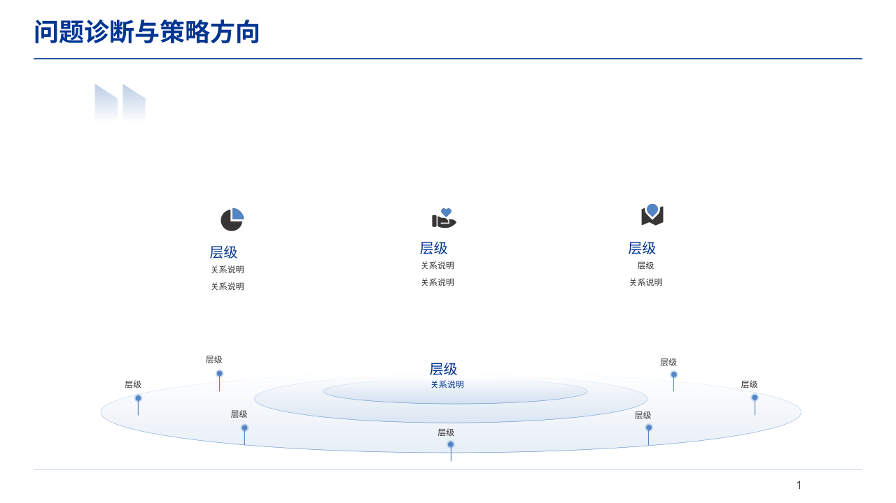

# 问题诊断与策略方向

来源为立体结构逻辑图1122.pptx#24。

## 结构与适用场景

顶3问题卡，下消费核心盘与外圈8策略节点

问题诊断与策略方向

上问题到下措施无逐一连线，不能假设一一对应；需补业务映射

固定节点、圆弧、扇区、分面和连接表达定性关系。数量比较、趋势或占比使用数据驱动图表，源页中已登记的微图槽可接收实际数据。

## 预览



## 调用

将下列完整page对象放入schema_version=1、template_id=business-blue-v1的pages数组，替换各节点内容。nodes键对应原文本框或已明确拆分的语义分段，字段角色及source_ref、segment见下表。

```json
{
  "id": "spatial-24",
  "family": "source-spatial",
  "variant": "page-24",
  "content": {
    "title": "问题诊断与策略方向",
    "nodes": {
      "shape_68": "层级",
      "shape_69": "关系说明",
      "shape_70": "关系说明",
      "shape_83": "层级",
      "shape_84": "关系说明",
      "shape_85": "关系说明",
      "shape_89": "层级",
      "shape_90": "层级",
      "shape_91": "关系说明",
      "shape_92": "层级",
      "shape_93": "关系说明",
      "shape_94": "层级",
      "shape_95": "层级",
      "shape_96": "层级",
      "shape_97": "层级",
      "shape_98": "层级",
      "shape_99": "层级",
      "shape_100": "层级"
    }
  },
  "config": {
    "show_source": true,
    "show_page_number": true
  }
}
```

config支持show_source、show_page_number、image_fit与image_position。image_fit可选contain或cover，image_position为xMin/xMid/xMax与YMin/YMid/YMax组合的九个焦点，默认为xMidYMid。字体、颜色、全局区和固定字阶取自tokens，节点数与连接结构由variant确定。

## 字段合同

每个业务节点required=true、min=1，max按具体框体登记。字符按规范化后的Unicode码点计数，空格标点换行均计入。build会以实际字体测量宽高，字符数通过后仍可能需要调整文字。

| 字段 | 节点角色与源标签 | 最短/最长 | 字阶 | 框体px | 原框引用 | 分段 | 旋转° | 垂直锚点 |
|---|---|---|---|---|---|---|---|---|
| nodes.shape_68 | 中左节点，源标签“用户质量低” | 1/11 | compactBody | [279.9283, 349.5716, 105.0538, 25.2122] | slide:68 |  | 0.0 | t |
| nodes.shape_69 | 中左节点，源标签“PRE-HYPOTHESIS” | 1/19 | diagramMicro | [279.9283, 378.2253, 105.0538, 15.0] | slide:69 |  | 0.0 | t |
| nodes.shape_70 | 中左节点，源标签“用户太少,导致首页异性用户推荐重复,异性质量较低” | 1/52 | diagramMicro | [262.1375, 402.2849, 140.6439, 31.7233] | slide:70 |  | 0.0 | t |
| nodes.shape_83 | 中中节点，源标签“功能少点” | 1/9 | compactBody | [590.6073, 343.6587, 84.0465, 25.2122] | slide:83 |  | 0.0 | t |
| nodes.shape_84 | 中中节点，源标签“LESS FUNCTION” | 1/19 | diagramMicro | [580.108, 372.3124, 105.0538, 15.0] | slide:84 |  | 0.0 | t |
| nodes.shape_85 | 中中节点，源标签“发现页面含糊不清,缺少视频展示,用户没有内容可以浏览,间接导致留存率低” | 1/84 | diagramMicro | [556.5257, 396.3807, 152.2097, 48.1182] | slide:85 |  | 0.0 | t |
| nodes.shape_89 | 中右节点，源标签“引导性弱” | 1/9 | compactBody | [888.2467, 343.6587, 84.0465, 25.2122] | slide:89 |  | 0.0 | t |
| nodes.shape_90 | 中右节点，源标签“GUIDE” | 1/19 | diagramMicro | [877.7387, 372.3124, 105.0538, 15.0] | slide:90 |  | 0.0 | t |
| nodes.shape_91 | 中右节点，源标签“首页作为引导功能的承接页,版块之间层级区分不明显,导致用户在寻找目标时易产生视觉” | 1/90 | diagramMicro | [847.8967, 396.3807, 164.7464, 48.1182] | slide:91 |  | 0.0 | t |
| nodes.shape_92 | 下中节点，源标签“消费基尖子生” | 1/14 | compactBody | [583.576, 516.8821, 126.0698, 25.0] | slide:92 |  | 0.0 | t |
| nodes.shape_93 | 下中节点，源标签“Top consumption students” | 1/26 | diagramMicro | [575.695, 542.5382, 141.8231, 15.0] | slide:93 |  | 0.0 | t |
| nodes.shape_94 | 下左节点，源标签“差异价值衔接品牌” | 1/19 | diagramMicro | [261.0451, 506.8527, 105.0538, 15.0] | slide:94 |  | 0.0 | t |
| nodes.shape_95 | 下左节点，源标签“调研顾客反馈” | 1/19 | diagramMicro | [145.4487, 542.5382, 105.0538, 15.0] | slide:95 |  | 0.0 | t |
| nodes.shape_96 | 下左节点，源标签“建立沟通逻辑” | 1/19 | diagramMicro | [296.8867, 585.0297, 105.0538, 15.0] | slide:96 |  | 0.0 | t |
| nodes.shape_97 | 下中节点，源标签“建立沟通逻辑” | 1/19 | diagramMicro | [592.4713, 611.343, 105.0538, 15.0] | slide:97 |  | 0.0 | t |
| nodes.shape_98 | 下右节点，源标签“聚焦人群画像” | 1/19 | diagramMicro | [873.8372, 586.7203, 105.0538, 15.0] | slide:98 |  | 0.0 | t |
| nodes.shape_99 | 下右节点，源标签“重塑品牌口号” | 1/19 | diagramMicro | [1025.8562, 542.4342, 105.0538, 15.0] | slide:99 |  | 0.0 | t |
| nodes.shape_100 | 下右节点，源标签“挖掘差异价值” | 1/19 | diagramMicro | [910.3724, 510.8409, 105.0538, 15.0] | slide:100 |  | 0.0 | t |

全局title必填、2至32码点，使用统一标题框。section_name可选0至24码点，source可选0至64码点。所有可编辑文本通过独立原生carrier导出，页码为派生文字。

## 来源处理

原生PPTX源件保存于用户材料目录，分发包仅含用户资产衍生的几何、字段和说明。原始逐框文字、源框与标准化框在page-catalog.json的variant.fields中。

源标题引用为`slide:66`，原文为“三维拆解用研目标”。模板默认标题依据真实结构设置。

密集全景中的diagramCompact为14px、diagramMicro为12px。适用于体系概览或附录局部标签，现场关键结论用统一标题与正常正文字阶表达。

源画布边界裁切已烘焙为可编辑Bezier几何，3D顶面、侧面与前面通过tokens配色的相对明暗保留。

