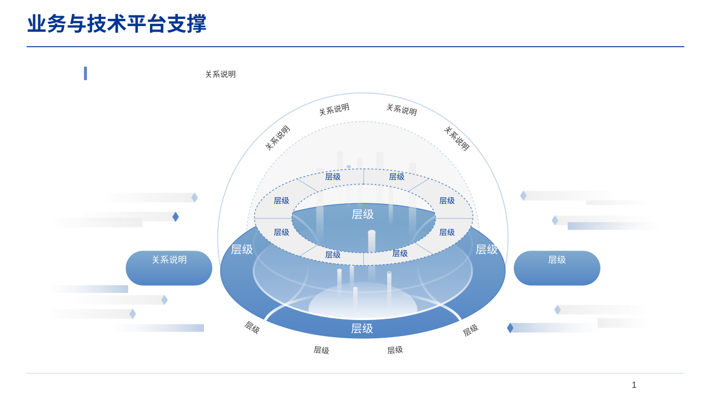

# 业务与技术平台支撑

来源为立体结构逻辑图1122.pptx#25。

## 结构与适用场景

上业务中台分8云域，外智能/数据中台环，底技术平台；两翼应用基础设施/共创平台

业务-智能-数据-技术平台

源标题与实际中台关系不符，依据实际结构；环内模块分层字段

固定节点、圆弧、扇区、分面和连接表达定性关系。数量比较、趋势或占比使用数据驱动图表，源页中已登记的微图槽可接收实际数据。

## 预览



## 调用

将下列完整page对象放入schema_version=1、template_id=business-blue-v1的pages数组，替换各节点内容。nodes键对应原文本框或已明确拆分的语义分段，字段角色及source_ref、segment见下表。

```json
{
  "id": "spatial-25",
  "family": "source-spatial",
  "variant": "page-25",
  "content": {
    "title": "业务与技术平台支撑",
    "nodes": {
      "shape_6": "关系说明",
      "shape_94": "层级",
      "shape_95": "层级",
      "shape_96": "层级",
      "shape_97": "层级",
      "shape_98": "层级",
      "shape_99": "层级",
      "shape_100": "层级",
      "shape_101": "层级",
      "shape_110": "关系说明",
      "shape_111": "层级",
      "shape_102": "层级",
      "shape_103": "层级",
      "shape_104": "层级",
      "shape_105": "层级",
      "shape_106": "层级",
      "shape_107": "层级",
      "shape_108": "层级",
      "shape_109": "层级",
      "shape_137_segment_1": "关系说明",
      "shape_137_segment_2": "关系说明",
      "shape_137_segment_3": "关系说明",
      "shape_137_segment_4": "关系说明"
    }
  },
  "config": {
    "show_source": true,
    "show_page_number": true
  }
}
```

config支持show_source、show_page_number、image_fit与image_position。image_fit可选contain或cover，image_position为xMin/xMid/xMax与YMin/YMid/YMax组合的九个焦点，默认为xMidYMid。字体、颜色、全局区和固定字阶取自tokens，节点数与连接结构由variant确定。

## 字段合同

每个业务节点required=true、min=1，max按具体框体登记。字符按规范化后的Unicode码点计数，空格标点换行均计入。build会以实际字体测量宽高，字符数通过后仍可能需要调整文字。

| 字段 | 节点角色与源标签 | 最短/最长 | 字阶 | 框体px | 原框引用 | 分段 | 旋转° | 垂直锚点 |
|---|---|---|---|---|---|---|---|---|
| nodes.shape_6 | 上中节点，源标签“User motivation and transformation” | 1/39 | diagramCompact | [368.4332, 126.3635, 251.834, 24.9059] | slide:6 |  | 0.0 | t |
| nodes.shape_94 | 下中节点，源标签“技术平台” | 1/17 | compactBody | [574.9089, 577.0679, 154.1631, 32.5455] | slide:94 |  | 0 | ctr |
| nodes.shape_95 | 中左节点，源标签“智能中台” | 1/15 | compactBody | [413.0291, 438.5438, 45.1955, 96.8572] | slide:95 |  | 0.0 | t |
| nodes.shape_96 | 中右节点，源标签“数据中台” | 1/15 | compactBody | [853.7129, 438.5438, 45.1955, 96.8572] | slide:96 |  | 0.0 | t |
| nodes.shape_97 | 中中节点，源标签“业务中台” | 1/12 | compactBody | [598.4445, 375.2427, 109.6613, 30.4386] | slide:97 |  | 0.0 | t |
| nodes.shape_98 | 下中节点，源标签“元数据驱动” | 1/17 | diagramCompact | [523.5127, 623.0941, 109.6613, 24.9059] | slide:98 |  | 5.8005 | t |
| nodes.shape_99 | 下中节点，源标签“中台化” | 1/17 | diagramCompact | [657.0779, 622.5897, 109.6613, 24.9059] | slide:99 |  | -6.0 | t |
| nodes.shape_100 | 下中节点，源标签“数用分离” | 1/17 | diagramCompact | [794.9339, 586.2748, 109.6613, 24.9059] | slide:100 |  | -30.0 | t |
| nodes.shape_101 | 下中节点，源标签“云原生（含微服务）” | 1/22 | diagramCompact | [380.2009, 581.5814, 143.1661, 24.9059] | slide:101 |  | 31.8989 | t |
| nodes.shape_110 | 中左节点，源标签“数智商业的 / 应用级基础设施” | 1/36 | caption | [236.0756, 459.116, 136.3915, 47.0454] | slide:110 |  | 0.0 | t |
| nodes.shape_111 | 中右节点，源标签“企业服务产业的共创平台” | 1/36 | caption | [934.7598, 459.116, 136.3915, 47.0454] | slide:111 |  | 0.0 | t |
| nodes.shape_102 | 中中节点，源标签“财务云” | 1/12 | diagramCompact | [560.1178, 451.3564, 78.6403, 24.1094] | slide:102 |  | 0.0 | t |
| nodes.shape_103 | 中中节点，源标签“协同云” | 1/17 | diagramCompact | [665.4883, 448.8641, 109.6613, 23.527] | slide:103 |  | 0.0 | t |
| nodes.shape_104 | 中中节点，源标签“供应链云” | 1/17 | diagramCompact | [750.1324, 410.8287, 109.6613, 23.527] | slide:104 |  | 0.0 | t |
| nodes.shape_105 | 中中节点，源标签“金融云” | 1/17 | diagramCompact | [452.1009, 410.8287, 109.6613, 23.527] | slide:105 |  | 0.0 | t |
| nodes.shape_106 | 中中节点，源标签“采购云” | 1/17 | diagramCompact | [750.1324, 353.814, 109.6613, 23.527] | slide:106 |  | 0.0 | t |
| nodes.shape_107 | 中中节点，源标签“营销云” | 1/17 | diagramCompact | [452.1009, 353.814, 109.6613, 23.527] | slide:107 |  | 0.0 | t |
| nodes.shape_108 | 中中节点，源标签“制造云” | 1/15 | diagramCompact | [551.399, 310.8196, 96.0779, 23.527] | slide:108 |  | 0.0 | t |
| nodes.shape_109 | 中中节点，源标签“人力云” | 1/15 | diagramCompact | [666.1649, 310.8196, 96.5318, 23.527] | slide:109 |  | 0.0 | t |
| nodes.shape_137_segment_1 | 上中节点，源标签“数字化 智能化        高弹性 安全可信        社会化 全球化  ” | 1/23 | diagramCompact | [431.0234, 239.622, 145.5985, 27.4068] | slide:137 | 1 | -45 | t |
| nodes.shape_137_segment_2 | 上中节点，源标签“数字化 智能化        高弹性 安全可信        社会化 全球化  ” | 1/23 | diagramCompact | [529.5165, 189.9472, 145.5985, 27.4068] | slide:137 | 2 | -12 | t |
| nodes.shape_137_segment_3 | 上中节点，源标签“数字化 智能化        高弹性 安全可信        社会化 全球化  ” | 1/23 | diagramCompact | [648.5646, 189.9472, 145.5985, 27.4068] | slide:137 | 3 | 12 | t |
| nodes.shape_137_segment_4 | 上中节点，源标签“数字化 智能化        高弹性 安全可信        社会化 全球化  ” | 1/23 | diagramCompact | [744.4883, 239.622, 145.5985, 27.4068] | slide:137 | 4 | 45 | t |

全局title必填、2至32码点，使用统一标题框。section_name可选0至24码点，source可选0至64码点。所有可编辑文本通过独立原生carrier导出，页码为派生文字。

## 来源处理

原生PPTX源件保存于用户材料目录，分发包仅含用户资产衍生的几何、字段和说明。原始逐框文字、源框与标准化框在page-catalog.json的variant.fields中。

源标题引用为`slide:5`，原文为“用户激励与转化”。模板默认标题依据真实结构设置。

密集全景中的diagramCompact为14px、diagramMicro为12px。适用于体系概览或附录局部标签，现场关键结论用统一标题与正常正文字阶表达。

源画布边界裁切已烘焙为可编辑Bezier几何，3D顶面、侧面与前面通过tokens配色的相对明暗保留。

