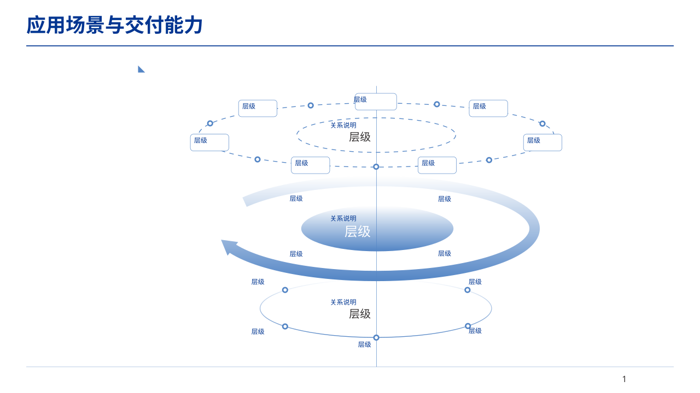

# 应用场景与交付能力

来源为立体结构逻辑图1122.pptx#26。

## 结构与适用场景

顶虚拟人场景7节点虚线环；中应用交付盘+环形箭头；底智能设计6节点环

场景-交付-能力支撑

三个不同环语义分别字段，环形箭头仅中层；重复英文标签可作为展示开关

固定节点、圆弧、扇区、分面和连接表达定性关系。数量比较、趋势或占比使用数据驱动图表，源页中已登记的微图槽可接收实际数据。

## 预览



## 调用

将下列完整page对象放入schema_version=1、template_id=business-blue-v1的pages数组，替换各节点内容。nodes键对应原文本框或已明确拆分的语义分段，字段角色及source_ref、segment见下表。

```json
{
  "id": "spatial-26",
  "family": "source-spatial",
  "variant": "page-26",
  "content": {
    "title": "应用场景与交付能力",
    "nodes": {
      "shape_17": "层级",
      "shape_19": "层级",
      "shape_21": "层级",
      "shape_23": "层级",
      "shape_25": "层级",
      "shape_27": "层级",
      "shape_29": "层级",
      "shape_37": "关系说明",
      "shape_38": "层级",
      "shape_39": "关系说明",
      "shape_40": "层级",
      "shape_41": "关系说明",
      "shape_42": "层级",
      "shape_43": "层级",
      "shape_44": "层级",
      "shape_45": "层级",
      "shape_46": "层级",
      "shape_47": "层级",
      "shape_48": "层级",
      "shape_49": "层级",
      "shape_50": "层级",
      "shape_51": "层级"
    }
  },
  "config": {
    "show_source": true,
    "show_page_number": true
  }
}
```

config支持show_source、show_page_number、image_fit与image_position。image_fit可选contain或cover，image_position为xMin/xMid/xMax与YMin/YMid/YMax组合的九个焦点，默认为xMidYMid。字体、颜色、全局区和固定字阶取自tokens，节点数与连接结构由variant确定。

## 字段合同

每个业务节点required=true、min=1，max按具体框体登记。字符按规范化后的Unicode码点计数，空格标点换行均计入。build会以实际字体测量宽高，字符数通过后仍可能需要调整文字。

| 字段 | 节点角色与源标签 | 最短/最长 | 字阶 | 框体px | 原框引用 | 分段 | 旋转° | 垂直锚点 |
|---|---|---|---|---|---|---|---|---|
| nodes.shape_17 | 中中节点，源标签“虚拟人” | 1/10 | diagramMicro | [771.1515, 290.9126, 56.6389, 24.6208] | slide:17 |  | 0.0 | t |
| nodes.shape_19 | 中中节点，源标签“虚拟人” | 1/10 | diagramMicro | [539.4745, 290.9126, 56.6389, 24.6208] | slide:19 |  | 0.0 | t |
| nodes.shape_21 | 上左节点，源标签“虚拟人” | 1/10 | diagramMicro | [354.9154, 249.353, 56.6389, 24.6208] | slide:21 |  | 0.0 | t |
| nodes.shape_23 | 上中节点，源标签“虚拟人” | 1/10 | diagramMicro | [443.0339, 186.79, 56.6389, 24.6208] | slide:23 |  | 0.0 | t |
| nodes.shape_25 | 上右节点，源标签“虚拟人” | 1/10 | diagramMicro | [864.8181, 186.79, 56.6389, 24.6208] | slide:25 |  | 0.0 | t |
| nodes.shape_27 | 上右节点，源标签“虚拟人” | 1/10 | diagramMicro | [964.0328, 249.4241, 56.6389, 24.6208] | slide:27 |  | 0.0 | t |
| nodes.shape_29 | 上中节点，源标签“虚拟人场景” | 1/15 | diagramMicro | [646.7572, 174.5965, 81.2597, 24.6208] | slide:29 |  | 0.0 | t |
| nodes.shape_37 | 上中节点，源标签“APPLICATION DELIVERY” | 1/31 | diagramMicro | [603.5312, 221.7651, 170.0184, 24.6208] | slide:37 |  | 0.0 | t |
| nodes.shape_38 | 上中节点，源标签“应用交付” | 1/11 | compactBody | [638.1506, 239.3035, 101.7855, 34.4772] | slide:38 |  | 0.0 | t |
| nodes.shape_39 | 下中节点，源标签“APPLICATION DELIVERY” | 1/31 | diagramMicro | [603.5312, 545.8792, 170.0184, 24.6208] | slide:39 |  | 0.0 | t |
| nodes.shape_40 | 下中节点，源标签“应用交付” | 1/11 | compactBody | [638.1506, 563.4176, 101.7855, 34.4772] | slide:40 |  | 0.0 | t |
| nodes.shape_41 | 中中节点，源标签“APPLICATION DELIVERY” | 1/31 | diagramMicro | [603.5312, 392.4745, 170.0184, 24.6208] | slide:41 |  | 0.0 | t |
| nodes.shape_42 | 中中节点，源标签“应用交付” | 1/10 | body | [629.9505, 410.0129, 118.2061, 39.4054] | slide:42 |  | 0.0 | t |
| nodes.shape_43 | 中中节点，源标签“智能设计” | 1/12 | diagramMicro | [529.6892, 355.9142, 68.9544, 24.6208] | slide:43 |  | 0.0 | t |
| nodes.shape_44 | 中中节点，源标签“智能设计” | 1/12 | diagramMicro | [529.6892, 457.3949, 68.9544, 24.6208] | slide:44 |  | 0.0 | t |
| nodes.shape_45 | 中中节点，源标签“智能设计” | 1/12 | diagramMicro | [801.0866, 356.6967, 68.9544, 24.6208] | slide:45 |  | 0.0 | t |
| nodes.shape_46 | 中中节点，源标签“智能设计” | 1/12 | diagramMicro | [801.0866, 456.6023, 68.9544, 24.6208] | slide:46 |  | 0.0 | t |
| nodes.shape_47 | 下右节点，源标签“智能设计” | 1/12 | diagramMicro | [856.9431, 508.5264, 68.9544, 24.6208] | slide:47 |  | 0.0 | t |
| nodes.shape_48 | 下右节点，源标签“智能设计” | 1/12 | diagramMicro | [856.9431, 598.2098, 68.9544, 24.6208] | slide:48 |  | 0.0 | t |
| nodes.shape_49 | 下中节点，源标签“智能设计” | 1/12 | diagramMicro | [654.7643, 623.3792, 68.9544, 24.6208] | slide:49 |  | 0.0 | t |
| nodes.shape_50 | 下中节点，源标签“智能设计” | 1/12 | diagramMicro | [459.6679, 599.7848, 68.9544, 24.6208] | slide:50 |  | 0.0 | t |
| nodes.shape_51 | 下中节点，源标签“智能设计” | 1/12 | diagramMicro | [459.6679, 508.5264, 68.9544, 24.6208] | slide:51 |  | 0.0 | t |

全局title必填、2至32码点，使用统一标题框。section_name可选0至24码点，source可选0至64码点。所有可编辑文本通过独立原生carrier导出，页码为派生文字。

## 来源处理

原生PPTX源件保存于用户材料目录，分发包仅含用户资产衍生的几何、字段和说明。原始逐框文字、源框与标准化框在page-catalog.json的variant.fields中。

源标题引用为`slide:9`，原文为“感知分成”。模板默认标题依据真实结构设置。

密集全景中的diagramCompact为14px、diagramMicro为12px。适用于体系概览或附录局部标签，现场关键结论用统一标题与正常正文字阶表达。

源画布边界裁切已烘焙为可编辑Bezier几何，3D顶面、侧面与前面通过tokens配色的相对明暗保留。

