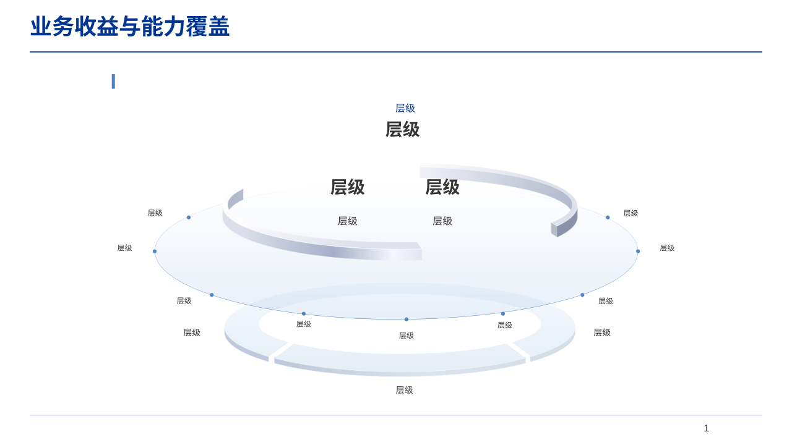

# 业务收益与能力覆盖

来源为立体结构逻辑图1122.pptx#27。

## 结构与适用场景

顶成果句与2指标；底单椭圆11检测节点；中空背景

量化收益与能力覆盖

源标题与检测内容不符，不能归类HEART框架；无真正5维度，周边节点非环形占比

固定节点、圆弧、扇区、分面和连接表达定性关系。数量比较、趋势或占比使用数据驱动图表，源页中已登记的微图槽可接收实际数据。

## 预览



## 调用

将下列完整page对象放入schema_version=1、template_id=business-blue-v1的pages数组，替换各节点内容。nodes键对应原文本框或已明确拆分的语义分段，字段角色及source_ref、segment见下表。

```json
{
  "id": "spatial-27",
  "family": "source-spatial",
  "variant": "page-27",
  "content": {
    "title": "业务收益与能力覆盖",
    "nodes": {
      "shape_29": "层级",
      "shape_30": "层级",
      "shape_32": "层级",
      "shape_33": "层级",
      "shape_35": "层级",
      "shape_36": "层级",
      "shape_37": "层级",
      "shape_38": "层级",
      "shape_39": "层级",
      "shape_40": "层级",
      "shape_41": "层级",
      "shape_42": "层级",
      "shape_43": "层级",
      "shape_44": "层级",
      "shape_45": "层级",
      "shape_46": "层级",
      "shape_47": "层级",
      "shape_48": "层级"
    }
  },
  "config": {
    "show_source": true,
    "show_page_number": true
  }
}
```

config支持show_source、show_page_number、image_fit与image_position。image_fit可选contain或cover，image_position为xMin/xMid/xMax与YMin/YMid/YMax组合的九个焦点，默认为xMidYMid。字体、颜色、全局区和固定字阶取自tokens，节点数与连接结构由variant确定。

## 字段合同

每个业务节点required=true、min=1，max按具体框体登记。字符按规范化后的Unicode码点计数，空格标点换行均计入。build会以实际字体测量宽高，字符数通过后仍可能需要调整文字。

| 字段 | 节点角色与源标签 | 最短/最长 | 字阶 | 框体px | 原框引用 | 分段 | 旋转° | 垂直锚点 |
|---|---|---|---|---|---|---|---|---|
| nodes.shape_29 | 上中节点，源标签“每次交付至少” | 1/25 | caption | [561.8813, 166.5111, 186.4119, 26.9991] | slide:29 |  | 0.0 | t |
| nodes.shape_30 | 上中节点，源标签“节省2小时重复工作” | 1/35 | heading | [425.3982, 194.5882, 450.9049, 51.2992] | slide:30 |  | 0.0 | t |
| nodes.shape_32 | 中中节点，源标签“外观检测” | 1/11 | caption | [522.2809, 349.1794, 79.2008, 26.9991] | slide:32 |  | 0.0 | t |
| nodes.shape_33 | 中中节点，源标签“21” | 1/4 | heading | [531.5647, 287.9947, 60.6415, 51.2992] | slide:33 |  | 0.0 | t |
| nodes.shape_35 | 中中节点，源标签“功能检测” | 1/11 | caption | [675.7189, 349.1794, 79.2008, 26.9991] | slide:35 |  | 0.0 | t |
| nodes.shape_36 | 中中节点，源标签“52” | 1/5 | heading | [677.6827, 287.9947, 75.265, 51.2992] | slide:36 |  | 0.0 | t |
| nodes.shape_37 | 下中节点，源标签“外观检测” | 1/11 | diagramCompact | [618.6455, 623.6999, 70.2011, 24.3001] | slide:37 |  | 0.0 | t |
| nodes.shape_38 | 下左节点，源标签“设备功能” | 1/11 | diagramCompact | [275.1689, 530.6862, 70.2011, 24.3001] | slide:38 |  | 0.0 | t |
| nodes.shape_39 | 下右节点，源标签“拆修浸液” | 1/11 | diagramCompact | [938.2064, 530.6862, 70.2011, 24.3001] | slide:39 |  | 0.0 | t |
| nodes.shape_40 | 中右节点，源标签“充电” | 1/7 | diagramMicro | [999.1655, 338.6755, 40.9541, 22.9547] | slide:40 |  | 0.0 | t |
| nodes.shape_41 | 中右节点，源标签“拆机测试” | 1/12 | diagramMicro | [1045.5178, 394.8632, 65.7054, 22.9547] | slide:41 |  | 0.0 | t |
| nodes.shape_42 | 下右节点，源标签“通话功能” | 1/12 | diagramMicro | [946.287, 480.7657, 65.7054, 22.9547] | slide:42 |  | 0.0 | t |
| nodes.shape_43 | 下中节点，源标签“生物识别” | 1/12 | diagramMicro | [783.2141, 519.8063, 65.7054, 22.9547] | slide:43 |  | 0.0 | t |
| nodes.shape_44 | 下中节点，源标签“电池次数” | 1/12 | diagramMicro | [624.052, 536.5523, 65.7054, 22.9547] | slide:44 |  | 0.0 | t |
| nodes.shape_45 | 下中节点，源标签“维修情况” | 1/12 | diagramMicro | [458.0963, 517.9345, 65.7054, 22.9547] | slide:45 |  | 0.0 | t |
| nodes.shape_46 | 下左节点，源标签“屏幕检测” | 1/12 | diagramMicro | [264.8823, 480.3061, 65.7054, 22.9547] | slide:46 |  | 0.0 | t |
| nodes.shape_47 | 中左节点，源标签“保修情况” | 1/12 | diagramMicro | [168.7768, 394.8632, 65.7054, 22.9547] | slide:47 |  | 0.0 | t |
| nodes.shape_48 | 中左节点，源标签“无线” | 1/7 | diagramMicro | [230.3208, 338.2577, 40.9541, 22.9547] | slide:48 |  | 0.0 | t |

## 保留的原装饰

本页保留用户原模板的结构图标或装饰图片，逐项身份见source-field-coverage.json中本页retained_source_images。其中图片内固化的字形随整图编辑，可在PowerPoint中原生替换整图；nodes字段控制已登记的可编辑文字。参数图片替换使用本页image_slots列出的槽位。


全局title必填、2至32码点，使用统一标题框。section_name可选0至24码点，source可选0至64码点。所有可编辑文本通过独立原生carrier导出，页码为派生文字。

## 来源处理

原生PPTX源件保存于用户材料目录，分发包仅含用户资产衍生的几何、字段和说明。原始逐框文字、源框与标准化框在page-catalog.json的variant.fields中。

源标题引用为`slide:49`，原文为“HEART模型的5个度量维度”。模板默认标题依据真实结构设置。

密集全景中的diagramCompact为14px、diagramMicro为12px。适用于体系概览或附录局部标签，现场关键结论用统一标题与正常正文字阶表达。

源画布边界裁切已烘焙为可编辑Bezier几何，3D顶面、侧面与前面通过tokens配色的相对明暗保留。

