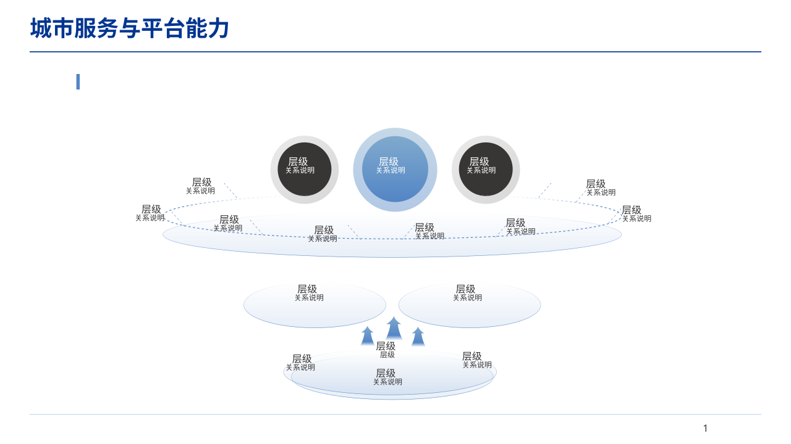

# 城市服务与平台能力

来源为立体结构逻辑图1122.pptx#28。

## 结构与适用场景

上民生/公共管理/城市治理3圆；中服务触点环；下业务/数据双中台；底云/大数据/移动/物联

城市服务能力平台

源标题HEART不符实际架构；需保留3服务域-触点-双中台-底座结构

固定节点、圆弧、扇区、分面和连接表达定性关系。数量比较、趋势或占比使用数据驱动图表，源页中已登记的微图槽可接收实际数据。

## 预览



## 调用

将下列完整page对象放入schema_version=1、template_id=business-blue-v1的pages数组，替换各节点内容。nodes键对应原文本框或已明确拆分的语义分段，字段角色及source_ref、segment见下表。

```json
{
  "id": "spatial-28",
  "family": "source-spatial",
  "variant": "page-28",
  "content": {
    "title": "城市服务与平台能力",
    "nodes": {
      "shape_26": "层级",
      "shape_27": "关系说明",
      "shape_28": "层级",
      "shape_29": "关系说明",
      "shape_30": "层级",
      "shape_31": "关系说明",
      "shape_32": "层级",
      "shape_33": "关系说明",
      "shape_34": "层级",
      "shape_35": "关系说明",
      "shape_37": "层级",
      "shape_38": "关系说明",
      "shape_39": "层级",
      "shape_40": "关系说明",
      "shape_41": "层级",
      "shape_42": "关系说明",
      "shape_43": "层级",
      "shape_44": "关系说明",
      "shape_45": "层级",
      "shape_46": "关系说明",
      "shape_47": "层级",
      "shape_48": "关系说明",
      "shape_49": "层级",
      "shape_50": "关系说明",
      "shape_51": "层级",
      "shape_52": "关系说明",
      "shape_53": "层级",
      "shape_54": "层级",
      "shape_55": "层级",
      "shape_56": "关系说明",
      "shape_57": "层级",
      "shape_58": "关系说明",
      "shape_59": "层级",
      "shape_60": "关系说明"
    }
  },
  "config": {
    "show_source": true,
    "show_page_number": true
  }
}
```

config支持show_source、show_page_number、image_fit与image_position。image_fit可选contain或cover，image_position为xMin/xMid/xMax与YMin/YMid/YMax组合的九个焦点，默认为xMidYMid。字体、颜色、全局区和固定字阶取自tokens，节点数与连接结构由variant确定。

## 字段合同

每个业务节点required=true、min=1，max按具体框体登记。字符按规范化后的Unicode码点计数，空格标点换行均计入。build会以实际字体测量宽高，字符数通过后仍可能需要调整文字。

| 字段 | 节点角色与源标签 | 最短/最长 | 字阶 | 框体px | 原框引用 | 分段 | 旋转° | 垂直锚点 |
|---|---|---|---|---|---|---|---|---|
| nodes.shape_26 | 上中节点，源标签“民生服务” | 1/13 | caption | [444.9185, 251.8146, 95.8944, 25.9841] | slide:26 |  | 0.0 | t |
| nodes.shape_27 | 上中节点，源标签“Smart Tourism” | 1/25 | diagramMicro | [423.1162, 268.3361, 139.5079, 25.1441] | slide:27 |  | 0.0 | t |
| nodes.shape_28 | 上中节点，源标签“公共管理” | 1/13 | caption | [591.5658, 251.8146, 95.8944, 25.9841] | slide:28 |  | 0.0 | t |
| nodes.shape_29 | 上中节点，源标签“Public Administration” | 1/25 | diagramMicro | [569.7635, 268.3361, 139.5079, 25.0548] | slide:29 |  | 0.0 | t |
| nodes.shape_30 | 上中节点，源标签“城市治理” | 1/13 | caption | [738.2042, 251.8146, 95.8944, 25.9841] | slide:30 |  | 0.0 | t |
| nodes.shape_31 | 上中节点，源标签“Urban.Governance” | 1/25 | diagramMicro | [716.4019, 268.3361, 139.5079, 25.1441] | slide:31 |  | 0.0 | t |
| nodes.shape_32 | 中右节点，源标签“智能交通” | 1/13 | caption | [948.3194, 287.8867, 95.8944, 25.9841] | slide:32 |  | 0.0 | t |
| nodes.shape_33 | 中右节点，源标签“Smart Transportation” | 1/38 | diagramMicro | [948.3194, 304.3993, 208.1137, 25.1441] | slide:33 |  | 0.0 | t |
| nodes.shape_34 | 中右节点，源标签“智能导航” | 1/13 | caption | [1006.1134, 330.2403, 95.8944, 25.9841] | slide:34 |  | 0.0 | t |
| nodes.shape_35 | 中右节点，源标签“Digital Policing ” | 1/25 | diagramMicro | [1006.1134, 346.7529, 139.5079, 25.1441] | slide:35 |  | 0.0 | t |
| nodes.shape_37 | 中中节点，源标签“智能安保” | 1/13 | caption | [818.4885, 351.0061, 95.8944, 25.9841] | slide:37 |  | 0.0 | t |
| nodes.shape_38 | 中中节点，源标签“Smart Security” | 1/25 | diagramMicro | [818.4885, 367.5276, 139.5079, 25.1441] | slide:38 |  | 0.0 | t |
| nodes.shape_39 | 中中节点，源标签“一网通办” | 1/13 | caption | [671.1442, 358.5119, 95.8944, 25.9841] | slide:39 |  | 0.0 | t |
| nodes.shape_40 | 中中节点，源标签“ Authenticatec d Once” | 1/28 | diagramMicro | [671.1442, 375.0244, 152.0621, 25.0548] | slide:40 |  | 0.0 | t |
| nodes.shape_41 | 中中节点，源标签“最多跑一次” | 1/13 | caption | [465.318, 362.8008, 95.8944, 25.9841] | slide:41 |  | 0.0 | t |
| nodes.shape_42 | 中中节点，源标签“Go Once at Most” | 1/25 | diagramMicro | [421.7134, 379.3223, 139.5079, 25.1441] | slide:42 |  | 0.0 | t |
| nodes.shape_43 | 中左节点，源标签“一事通办” | 1/13 | caption | [311.9334, 345.7164, 95.8944, 25.9841] | slide:43 |  | 0.0 | t |
| nodes.shape_44 | 中左节点，源标签“One-stop Services” | 1/25 | diagramMicro | [268.3288, 362.229, 139.5079, 25.1441] | slide:44 |  | 0.0 | t |
| nodes.shape_45 | 中左节点，源标签“智能导航” | 1/13 | caption | [185.8553, 329.043, 95.8944, 25.9841] | slide:45 |  | 0.0 | t |
| nodes.shape_46 | 中左节点，源标签“Smart Navigation” | 1/25 | diagramMicro | [142.2507, 345.5645, 139.5079, 25.1441] | slide:46 |  | 0.0 | t |
| nodes.shape_47 | 中左节点，源标签“智能旅游” | 1/13 | caption | [267.6497, 285.2776, 95.8944, 25.9841] | slide:47 |  | 0.0 | t |
| nodes.shape_48 | 中左节点，源标签“Smart Tourism” | 1/25 | diagramMicro | [224.0361, 301.7901, 139.5079, 25.1441] | slide:48 |  | 0.0 | t |
| nodes.shape_49 | 中中节点，源标签“业务中台” | 1/13 | caption | [459.6976, 458.4272, 95.8944, 25.9841] | slide:49 |  | 0.0 | t |
| nodes.shape_50 | 中中节点，源标签“Business Middle Office” | 1/31 | diagramMicro | [423.7327, 474.9397, 167.8241, 25.1441] | slide:50 |  | 0.0 | t |
| nodes.shape_51 | 中中节点，源标签“数据中台” | 1/13 | caption | [716.0177, 458.4272, 95.8944, 25.9841] | slide:51 |  | 0.0 | t |
| nodes.shape_52 | 中中节点，源标签“Data Middle Office ” | 1/25 | diagramMicro | [694.2154, 474.9397, 139.5079, 25.1441] | slide:52 |  | 0.0 | t |
| nodes.shape_53 | 下中节点，源标签“大数据” | 1/13 | caption | [586.8301, 550.9619, 95.8944, 25.9841] | slide:53 |  | 0.0 | t |
| nodes.shape_54 | 下中节点，源标签“Big Data” | 1/25 | diagramMicro | [565.0278, 567.4744, 139.5079, 25.1441] | slide:54 |  | 0.0 | t |
| nodes.shape_55 | 下中节点，源标签“云化基础设施” | 1/19 | caption | [565.0278, 594.9596, 139.5079, 25.9841] | slide:55 |  | 0.0 | t |
| nodes.shape_56 | 下中节点，源标签“Cloud-based infrastructure” | 1/40 | diagramMicro | [525.5334, 611.4722, 218.4877, 25.1441] | slide:56 |  | 0.0 | t |
| nodes.shape_57 | 下中节点，源标签“智联网” | 1/13 | caption | [429.639, 571.5043, 95.8944, 25.9841] | slide:57 |  | 0.0 | t |
| nodes.shape_58 | 下中节点，源标签“Internet of Intelligences” | 1/30 | diagramMicro | [360.4256, 588.0258, 165.1167, 25.0548] | slide:58 |  | 0.0 | t |
| nodes.shape_59 | 下中节点，源标签“移动协同” | 1/13 | caption | [747.8365, 567.4119, 95.8944, 25.9841] | slide:59 |  | 0.0 | t |
| nodes.shape_60 | 下中节点，源标签“Unparalleled Mobility ” | 1/25 | diagramMicro | [747.8365, 583.9245, 139.5079, 25.0548] | slide:60 |  | 0.0 | t |

全局title必填、2至32码点，使用统一标题框。section_name可选0至24码点，source可选0至64码点。所有可编辑文本通过独立原生carrier导出，页码为派生文字。

## 来源处理

原生PPTX源件保存于用户材料目录，分发包仅含用户资产衍生的几何、字段和说明。原始逐框文字、源框与标准化框在page-catalog.json的variant.fields中。

源标题引用为`slide:5`，原文为“HEART模型的5个度量维度”。模板默认标题依据真实结构设置。

密集全景中的diagramCompact为14px、diagramMicro为12px。适用于体系概览或附录局部标签，现场关键结论用统一标题与正常正文字阶表达。

源画布边界裁切已烘焙为可编辑Bezier几何，3D顶面、侧面与前面通过tokens配色的相对明暗保留。

