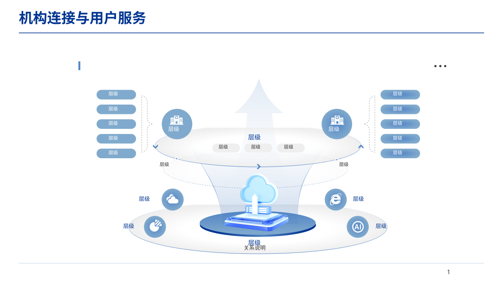

# 机构连接与用户服务

来源为立体结构逻辑图1122.pptx#29。

## 结构与适用场景

上机构/医疗2圈和两侧各5权益条；中用户权益匹配圆盘与上箭头；底4技术球体与平台圆盘

平台连接两类机构和用户服务

源圈和下部球体有明显层级；上下角色、左右服务清单独立

固定节点、圆弧、扇区、分面和连接表达定性关系。数量比较、趋势或占比使用数据驱动图表，源页中已登记的微图槽可接收实际数据。

## 预览



## 调用

将下列完整page对象放入schema_version=1、template_id=business-blue-v1的pages数组，替换各节点内容。nodes键对应原文本框或已明确拆分的语义分段，字段角色及source_ref、segment见下表。

```json
{
  "id": "spatial-29",
  "family": "source-spatial",
  "variant": "page-29",
  "content": {
    "title": "机构连接与用户服务",
    "nodes": {
      "shape_273": "层级",
      "shape_311": "层级",
      "shape_221": "层级",
      "shape_312": "层级",
      "shape_324": "层级",
      "shape_325": "层级",
      "shape_326": "层级",
      "shape_327": "层级",
      "shape_328": "层级",
      "shape_329": "层级",
      "shape_330": "层级",
      "shape_331": "层级",
      "shape_332": "层级",
      "shape_333": "层级",
      "shape_334": "层级",
      "shape_342": "层级",
      "shape_343": "层级",
      "shape_344": "层级",
      "shape_345": "层级",
      "shape_346": "层级",
      "shape_347": "层级",
      "shape_348": "层级",
      "shape_246": "层级",
      "shape_261": "关系说明"
    }
  },
  "config": {
    "show_source": true,
    "show_page_number": true
  }
}
```

config支持show_source、show_page_number、image_fit与image_position。image_fit可选contain或cover，image_position为xMin/xMid/xMax与YMin/YMid/YMax组合的九个焦点，默认为xMidYMid。字体、颜色、全局区和固定字阶取自tokens，节点数与连接结构由variant确定。

## 字段合同

每个业务节点required=true、min=1，max按具体框体登记。字符按规范化后的Unicode码点计数，空格标点换行均计入。build会以实际字体测量宽高，字符数通过后仍可能需要调整文字。

| 字段 | 节点角色与源标签 | 最短/最长 | 字阶 | 框体px | 原框引用 | 分段 | 旋转° | 垂直锚点 |
|---|---|---|---|---|---|---|---|---|
| nodes.shape_273 | 中中节点，源标签“以人为中心跨界共享” | 1/90 | caption | [492.6485, 323.0051, 330.401, 54.0487] | slide:273 |  | 0.0 | ctr |
| nodes.shape_311 | 下左节点，源标签“大数据” | 1/10 | diagramCompact | [302.7135, 568.733, 67.8675, 23.1614] | slide:311 |  | 0.0 | t |
| nodes.shape_221 | 中左节点，源标签“用户标签” | 1/12 | diagramMicro | [392.8663, 411.8995, 66.4418, 21.234] | slide:221 |  | 0.0 | t |
| nodes.shape_312 | 中右节点，源标签“权益匹配” | 1/12 | diagramMicro | [849.6278, 411.8995, 66.4418, 21.234] | slide:312 |  | 0.0 | t |
| nodes.shape_324 | 下左节点，源标签“云计算” | 1/10 | diagramCompact | [342.5531, 499.2965, 67.8675, 23.934] | slide:324 |  | 0.0 | t |
| nodes.shape_325 | 下右节点，源标签“AI智能” | 1/10 | diagramCompact | [944.9895, 568.733, 67.8675, 23.1614] | slide:325 |  | 0.0 | t |
| nodes.shape_326 | 下右节点，源标签“移动互联” | 1/10 | diagramCompact | [887.2611, 499.2965, 67.8675, 23.934] | slide:326 |  | 0.0 | t |
| nodes.shape_327 | 中中节点，源标签“权益匹配” | 1/12 | diagramMicro | [542.8104, 367.1855, 66.4418, 21.234] | slide:327 |  | 0.0 | t |
| nodes.shape_328 | 中中节点，源标签“权益匹配” | 1/12 | diagramMicro | [625.4684, 367.1855, 66.4418, 21.234] | slide:328 |  | 0.0 | t |
| nodes.shape_329 | 中中节点，源标签“权益匹配” | 1/12 | diagramMicro | [709.106, 367.1855, 66.4418, 21.234] | slide:329 |  | 0.0 | t |
| nodes.shape_330 | 上左节点，源标签“权益匹配” | 1/12 | diagramMicro | [262.7306, 231.3151, 66.4418, 21.234] | slide:330 |  | 0.0 | t |
| nodes.shape_331 | 上左节点，源标签“权益匹配” | 1/12 | diagramMicro | [262.7306, 269.944, 66.4418, 21.234] | slide:331 |  | 0.0 | t |
| nodes.shape_332 | 中左节点，源标签“权益匹配” | 1/12 | diagramMicro | [262.7306, 306.6376, 66.4418, 21.234] | slide:332 |  | 0.0 | t |
| nodes.shape_333 | 中左节点，源标签“权益匹配” | 1/12 | diagramMicro | [262.7306, 344.486, 66.4418, 21.234] | slide:333 |  | 0.0 | t |
| nodes.shape_334 | 中左节点，源标签“权益匹配” | 1/12 | diagramMicro | [262.7306, 381.8167, 66.4418, 21.234] | slide:334 |  | 0.0 | t |
| nodes.shape_342 | 上右节点，源标签“权益匹配” | 1/12 | diagramMicro | [986.4221, 231.3151, 66.4418, 21.234] | slide:342 |  | 0.0 | t |
| nodes.shape_343 | 上右节点，源标签“权益匹配” | 1/12 | diagramMicro | [986.4221, 269.944, 66.4418, 21.234] | slide:343 |  | 0.0 | t |
| nodes.shape_344 | 中右节点，源标签“权益匹配” | 1/12 | diagramMicro | [986.4221, 306.6376, 66.4418, 21.234] | slide:344 |  | 0.0 | t |
| nodes.shape_345 | 中右节点，源标签“权益匹配” | 1/12 | diagramMicro | [986.4221, 344.486, 66.4418, 21.234] | slide:345 |  | 0.0 | t |
| nodes.shape_346 | 中右节点，源标签“权益匹配” | 1/12 | diagramMicro | [986.4221, 381.8167, 66.4418, 21.234] | slide:346 |  | 0.0 | t |
| nodes.shape_347 | 中中节点，源标签“机构合作” | 1/19 | diagramCompact | [388.9317, 320.9582, 124.5604, 23.1614] | slide:347 |  | 0.0 | t |
| nodes.shape_348 | 中中节点，源标签“医疗机构” | 1/19 | diagramCompact | [796.6305, 320.9582, 124.5604, 23.1614] | slide:348 |  | 0.0 | t |
| nodes.shape_246 | 下中节点，源标签“跨界惠民服务平台” | 1/90 | caption | [492.6485, 592.2847, 330.401, 54.0487] | slide:246 |  | 0.0 | ctr |
| nodes.shape_261 | 下中节点，源标签“Service Platform” | 1/34 | diagramCompact | [547.868, 624.3029, 218.385, 23.1614] | slide:261 |  | 0.0 | t |

## 保留的原装饰

本页保留用户原模板的结构图标或装饰图片，逐项身份见source-field-coverage.json中本页retained_source_images。其中图片内固化的字形随整图编辑，可在PowerPoint中原生替换整图；nodes字段控制已登记的可编辑文字。参数图片替换使用本页image_slots列出的槽位。


全局title必填、2至32码点，使用统一标题框。section_name可选0至24码点，source可选0至64码点。所有可编辑文本通过独立原生carrier导出，页码为派生文字。

## 来源处理

原生PPTX源件保存于用户材料目录，分发包仅含用户资产衍生的几何、字段和说明。原始逐框文字、源框与标准化框在page-catalog.json的variant.fields中。

源标题引用为`slide:30`，原文为“系统介绍”。模板默认标题依据真实结构设置。

密集全景中的diagramCompact为14px、diagramMicro为12px。适用于体系概览或附录局部标签，现场关键结论用统一标题与正常正文字阶表达。

源画布边界裁切已烘焙为可编辑Bezier几何，3D顶面、侧面与前面通过tokens配色的相对明暗保留。

