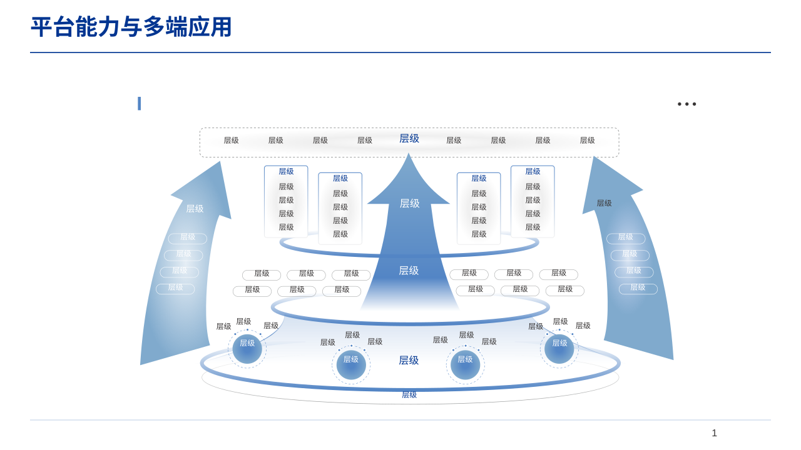

# 平台能力与多端应用

来源为立体结构逻辑图1122.pptx#30。

## 结构与适用场景

底平台层4球体/环；能力层多共性模块；应用层4列应用；顶多端入口；左右PaaS/运营立式上箭头；中总上箭头

平台能力到应用与多端触达

保留两侧贯穿支撑和内部多层模块，原生几何重建应核对箭头与椭圆截面

固定节点、圆弧、扇区、分面和连接表达定性关系。数量比较、趋势或占比使用数据驱动图表，源页中已登记的微图槽可接收实际数据。

## 预览



## 调用

将下列完整page对象放入schema_version=1、template_id=business-blue-v1的pages数组，替换各节点内容。nodes键对应原文本框或已明确拆分的语义分段，字段角色及source_ref、segment见下表。

```json
{
  "id": "spatial-30",
  "family": "source-spatial",
  "variant": "page-30",
  "content": {
    "title": "平台能力与多端应用",
    "nodes": {
      "shape_452": "层级",
      "shape_459": "层级",
      "shape_460": "层级",
      "shape_36": "层级",
      "shape_39": "层级",
      "shape_40": "层级",
      "shape_213": "层级",
      "shape_216": "层级",
      "shape_217": "层级",
      "shape_484": "层级",
      "shape_487": "层级",
      "shape_488": "层级",
      "shape_495": "层级",
      "shape_496": "层级",
      "shape_497": "层级",
      "shape_498": "层级",
      "shape_502": "层级",
      "shape_506": "层级",
      "shape_509": "层级",
      "shape_512": "层级",
      "shape_515": "层级",
      "shape_518": "层级",
      "shape_521": "层级",
      "shape_524": "层级",
      "shape_527": "层级",
      "shape_530": "层级",
      "shape_533": "层级",
      "shape_536": "层级",
      "shape_500": "层级",
      "shape_539": "层级",
      "shape_549": "层级",
      "shape_550": "层级",
      "shape_552": "层级",
      "shape_553": "层级",
      "shape_554": "层级",
      "shape_566": "层级",
      "shape_567": "层级",
      "shape_568": "层级",
      "shape_569": "层级",
      "shape_570": "层级",
      "shape_575": "层级",
      "shape_576": "层级",
      "shape_577": "层级",
      "shape_578": "层级",
      "shape_579": "层级",
      "shape_584": "层级",
      "shape_585": "层级",
      "shape_586": "层级",
      "shape_587": "层级",
      "shape_588": "层级",
      "shape_593": "层级",
      "shape_594": "层级",
      "shape_596": "层级",
      "shape_597": "层级",
      "shape_598": "层级",
      "shape_599": "层级",
      "shape_600": "层级",
      "shape_601": "层级",
      "shape_602": "层级",
      "shape_604": "层级",
      "shape_606": "层级",
      "shape_608": "层级",
      "shape_613": "层级",
      "shape_616": "层级",
      "shape_620": "层级",
      "shape_631": "层级",
      "shape_629": "层级",
      "shape_627": "层级",
      "shape_625": "层级",
      "shape_633": "层级",
      "shape_635": "层级"
    }
  },
  "config": {
    "show_source": true,
    "show_page_number": true
  }
}
```

config支持show_source、show_page_number、image_fit与image_position。image_fit可选contain或cover，image_position为xMin/xMid/xMax与YMin/YMid/YMax组合的九个焦点，默认为xMidYMid。字体、颜色、全局区和固定字阶取自tokens，节点数与连接结构由variant确定。

## 字段合同

每个业务节点required=true、min=1，max按具体框体登记。字符按规范化后的Unicode码点计数，空格标点换行均计入。build会以实际字体测量宽高，字符数通过后仍可能需要调整文字。

| 字段 | 节点角色与源标签 | 最短/最长 | 字阶 | 框体px | 原框引用 | 分段 | 旋转° | 垂直锚点 |
|---|---|---|---|---|---|---|---|---|
| nodes.shape_452 | 下左节点，源标签“权限管理” | 1/9 | diagramMicro | [406.9533, 514.657, 52.5435, 19.9628] | slide:452 |  | 0.0 | t |
| nodes.shape_459 | 下左节点，源标签“角色管理” | 1/9 | diagramMicro | [363.1885, 508.0255, 52.5435, 19.9628] | slide:459 |  | 0.0 | t |
| nodes.shape_460 | 下左节点，源标签“组织架构” | 1/9 | diagramMicro | [331.4196, 515.9165, 52.5435, 19.9628] | slide:460 |  | 0.0 | t |
| nodes.shape_36 | 下中节点，源标签“LAM” | 1/9 | diagramMicro | [573.1654, 540.2193, 52.5435, 19.9628] | slide:36 |  | 0.0 | t |
| nodes.shape_39 | 下中节点，源标签“移动基座” | 1/9 | diagramMicro | [536.9881, 529.5437, 52.5435, 19.9628] | slide:39 |  | 0.0 | t |
| nodes.shape_40 | 下中节点，源标签“小程序容器” | 1/13 | diagramMicro | [488.3977, 541.4789, 71.0267, 19.9628] | slide:40 |  | 0.0 | t |
| nodes.shape_213 | 下中节点，源标签“文档管理” | 1/9 | diagramMicro | [755.5465, 540.2193, 52.5435, 19.9628] | slide:213 |  | 0.0 | t |
| nodes.shape_216 | 下中节点，源标签“服务管理” | 1/9 | diagramMicro | [719.3692, 529.5437, 52.5435, 19.9628] | slide:216 |  | 0.0 | t |
| nodes.shape_217 | 下中节点，源标签“开发者 / 管理” | 1/18 | diagramMicro | [677.6151, 537.541, 52.5435, 32.9222] | slide:217 |  | 0.0 | t |
| nodes.shape_484 | 下右节点，源标签“订单管理” | 1/9 | diagramMicro | [905.5896, 514.657, 52.5435, 19.9628] | slide:484 |  | 0.0 | t |
| nodes.shape_487 | 下右节点，源标签“统一认证” | 1/9 | diagramMicro | [869.4123, 508.0255, 52.5435, 19.9628] | slide:487 |  | 0.0 | t |
| nodes.shape_488 | 下中节点，源标签“库存管理” | 1/9 | diagramMicro | [830.0635, 515.9165, 52.5435, 19.9628] | slide:488 |  | 0.0 | t |
| nodes.shape_495 | 下左节点，源标签“基础 / 服务平台” | 1/18 | diagramMicro | [369.0233, 542.5715, 52.5435, 32.9222] | slide:495 |  | 0.0 | t |
| nodes.shape_496 | 下中节点，源标签“移动应用平台” | 1/18 | diagramMicro | [534.6739, 568.6194, 52.5435, 32.9222] | slide:496 |  | 0.0 | t |
| nodes.shape_497 | 下中节点，源标签“开放 / 平台” | 1/18 | diagramMicro | [717.1688, 568.6194, 52.5435, 32.9222] | slide:497 |  | 0.0 | t |
| nodes.shape_498 | 下右节点，源标签“业务 / 中台” | 1/18 | diagramMicro | [868.517, 542.5715, 52.5435, 32.9222] | slide:498 |  | 0.0 | t |
| nodes.shape_502 | 中中节点，源标签“统一待办” | 1/9 | diagramMicro | [535.4706, 430.944, 52.5435, 19.9628] | slide:502 |  | 0.0 | t |
| nodes.shape_506 | 中中节点，源标签“统一通知” | 1/9 | diagramMicro | [463.7155, 430.944, 52.5435, 19.9628] | slide:506 |  | 0.0 | t |
| nodes.shape_509 | 中左节点，源标签“统一IM” | 1/9 | diagramMicro | [392.317, 430.944, 52.5435, 19.9628] | slide:509 |  | 0.0 | t |
| nodes.shape_512 | 中中节点，源标签“视频能力” | 1/9 | diagramMicro | [520.3639, 456.7339, 52.5435, 19.9628] | slide:512 |  | 0.0 | t |
| nodes.shape_515 | 中中节点，源标签“文档能力” | 1/9 | diagramMicro | [448.6087, 456.7339, 52.5435, 19.9628] | slide:515 |  | 0.0 | t |
| nodes.shape_518 | 中左节点，源标签“电子签名” | 1/9 | diagramMicro | [377.2102, 456.7339, 52.5435, 19.9628] | slide:518 |  | 0.0 | t |
| nodes.shape_521 | 中右节点，源标签“流程能力” | 1/9 | diagramMicro | [866.9691, 430.1245, 52.5435, 19.9628] | slide:521 |  | 0.0 | t |
| nodes.shape_524 | 中中节点，源标签“表单能力” | 1/9 | diagramMicro | [795.2216, 430.1245, 52.5435, 19.9628] | slide:524 |  | 0.0 | t |
| nodes.shape_527 | 中中节点，源标签“统一登录” | 1/9 | diagramMicro | [723.8231, 430.1245, 52.5435, 19.9628] | slide:527 |  | 0.0 | t |
| nodes.shape_530 | 中右节点，源标签“语音能力” | 1/9 | diagramMicro | [877.0605, 455.9145, 52.5435, 19.9628] | slide:530 |  | 0.0 | t |
| nodes.shape_533 | 中中节点，源标签“人脸识别” | 1/9 | diagramMicro | [805.3054, 455.9145, 52.5435, 19.9628] | slide:533 |  | 0.0 | t |
| nodes.shape_536 | 中中节点，源标签“AI能力” | 1/9 | diagramMicro | [733.9145, 455.9145, 52.5435, 19.9628] | slide:536 |  | 0.0 | t |
| nodes.shape_500 | 中中节点，源标签“能力层” | 1/8 | caption | [621.1564, 424.4946, 64.6305, 29.7734] | slide:500 |  | 0.0 | t |
| nodes.shape_539 | 中中节点，源标签“应用层” | 1/9 | caption | [619.6237, 317.0629, 70.5715, 29.7734] | slide:539 |  | 0.0 | t |
| nodes.shape_549 | 上中节点，源标签“应用集成” | 1/12 | diagramMicro | [817.4151, 267.8427, 68.5608, 22.0645] | slide:549 |  | 0.0 | t |
| nodes.shape_550 | 中中节点，源标签“智慧食堂” | 1/12 | diagramMicro | [817.4151, 292.3125, 68.5608, 19.9628] | slide:550 |  | 0.0 | t |
| nodes.shape_552 | 中中节点，源标签“应急平台” | 1/12 | diagramMicro | [817.4151, 335.5537, 68.5608, 19.9628] | slide:552 |  | 0.0 | t |
| nodes.shape_553 | 中中节点，源标签“培训管理” | 1/12 | diagramMicro | [817.4151, 357.1705, 68.5608, 19.9628] | slide:553 |  | 0.0 | t |
| nodes.shape_554 | 中中节点，源标签“合同管理” | 1/12 | diagramMicro | [817.4151, 313.9293, 68.5608, 19.9628] | slide:554 |  | 0.0 | t |
| nodes.shape_566 | 上中节点，源标签“职能应用” | 1/12 | diagramMicro | [731.3196, 278.9281, 68.5608, 22.0645] | slide:566 |  | 0.0 | t |
| nodes.shape_567 | 中中节点，源标签“报销管理” | 1/12 | diagramMicro | [731.3196, 303.3978, 68.5608, 19.9628] | slide:567 |  | 0.0 | t |
| nodes.shape_568 | 中中节点，源标签“绩效管理” | 1/12 | diagramMicro | [731.3196, 346.6391, 68.5608, 19.9628] | slide:568 |  | 0.0 | t |
| nodes.shape_569 | 中中节点，源标签“考勤管理” | 1/12 | diagramMicro | [731.3196, 368.2635, 68.5608, 19.9628] | slide:569 |  | 0.0 | t |
| nodes.shape_570 | 中中节点，源标签“假期管理” | 1/12 | diagramMicro | [731.3196, 325.0222, 68.5608, 19.9628] | slide:570 |  | 0.0 | t |
| nodes.shape_575 | 上中节点，源标签“基础应用” | 1/12 | diagramMicro | [509.8324, 278.9281, 68.5608, 22.0645] | slide:575 |  | 0.0 | t |
| nodes.shape_576 | 中中节点，源标签“消息” | 1/12 | diagramMicro | [509.8324, 303.3978, 68.5608, 19.9628] | slide:576 |  | 0.0 | t |
| nodes.shape_577 | 中中节点，源标签“任务管理” | 1/12 | diagramMicro | [509.8324, 346.6391, 68.5608, 19.9628] | slide:577 |  | 0.0 | t |
| nodes.shape_578 | 中中节点，源标签“投票助手” | 1/12 | diagramMicro | [509.8324, 368.2635, 68.5608, 19.9628] | slide:578 |  | 0.0 | t |
| nodes.shape_579 | 中中节点，源标签“问卷调查” | 1/12 | diagramMicro | [509.8324, 325.0222, 68.5608, 19.9628] | slide:579 |  | 0.0 | t |
| nodes.shape_584 | 上中节点，源标签“核心应用” | 1/12 | diagramMicro | [423.3347, 267.8427, 68.5608, 22.0645] | slide:584 |  | 0.0 | t |
| nodes.shape_585 | 中中节点，源标签“公文管理” | 1/12 | diagramMicro | [423.3347, 292.3125, 68.5608, 19.9628] | slide:585 |  | 0.0 | t |
| nodes.shape_586 | 中中节点，源标签“党建管理” | 1/12 | diagramMicro | [423.3347, 335.5537, 68.5608, 19.9628] | slide:586 |  | 0.0 | t |
| nodes.shape_587 | 中中节点，源标签“新闻管理” | 1/12 | diagramMicro | [423.3347, 357.1705, 68.5608, 19.9628] | slide:587 |  | 0.0 | t |
| nodes.shape_588 | 中中节点，源标签“会议管理” | 1/12 | diagramMicro | [423.3347, 313.9293, 68.5608, 19.9628] | slide:588 |  | 0.0 | t |
| nodes.shape_593 | 上左节点，源标签“APP” | 1/12 | diagramMicro | [335.441, 218.2583, 68.5608, 19.9628] | slide:593 |  | 0.0 | t |
| nodes.shape_594 | 上中节点，源标签“表现层” | 1/9 | caption | [619.9879, 213.0533, 68.5608, 29.7734] | slide:594 |  | 0.0 | t |
| nodes.shape_596 | 上中节点，源标签“WEB” | 1/12 | diagramMicro | [406.5815, 218.2583, 68.5608, 19.9628] | slide:596 |  | 0.0 | t |
| nodes.shape_597 | 上中节点，源标签“PC” | 1/12 | diagramMicro | [477.7145, 218.2583, 68.5608, 19.9628] | slide:597 |  | 0.0 | t |
| nodes.shape_598 | 上中节点，源标签“PAD” | 1/12 | diagramMicro | [548.8474, 218.2583, 68.5608, 19.9628] | slide:598 |  | 0.0 | t |
| nodes.shape_599 | 上中节点，源标签“领导门户” | 1/12 | diagramMicro | [691.1209, 218.2583, 68.5608, 19.9628] | slide:599 |  | 0.0 | t |
| nodes.shape_600 | 上中节点，源标签“新闻门户” | 1/12 | diagramMicro | [762.2614, 218.2583, 68.5608, 19.9628] | slide:600 |  | 0.0 | t |
| nodes.shape_601 | 上中节点，源标签“工作门户” | 1/12 | diagramMicro | [833.3944, 218.2583, 68.5608, 19.9628] | slide:601 |  | 0.0 | t |
| nodes.shape_602 | 上右节点，源标签“驾驶舱门户” | 1/12 | diagramMicro | [904.5273, 218.2583, 68.5608, 19.9628] | slide:602 |  | 0.0 | t |
| nodes.shape_604 | 中左节点，源标签“PASS / 平台” | 1/22 | diagramCompact | [276.2887, 326.5701, 70.5715, 41.6782] | slide:604 |  | 0.0 | t |
| nodes.shape_606 | 中左节点，源标签“能力开放” | 1/9 | diagramMicro | [274.0276, 372.5201, 52.5435, 19.9628] | slide:606 |  | 0.0 | t |
| nodes.shape_608 | 中左节点，源标签“开发服务” | 1/9 | diagramMicro | [267.4872, 399.4027, 52.5435, 19.9628] | slide:608 |  | 0.0 | t |
| nodes.shape_613 | 中左节点，源标签“API管理” | 1/9 | diagramMicro | [260.9467, 426.2776, 52.5435, 19.9628] | slide:613 |  | 0.0 | t |
| nodes.shape_616 | 中左节点，源标签“文档说明” | 1/9 | diagramMicro | [254.4063, 453.1602, 52.5435, 19.9628] | slide:616 |  | 0.0 | t |
| nodes.shape_620 | 中右节点，源标签“运营 / 管理” | 1/39 | diagramMicro | [953.8083, 318.7094, 70.5715, 47.1185] | slide:620 |  | 0.0 | t |
| nodes.shape_631 | 中右节点，源标签“维护管理” | 1/9 | diagramMicro | [973.5737, 372.5201, 52.5435, 19.9628] | slide:631 |  | 0.0 | t |
| nodes.shape_629 | 中右节点，源标签“审批管理” | 1/9 | diagramMicro | [980.1142, 399.4027, 52.5435, 19.9628] | slide:629 |  | 0.0 | t |
| nodes.shape_627 | 中右节点，源标签“培训机制” | 1/9 | diagramMicro | [986.6546, 426.2776, 52.5435, 19.9628] | slide:627 |  | 0.0 | t |
| nodes.shape_625 | 中右节点，源标签“责任机制” | 1/9 | diagramMicro | [993.1951, 453.1602, 52.5435, 19.9628] | slide:625 |  | 0.0 | t |
| nodes.shape_633 | 下中节点，源标签“云服务基础设施” | 1/28 | diagramMicro | [577.2247, 625.2375, 154.0873, 22.7625] | slide:633 |  | 0.0 | t |
| nodes.shape_635 | 下中节点，源标签“平台层” | 1/8 | caption | [621.1564, 568.1035, 64.6305, 29.7734] | slide:635 |  | 0.0 | t |

## 保留的原装饰

本页保留用户原模板的结构图标或装饰图片，逐项身份见source-field-coverage.json中本页retained_source_images。其中图片内固化的字形随整图编辑，可在PowerPoint中原生替换整图；nodes字段控制已登记的可编辑文字。参数图片替换使用本页image_slots列出的槽位。


全局title必填、2至32码点，使用统一标题框。section_name可选0至24码点，source可选0至64码点。所有可编辑文本通过独立原生carrier导出，页码为派生文字。

## 来源处理

原生PPTX源件保存于用户材料目录，分发包仅含用户资产衍生的几何、字段和说明。原始逐框文字、源框与标准化框在page-catalog.json的variant.fields中。

源标题引用为`slide:166`，原文为“系统介绍”。模板默认标题依据真实结构设置。

密集全景中的diagramCompact为14px、diagramMicro为12px。适用于体系概览或附录局部标签，现场关键结论用统一标题与正常正文字阶表达。

源画布边界裁切已烘焙为可编辑Bezier几何，3D顶面、侧面与前面通过tokens配色的相对明暗保留。

