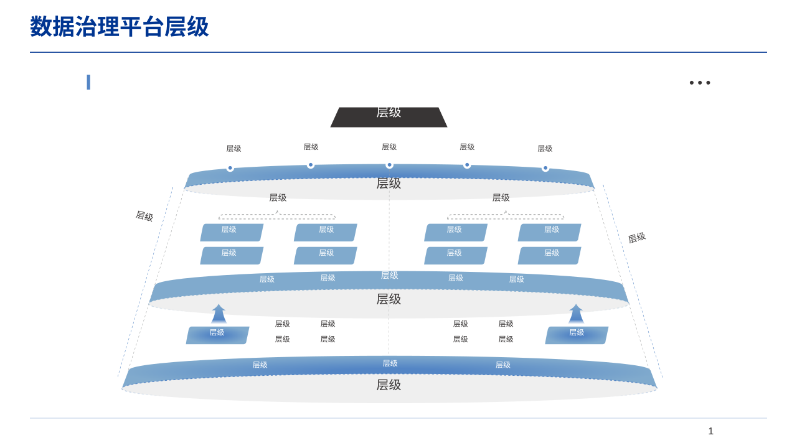

# 数据治理平台层级

来源为立体结构逻辑图1122.pptx#31。

## 结构与适用场景

立体梯形3层平台，源/总线/应用；中层多系统与上箭头，上层标准和资产2组模块；左右生命周期/安全

数据治理平台层级

保留梯形透视、模块嵌套、侧贯穿能力、内部/外部数据输入，不能用3矩形替代

固定节点、圆弧、扇区、分面和连接表达定性关系。数量比较、趋势或占比使用数据驱动图表，源页中已登记的微图槽可接收实际数据。

## 预览



## 调用

将下列完整page对象放入schema_version=1、template_id=business-blue-v1的pages数组，替换各节点内容。nodes键对应原文本框或已明确拆分的语义分段，字段角色及source_ref、segment见下表。

```json
{
  "id": "spatial-31",
  "family": "source-spatial",
  "variant": "page-31",
  "content": {
    "title": "数据治理平台层级",
    "nodes": {
      "shape_46": "层级",
      "shape_47": "层级",
      "shape_48": "层级",
      "shape_203": "层级",
      "shape_204": "层级",
      "shape_483": "层级",
      "shape_484": "层级",
      "shape_515": "层级",
      "shape_516": "层级",
      "shape_517": "层级",
      "shape_518": "层级",
      "shape_519": "层级",
      "shape_520": "层级",
      "shape_521": "层级",
      "shape_522": "层级",
      "shape_523": "层级",
      "shape_524": "层级",
      "shape_525": "层级",
      "shape_526": "层级",
      "shape_527": "层级",
      "shape_528": "层级",
      "shape_534": "层级",
      "shape_535": "层级",
      "shape_536": "层级",
      "shape_537": "层级",
      "shape_538": "层级",
      "shape_539": "层级",
      "shape_540": "层级",
      "shape_546": "层级",
      "shape_547": "层级",
      "shape_548": "层级",
      "shape_549": "层级",
      "shape_550": "层级",
      "shape_551": "层级",
      "shape_552": "层级",
      "shape_553": "层级",
      "shape_569": "层级",
      "shape_570": "层级",
      "shape_573": "层级"
    }
  },
  "config": {
    "show_source": true,
    "show_page_number": true
  }
}
```

config支持show_source、show_page_number、image_fit与image_position。image_fit可选contain或cover，image_position为xMin/xMid/xMax与YMin/YMid/YMax组合的九个焦点，默认为xMidYMid。字体、颜色、全局区和固定字阶取自tokens，节点数与连接结构由variant确定。

## 字段合同

每个业务节点required=true、min=1，max按具体框体登记。字符按规范化后的Unicode码点计数，空格标点换行均计入。build会以实际字体测量宽高，字符数通过后仍可能需要调整文字。

| 字段 | 节点角色与源标签 | 最短/最长 | 字阶 | 框体px | 原框引用 | 分段 | 旋转° | 垂直锚点 |
|---|---|---|---|---|---|---|---|---|
| nodes.shape_46 | 中中节点，源标签“数据应用” | 1/13 | compactBody | [562.6617, 284.1363, 123.7685, 34.2373] | slide:46 |  | 0.0 | t |
| nodes.shape_47 | 中中节点，源标签“数据总线” | 1/13 | compactBody | [562.6617, 470.1637, 123.7685, 34.2373] | slide:47 |  | 0.0 | t |
| nodes.shape_48 | 下中节点，源标签“数据源” | 1/13 | compactBody | [562.6617, 607.9813, 123.7685, 34.2373] | slide:48 |  | 0.0 | t |
| nodes.shape_203 | 中中节点，源标签“数据标准” | 1/19 | diagramCompact | [384.6381, 310.3273, 123.7685, 27.7406] | slide:203 |  | 0.0 | t |
| nodes.shape_204 | 中中节点，源标签“数据资产管理” | 1/19 | diagramCompact | [742.9247, 310.3273, 123.7685, 27.7406] | slide:204 |  | 0.0 | t |
| nodes.shape_483 | 中左节点，源标签“数据圈生命周期管理” | 1/55 | diagramCompact | [192.94, 337.4974, 35.9913, 192.3963] | slide:483 |  | 14.0574 | t |
| nodes.shape_484 | 中右节点，源标签“数据安全” | 1/30 | diagramCompact | [1012.2857, 373.3342, 40.9298, 89.2247] | slide:484 |  | -15.4569 | t |
| nodes.shape_515 | 下中节点，源标签“OA系统” | 1/13 | diagramMicro | [416.8744, 514.0395, 73.7451, 22.0103] | slide:515 |  | 0.0 | t |
| nodes.shape_516 | 下中节点，源标签“PLM系统” | 1/13 | diagramMicro | [489.8277, 514.0395, 73.7451, 22.0103] | slide:516 |  | 0.0 | t |
| nodes.shape_517 | 下中节点，源标签“ERP系统” | 1/13 | diagramMicro | [416.8744, 538.8171, 73.7451, 22.0103] | slide:517 |  | 0.0 | t |
| nodes.shape_518 | 下中节点，源标签“其他系统” | 1/13 | diagramMicro | [489.8277, 538.8171, 73.7451, 22.0103] | slide:518 |  | 0.0 | t |
| nodes.shape_519 | 下中节点，源标签“社交媒体” | 1/13 | diagramMicro | [702.8975, 514.0395, 73.7451, 22.0103] | slide:519 |  | 0.0 | t |
| nodes.shape_520 | 下中节点，源标签“互联网” | 1/13 | diagramMicro | [775.8508, 514.0395, 73.7451, 22.0103] | slide:520 |  | 0.0 | t |
| nodes.shape_521 | 下中节点，源标签“其他企业应用” | 1/17 | diagramMicro | [692.1435, 538.8171, 95.253, 22.0103] | slide:521 |  | 0.0 | t |
| nodes.shape_522 | 下中节点，源标签“政府数据” | 1/13 | diagramMicro | [775.8508, 538.8171, 73.7451, 22.0103] | slide:522 |  | 0.0 | t |
| nodes.shape_523 | 上中节点，源标签“数据管理平台” | 1/17 | compactBody | [546.9267, 169.4614, 155.23, 34.2373] | slide:523 |  | 0.0 | t |
| nodes.shape_524 | 上左节点，源标签“基础数据统一” | 1/20 | diagramMicro | [319.2203, 232.41, 112.725, 22.0103] | slide:524 |  | 0.0 | t |
| nodes.shape_525 | 上中节点，源标签“运营决策系统” | 1/17 | diagramMicro | [451.9717, 229.7023, 95.3893, 22.0103] | slide:525 |  | 0.0 | t |
| nodes.shape_526 | 上中节点，源标签“缩减管理成本” | 1/17 | diagramMicro | [577.5708, 229.7023, 95.3893, 22.0103] | slide:526 |  | 0.0 | t |
| nodes.shape_527 | 上中节点，源标签“提升数据价值” | 1/17 | diagramMicro | [702.6676, 229.7023, 95.3893, 22.0103] | slide:527 |  | 0.0 | t |
| nodes.shape_528 | 上中节点，源标签“降低数据风险” | 1/17 | diagramMicro | [827.7559, 232.41, 95.3893, 22.0103] | slide:528 |  | 0.0 | t |
| nodes.shape_534 | 中中节点，源标签“元数据” | 1/19 | diagramCompact | [563.956, 435.0068, 123.7685, 27.7406] | slide:534 |  | 0.0 | t |
| nodes.shape_535 | 中中节点，源标签“OA系统” | 1/13 | diagramMicro | [489.8277, 440.2433, 73.7451, 22.0103] | slide:535 |  | 0.0 | t |
| nodes.shape_536 | 中左节点，源标签“ERP系统” | 1/13 | diagramMicro | [392.1139, 442.5082, 73.7451, 22.0103] | slide:536 |  | 0.0 | t |
| nodes.shape_537 | 中中节点，源标签“PLM系统” | 1/13 | diagramMicro | [792.9566, 442.5082, 73.7451, 22.0103] | slide:537 |  | 0.0 | t |
| nodes.shape_538 | 中中节点，源标签“精益营销系统” | 1/18 | diagramMicro | [682.8882, 440.2433, 98.429, 22.0103] | slide:538 |  | 0.0 | t |
| nodes.shape_539 | 下左节点，源标签“内部数据” | 1/13 | diagramMicro | [311.6423, 527.9269, 73.7451, 22.0103] | slide:539 |  | 0.0 | t |
| nodes.shape_540 | 下右节点，源标签“外部数据” | 1/13 | diagramMicro | [889.5379, 527.9269, 73.7451, 22.0103] | slide:540 |  | 0.0 | t |
| nodes.shape_546 | 中左节点，源标签“数据标准定义” | 1/19 | diagramMicro | [314.0604, 362.3516, 107.2842, 22.0103] | slide:546 |  | 0.0 | t |
| nodes.shape_547 | 中中节点，源标签“数据标准落地” | 1/17 | diagramMicro | [475.9318, 362.3516, 96.7431, 22.0103] | slide:547 |  | 0.0 | t |
| nodes.shape_548 | 中左节点，源标签“数据评估检测” | 1/17 | diagramMicro | [319.3225, 399.9011, 96.7431, 22.0103] | slide:548 |  | 0.0 | t |
| nodes.shape_549 | 中中节点，源标签“标准管理” | 1/17 | diagramMicro | [475.9318, 399.9011, 96.7431, 22.0103] | slide:549 |  | 0.0 | t |
| nodes.shape_550 | 中中节点，源标签“数据同步分发” | 1/17 | diagramMicro | [681.2704, 362.3516, 96.7431, 22.0103] | slide:550 |  | 0.0 | t |
| nodes.shape_551 | 中中节点，源标签“数据资产大屏” | 1/17 | diagramMicro | [837.8712, 362.3516, 96.7431, 22.0103] | slide:551 |  | 0.0 | t |
| nodes.shape_552 | 中中节点，源标签“全数据管理” | 1/17 | diagramMicro | [681.2704, 399.9011, 96.7431, 22.0103] | slide:552 |  | 0.0 | t |
| nodes.shape_553 | 中中节点，源标签“主数据建模” | 1/17 | diagramMicro | [837.8712, 399.9011, 96.7431, 22.0103] | slide:553 |  | 0.0 | t |
| nodes.shape_569 | 下左节点，源标签“ESB企业服务总线” | 1/20 | diagramMicro | [362.0744, 580.113, 111.3542, 22.0103] | slide:569 |  | 0.0 | t |
| nodes.shape_570 | 下中节点，源标签“数据仓库” | 1/18 | diagramMicro | [577.5027, 577.5586, 98.429, 22.0103] | slide:570 |  | 0.0 | t |
| nodes.shape_573 | 下中节点，源标签“数据集市” | 1/18 | diagramMicro | [758.8811, 580.113, 98.429, 22.0103] | slide:573 |  | 0.0 | t |

全局title必填、2至32码点，使用统一标题框。section_name可选0至24码点，source可选0至64码点。所有可编辑文本通过独立原生carrier导出，页码为派生文字。

## 来源处理

原生PPTX源件保存于用户材料目录，分发包仅含用户资产衍生的几何、字段和说明。原始逐框文字、源框与标准化框在page-catalog.json的variant.fields中。

源标题引用为`slide:92`，原文为“系统介绍”。模板默认标题依据真实结构设置。

密集全景中的diagramCompact为14px、diagramMicro为12px。适用于体系概览或附录局部标签，现场关键结论用统一标题与正常正文字阶表达。

源画布边界裁切已烘焙为可编辑Bezier几何，3D顶面、侧面与前面通过tokens配色的相对明暗保留。

