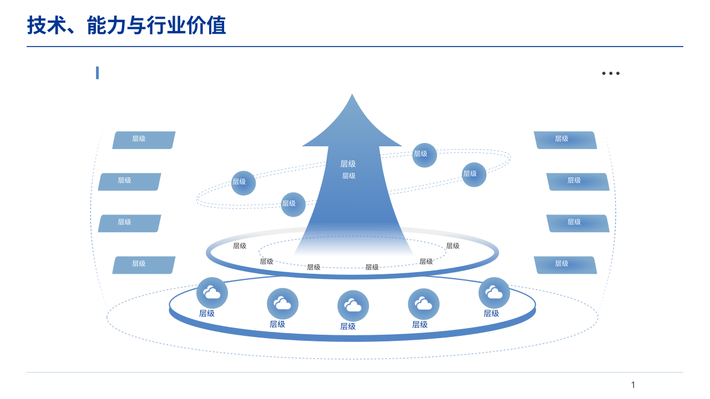

# 技术、能力与行业价值

来源为立体结构逻辑图1122.pptx#32。

## 结构与适用场景

底5云球体环，中6技术能力环，顶4价值球体斜环；中央大上箭头；左右8行业

技术基础-能力-行业价值

行业两侧属应用范围，价值与技术层独立；球体并列非量化气泡

固定节点、圆弧、扇区、分面和连接表达定性关系。数量比较、趋势或占比使用数据驱动图表，源页中已登记的微图槽可接收实际数据。

## 预览



## 调用

将下列完整page对象放入schema_version=1、template_id=business-blue-v1的pages数组，替换各节点内容。nodes键对应原文本框或已明确拆分的语义分段，字段角色及source_ref、segment见下表。

```json
{
  "id": "spatial-32",
  "family": "source-spatial",
  "variant": "page-32",
  "content": {
    "title": "技术、能力与行业价值",
    "nodes": {
      "shape_14": "层级",
      "shape_22": "层级",
      "shape_26": "层级",
      "shape_31": "层级",
      "shape_452": "层级",
      "shape_478": "层级",
      "shape_35": "层级",
      "shape_38": "层级",
      "shape_41": "层级",
      "shape_44": "层级",
      "shape_47": "层级",
      "shape_50": "层级",
      "shape_53": "层级",
      "shape_59": "层级",
      "shape_60": "层级",
      "shape_54": "层级",
      "shape_55": "层级",
      "shape_56": "层级",
      "shape_57": "层级",
      "shape_196": "层级",
      "shape_201": "层级",
      "shape_202": "层级",
      "shape_203": "层级",
      "shape_204": "层级",
      "shape_205": "层级"
    }
  },
  "config": {
    "show_source": true,
    "show_page_number": true
  }
}
```

config支持show_source、show_page_number、image_fit与image_position。image_fit可选contain或cover，image_position为xMin/xMid/xMax与YMin/YMid/YMax组合的九个焦点，默认为xMidYMid。字体、颜色、全局区和固定字阶取自tokens，节点数与连接结构由variant确定。

## 字段合同

每个业务节点required=true、min=1，max按具体框体登记。字符按规范化后的Unicode码点计数，空格标点换行均计入。build会以实际字体测量宽高，字符数通过后仍可能需要调整文字。

| 字段 | 节点角色与源标签 | 最短/最长 | 字阶 | 框体px | 原框引用 | 分段 | 旋转° | 垂直锚点 |
|---|---|---|---|---|---|---|---|---|
| nodes.shape_14 | 下左节点，源标签“混合云” | 1/10 | diagramCompact | [347.6035, 557.1571, 69.1136, 23.5867] | slide:14 |  | 0.0 | t |
| nodes.shape_22 | 下中节点，源标签“共有云” | 1/10 | diagramCompact | [474.7755, 576.6721, 69.1136, 23.5867] | slide:22 |  | 0.0 | t |
| nodes.shape_26 | 下中节点，源标签“边缘云” | 1/10 | diagramCompact | [601.9474, 580.6059, 69.1136, 23.5867] | slide:26 |  | 0.0 | t |
| nodes.shape_31 | 下中节点，源标签“伙伴云” | 1/10 | diagramCompact | [731.723, 577.3372, 69.1136, 24.3735] | slide:31 |  | 0.0 | t |
| nodes.shape_452 | 下右节点，源标签“私有云” | 1/10 | diagramCompact | [860.4928, 557.1571, 69.1136, 24.3735] | slide:452 |  | 0.0 | t |
| nodes.shape_478 | 上左节点，源标签“工业物联网” | 1/13 | diagramMicro | [223.1001, 242.4189, 70.2167, 21.2264] | slide:478 |  | 0.0 | t |
| nodes.shape_35 | 中左节点，源标签“电商” | 1/7 | diagramMicro | [213.2371, 317.5752, 38.2757, 21.2264] | slide:35 |  | 0.0 | t |
| nodes.shape_38 | 中左节点，源标签“政府及公共事业” | 1/16 | diagramMicro | [186.6169, 392.7314, 91.5161, 21.2264] | slide:38 |  | 0.0 | t |
| nodes.shape_41 | 中左节点，源标签“社交咨询” | 1/11 | diagramMicro | [228.4209, 467.8796, 59.5751, 21.2264] | slide:41 |  | 0.0 | t |
| nodes.shape_44 | 上右节点，源标签“游戏娱乐” | 1/11 | diagramMicro | [990.8036, 242.4189, 59.5751, 21.2264] | slide:44 |  | 0.0 | t |
| nodes.shape_47 | 中右节点，源标签“金融” | 1/7 | diagramMicro | [1023.9451, 317.5752, 38.2757, 21.2264] | slide:47 |  | 0.0 | t |
| nodes.shape_50 | 中右节点，源标签“影音视频” | 1/11 | diagramMicro | [1013.2954, 392.7314, 59.5751, 21.2264] | slide:50 |  | 0.0 | t |
| nodes.shape_53 | 中右节点，源标签“出行交通” | 1/11 | diagramMicro | [990.8036, 467.8796, 59.5751, 21.2264] | slide:53 |  | 0.0 | t |
| nodes.shape_59 | 中中节点，源标签“效率提升” | 1/10 | diagramCompact | [602.2069, 287.3537, 69.1136, 23.5867] | slide:59 |  | 0.0 | t |
| nodes.shape_60 | 中中节点，源标签“Performance” | 1/14 | diagramMicro | [597.4134, 309.4642, 78.9522, 21.2021] | slide:60 |  | 0.0 | t |
| nodes.shape_54 | 中左节点，源标签“链接” | 1/12 | diagramMicro | [404.5507, 320.0734, 69.1136, 22.2808] | slide:54 |  | 0.0 | t |
| nodes.shape_55 | 中中节点，源标签“高效” | 1/12 | diagramMicro | [494.3229, 359.3224, 69.1136, 22.2808] | slide:55 |  | 0.0 | t |
| nodes.shape_56 | 上中节点，源标签“赋能” | 1/12 | diagramMicro | [731.723, 269.542, 69.1136, 22.2808] | slide:56 |  | 0.0 | t |
| nodes.shape_57 | 中中节点，源标签“数据” | 1/12 | diagramMicro | [820.9031, 305.5061, 69.1136, 22.2808] | slide:57 |  | 0.0 | t |
| nodes.shape_196 | 中中节点，源标签“数据智能” | 1/15 | diagramMicro | [399.384, 435.8899, 81.4179, 21.6239] | slide:196 |  | 0.0 | t |
| nodes.shape_201 | 中中节点，源标签“云原生” | 1/15 | diagramMicro | [447.8308, 464.1567, 81.4179, 21.6239] | slide:201 |  | 0.0 | t |
| nodes.shape_202 | 中中节点，源标签“协同办公” | 1/15 | diagramMicro | [532.7527, 474.4982, 81.4179, 21.6239] | slide:202 |  | 0.0 | t |
| nodes.shape_203 | 中中节点，源标签“音视频” | 1/15 | diagramMicro | [638.0331, 474.4982, 81.4179, 22.2808] | slide:203 |  | 0.0 | t |
| nodes.shape_204 | 中中节点，源标签“人工智能” | 1/15 | diagramMicro | [735.673, 464.1567, 81.4179, 21.6239] | slide:204 |  | 0.0 | t |
| nodes.shape_205 | 中中节点，源标签“边缘计算” | 1/15 | diagramMicro | [783.5683, 435.8899, 81.4179, 22.2808] | slide:205 |  | 0.0 | t |

## 保留的原装饰

本页保留用户原模板的结构图标或装饰图片，逐项身份见source-field-coverage.json中本页retained_source_images。其中图片内固化的字形随整图编辑，可在PowerPoint中原生替换整图；nodes字段控制已登记的可编辑文字。参数图片替换使用本页image_slots列出的槽位。


全局title必填、2至32码点，使用统一标题框。section_name可选0至24码点，source可选0至64码点。所有可编辑文本通过独立原生carrier导出，页码为派生文字。

## 来源处理

原生PPTX源件保存于用户材料目录，分发包仅含用户资产衍生的几何、字段和说明。原始逐框文字、源框与标准化框在page-catalog.json的variant.fields中。

源标题引用为`slide:66`，原文为“系统介绍”。模板默认标题依据真实结构设置。

密集全景中的diagramCompact为14px、diagramMicro为12px。适用于体系概览或附录局部标签，现场关键结论用统一标题与正常正文字阶表达。

源画布边界裁切已烘焙为可编辑Bezier几何，3D顶面、侧面与前面通过tokens配色的相对明暗保留。

