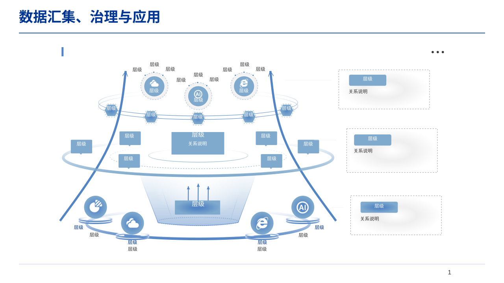

# 数据汇集、治理与应用

来源为立体结构逻辑图1122.pptx#33。

## 结构与适用场景

底4源系统球体，中源头倒锥汇聚到总线环，上效益与应用3球；左右弧箭头；右3段说明

数据汇集-治理-应用链

总线内标准/规则/资产模块独立，源系统与右解释绑定；源头方向不能颠倒

固定节点、圆弧、扇区、分面和连接表达定性关系。数量比较、趋势或占比使用数据驱动图表，源页中已登记的微图槽可接收实际数据。

## 预览



## 调用

将下列完整page对象放入schema_version=1、template_id=business-blue-v1的pages数组，替换各节点内容。nodes键对应原文本框或已明确拆分的语义分段，字段角色及source_ref、segment见下表。

```json
{
  "id": "spatial-33",
  "family": "source-spatial",
  "variant": "page-33",
  "content": {
    "title": "数据汇集、治理与应用",
    "nodes": {
      "shape_456": "层级",
      "shape_15": "层级",
      "shape_16": "层级",
      "shape_18": "层级",
      "shape_20": "层级",
      "shape_458": "层级",
      "shape_459": "层级",
      "shape_460": "层级",
      "shape_461": "层级",
      "shape_33": "层级",
      "shape_35": "层级",
      "shape_42": "层级",
      "shape_43": "层级",
      "shape_44": "层级",
      "shape_536": "层级",
      "shape_540": "关系说明",
      "shape_205": "层级",
      "shape_213": "层级",
      "shape_218": "关系说明",
      "shape_219": "关系说明",
      "shape_552": "层级",
      "shape_553": "层级",
      "shape_554": "层级",
      "shape_555": "层级",
      "shape_522": "层级",
      "shape_566": "层级",
      "shape_573": "层级",
      "shape_574": "层级",
      "shape_525": "层级",
      "shape_578": "层级",
      "shape_585": "层级",
      "shape_586": "层级",
      "shape_524": "层级",
      "shape_590": "层级",
      "shape_597": "层级",
      "shape_598": "层级",
      "shape_604": "层级",
      "shape_606": "层级",
      "shape_48": "层级",
      "shape_49": "关系说明"
    }
  },
  "config": {
    "show_source": true,
    "show_page_number": true
  }
}
```

config支持show_source、show_page_number、image_fit与image_position。image_fit可选contain或cover，image_position为xMin/xMid/xMax与YMin/YMid/YMax组合的九个焦点，默认为xMidYMid。字体、颜色、全局区和固定字阶取自tokens，节点数与连接结构由variant确定。

## 字段合同

每个业务节点required=true、min=1，max按具体框体登记。字符按规范化后的Unicode码点计数，空格标点换行均计入。build会以实际字体测量宽高，字符数通过后仍可能需要调整文字。

| 字段 | 节点角色与源标签 | 最短/最长 | 字阶 | 框体px | 原框引用 | 分段 | 旋转° | 垂直锚点 |
|---|---|---|---|---|---|---|---|---|
| nodes.shape_456 | 下中节点，源标签“数据源头” | 1/16 | caption | [443.1031, 510.2242, 120.1097, 33.2252] | slide:456 |  | 0.0 | t |
| nodes.shape_15 | 下左节点，源标签“OA系统” | 1/13 | diagramMicro | [162.8252, 572.1713, 73.8043, 23.2684] | slide:15 |  | 0.0 | t |
| nodes.shape_16 | 下左节点，源标签“ERP系统” | 1/13 | diagramMicro | [299.6342, 610.1641, 73.8043, 23.2684] | slide:16 |  | 0.0 | t |
| nodes.shape_18 | 下中节点，源标签“OLM系统” | 1/13 | diagramMicro | [629.3822, 610.1641, 73.8043, 23.2684] | slide:18 |  | 0.0 | t |
| nodes.shape_20 | 下中节点，源标签“ITO系统” | 1/13 | diagramMicro | [774.3797, 572.1713, 73.8043, 23.2684] | slide:20 |  | 0.0 | t |
| nodes.shape_458 | 中左节点，源标签“标准定义” | 1/13 | diagramMicro | [169.766, 359.6161, 73.8043, 23.3427] | slide:458 |  | 0.0 | t |
| nodes.shape_459 | 中中节点，源标签“数据建模” | 1/13 | diagramMicro | [745.9471, 359.6161, 73.8043, 23.3427] | slide:459 |  | 0.0 | t |
| nodes.shape_460 | 中中节点，源标签“资产统一” | 1/13 | diagramMicro | [653.1959, 396.981, 73.8043, 23.3427] | slide:460 |  | 0.0 | t |
| nodes.shape_461 | 中左节点，源标签“规则定义” | 1/13 | diagramMicro | [289.4873, 396.981, 73.8043, 23.3427] | slide:461 |  | 0.0 | t |
| nodes.shape_33 | 上左节点，源标签“提效” | 1/13 | diagramMicro | [245.6195, 269.0546, 73.8043, 23.3427] | slide:33 |  | 0.0 | t |
| nodes.shape_35 | 上中节点，源标签“舒适” | 1/13 | diagramMicro | [690.9078, 269.0546, 73.8043, 23.3427] | slide:35 |  | 0.0 | t |
| nodes.shape_42 | 中中节点，源标签“升级” | 1/13 | diagramMicro | [594.6036, 285.2252, 73.8043, 23.3427] | slide:42 |  | 0.0 | t |
| nodes.shape_43 | 中左节点，源标签“降本” | 1/13 | diagramMicro | [346.7163, 285.2252, 73.8043, 23.3427] | slide:43 |  | 0.0 | t |
| nodes.shape_44 | 中中节点，源标签“提质” | 1/13 | diagramMicro | [465.9831, 290.8439, 73.8043, 23.3427] | slide:44 |  | 0.0 | t |
| nodes.shape_536 | 上右节点，源标签“应用搭建” | 1/11 | diagramMicro | [903.7852, 194.1514, 60.0053, 20.7647] | slide:536 |  | 0.0 | t |
| nodes.shape_540 | 上右节点，源标签“基于全企业的数据汇总、统一提供的服务能力，赋能应用建设。” | 1/68 | diagramMicro | [885.2432, 226.4841, 186.3782, 40.1412] | slide:540 |  | 0.0 | t |
| nodes.shape_205 | 中右节点，源标签“数据治理” | 1/11 | diagramMicro | [916.4935, 346.2054, 60.0053, 20.7647] | slide:205 |  | 0.0 | t |
| nodes.shape_213 | 下右节点，源标签“数据来源” | 1/11 | diagramMicro | [932.9863, 517.6195, 60.0053, 20.7647] | slide:213 |  | 0.0 | t |
| nodes.shape_218 | 中右节点，源标签“数据治理是数据治理系统核心的一环，高质量的数据管理，能够更好的支持应用建设。” | 1/111 | diagramMicro | [897.9516, 377.4392, 205.0772, 56.8323] | slide:218 |  | 0.0 | t |
| nodes.shape_219 | 下右节点，源标签“数据来源是关键的一层，需要在前期花费足够的精力打好地基。” | 1/68 | diagramMicro | [914.4443, 550.3407, 186.3782, 40.1412] | slide:219 |  | 0.0 | t |
| nodes.shape_552 | 下左节点，源标签“商品、订单数据” | 1/21 | diagramMicro | [280.0346, 627.3262, 113.7224, 20.6738] | slide:552 |  | 0.0 | t |
| nodes.shape_553 | 下中节点，源标签“配方数据、BOM数据” | 1/21 | diagramMicro | [608.7001, 627.3262, 113.7224, 20.6738] | slide:553 |  | 0.0 | t |
| nodes.shape_554 | 下中节点，源标签“物料数据、设备数据” | 1/21 | diagramMicro | [713.416, 591.8618, 113.7224, 20.6738] | slide:554 |  | 0.0 | t |
| nodes.shape_555 | 下左节点，源标签“组织数据、流程数据” | 1/21 | diagramMicro | [182.5157, 591.0438, 113.7224, 20.6738] | slide:555 |  | 0.0 | t |
| nodes.shape_522 | 上中节点，源标签“社交” | 1/9 | diagramMicro | [593.8847, 224.1953, 50.7673, 21.8058] | slide:522 |  | 0.0 | t |
| nodes.shape_566 | 上中节点，源标签“即时通讯” | 1/10 | diagramMicro | [632.4642, 169.5031, 58.4518, 20.2689] | slide:566 |  | 0.0 | t |
| nodes.shape_573 | 上中节点，源标签“即时通讯” | 1/10 | diagramMicro | [592.2239, 157.621, 58.4518, 20.2689] | slide:573 |  | 0.0 | t |
| nodes.shape_574 | 上中节点，源标签“即时通讯” | 1/10 | diagramMicro | [548.447, 170.8995, 58.4518, 20.2689] | slide:574 |  | 0.0 | t |
| nodes.shape_525 | 上左节点，源标签“商城” | 1/9 | diagramMicro | [365.754, 224.1953, 50.7673, 21.8058] | slide:525 |  | 0.0 | t |
| nodes.shape_578 | 上左节点，源标签“即时通讯” | 1/10 | diagramMicro | [403.3255, 169.5031, 58.4518, 20.2689] | slide:578 |  | 0.0 | t |
| nodes.shape_585 | 上左节点，源标签“即时通讯” | 1/10 | diagramMicro | [363.0851, 157.621, 58.4518, 20.2689] | slide:585 |  | 0.0 | t |
| nodes.shape_586 | 上左节点，源标签“即时通讯” | 1/10 | diagramMicro | [319.3082, 170.8995, 58.4518, 20.2689] | slide:586 |  | 0.0 | t |
| nodes.shape_524 | 上中节点，源标签“物流” | 1/9 | diagramMicro | [478.6336, 247.7033, 50.7673, 21.8058] | slide:524 |  | 0.0 | t |
| nodes.shape_590 | 上中节点，源标签“即时通讯” | 1/10 | diagramMicro | [514.7591, 195.7213, 58.4518, 20.2689] | slide:590 |  | 0.0 | t |
| nodes.shape_597 | 上中节点，源标签“即时通讯” | 1/10 | diagramMicro | [474.5187, 183.8475, 58.4518, 20.2689] | slide:597 |  | 0.0 | t |
| nodes.shape_598 | 上中节点，源标签“即时通讯” | 1/10 | diagramMicro | [430.7418, 197.1177, 58.4518, 20.2689] | slide:598 |  | 0.0 | t |
| nodes.shape_604 | 中左节点，源标签“规则定义” | 1/13 | diagramMicro | [291.7349, 339.2233, 73.8043, 23.3427] | slide:604 |  | 0.0 | t |
| nodes.shape_606 | 中中节点，源标签“规则定义” | 1/13 | diagramMicro | [637.926, 339.2233, 73.8043, 23.3427] | slide:606 |  | 0.0 | t |
| nodes.shape_48 | 中中节点，源标签“数据总线” | 1/16 | caption | [443.1031, 333.6706, 120.1097, 33.2252] | slide:48 |  | 0.0 | t |
| nodes.shape_49 | 中中节点，源标签“搭建ESB总监，对数 / 据进行统一通信、治理” | 1/84 | diagramMicro | [386.874, 359.046, 228.8413, 35.8858] | slide:49 |  | 0.0 | t |

## 保留的原装饰

本页保留用户原模板的结构图标或装饰图片，逐项身份见source-field-coverage.json中本页retained_source_images。其中图片内固化的字形随整图编辑，可在PowerPoint中原生替换整图；nodes字段控制已登记的可编辑文字。参数图片替换使用本页image_slots列出的槽位。


全局title必填、2至32码点，使用统一标题框。section_name可选0至24码点，source可选0至64码点。所有可编辑文本通过独立原生carrier导出，页码为派生文字。

## 来源处理

原生PPTX源件保存于用户材料目录，分发包仅含用户资产衍生的几何、字段和说明。原始逐框文字、源框与标准化框在page-catalog.json的variant.fields中。

源标题引用为`slide:162`，原文为“系统介绍”。模板默认标题依据真实结构设置。

密集全景中的diagramCompact为14px、diagramMicro为12px。适用于体系概览或附录局部标签，现场关键结论用统一标题与正常正文字阶表达。

源画布边界裁切已烘焙为可编辑Bezier几何，3D顶面、侧面与前面通过tokens配色的相对明暗保留。

