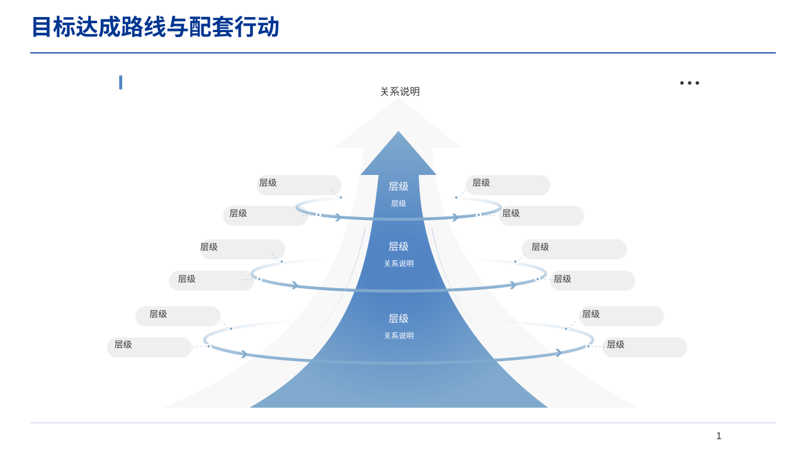

# 目标达成路线与配套行动

来源为立体结构逻辑图1122.pptx#34。

## 结构与适用场景

巨大上升箭头，3层环分别第一/二/三步；左右每层4项动作；顶营业额目标

目标达成路线与配套动作

每阶段目标、任务、数量与环上方向参数化；源金额/人数是例文，不能照抄

固定节点、圆弧、扇区、分面和连接表达定性关系。数量比较、趋势或占比使用数据驱动图表，源页中已登记的微图槽可接收实际数据。

## 预览



## 调用

将下列完整page对象放入schema_version=1、template_id=business-blue-v1的pages数组，替换各节点内容。nodes键对应原文本框或已明确拆分的语义分段，字段角色及source_ref、segment见下表。

```json
{
  "id": "spatial-34",
  "family": "source-spatial",
  "variant": "page-34",
  "content": {
    "title": "目标达成路线与配套行动",
    "nodes": {
      "shape_3": "关系说明",
      "shape_19": "层级",
      "shape_20": "关系说明",
      "shape_22": "层级",
      "shape_23": "关系说明",
      "shape_24": "层级",
      "shape_25": "层级",
      "shape_558": "层级",
      "shape_566": "层级",
      "shape_605": "层级",
      "shape_609": "层级",
      "shape_618": "层级",
      "shape_622": "层级",
      "shape_13": "层级",
      "shape_16": "层级",
      "shape_26": "层级",
      "shape_29": "层级",
      "shape_450": "层级",
      "shape_453": "层级"
    }
  },
  "config": {
    "show_source": true,
    "show_page_number": true
  }
}
```

config支持show_source、show_page_number、image_fit与image_position。image_fit可选contain或cover，image_position为xMin/xMid/xMax与YMin/YMid/YMax组合的九个焦点，默认为xMidYMid。字体、颜色、全局区和固定字阶取自tokens，节点数与连接结构由variant确定。

## 字段合同

每个业务节点required=true、min=1，max按具体框体登记。字符按规范化后的Unicode码点计数，空格标点换行均计入。build会以实际字体测量宽高，字符数通过后仍可能需要调整文字。

| 字段 | 节点角色与源标签 | 最短/最长 | 字阶 | 框体px | 原框引用 | 分段 | 旋转° | 垂直锚点 |
|---|---|---|---|---|---|---|---|---|
| nodes.shape_3 | 上中节点，源标签“营业额 / 10,000,000” | 1/69 | caption | [550.1615, 137.0714, 169.1944, 63.2873] | slide:3 |  | 0.0 | t |
| nodes.shape_19 | 下中节点，源标签“第一步” | 1/13 | caption | [584.6569, 498.0707, 97.0619, 21.1767] | slide:19 |  | 0.0 | t |
| nodes.shape_20 | 下中节点，源标签“扩充销售团队，建立相关制度保障” | 1/50 | diagramMicro | [565.243, 527.3405, 135.882, 33.7981] | slide:20 |  | 0.0 | t |
| nodes.shape_22 | 中中节点，源标签“第二步” | 1/13 | caption | [584.6569, 383.4046, 97.0619, 21.1767] | slide:22 |  | 0.0 | t |
| nodes.shape_23 | 中中节点，源标签“关键项目攻坚 / 普通项目规模化” | 1/64 | diagramMicro | [546.3774, 412.6744, 173.6131, 34.8558] | slide:23 |  | 0.0 | t |
| nodes.shape_24 | 中中节点，源标签“第三步” | 1/13 | caption | [584.6569, 287.8625, 97.0619, 21.1767] | slide:24 |  | 0.0 | t |
| nodes.shape_25 | 中中节点，源标签“保交付” | 1/32 | diagramMicro | [546.3774, 317.1402, 173.6131, 17.0009] | slide:25 |  | 0.0 | t |
| nodes.shape_558 | 中中节点，源标签“推出团队合作机制” | 1/18 | diagramCompact | [750.3963, 283.0521, 116.4524, 22.7828] | slide:558 |  | 0.0 | t |
| nodes.shape_566 | 中中节点，源标签“建立交付保障制度” | 1/18 | diagramCompact | [797.6307, 331.5557, 116.4524, 22.7828] | slide:566 |  | 0.0 | t |
| nodes.shape_605 | 中右节点，源标签“推进25个普通客户签约” | 1/22 | diagramCompact | [844.1442, 385.1203, 143.6147, 22.7828] | slide:605 |  | 0.0 | t |
| nodes.shape_609 | 中右节点，源标签“攻坚5个KA大客户” | 1/18 | diagramCompact | [879.3918, 435.9429, 114.7366, 22.7828] | slide:609 |  | 0.0 | t |
| nodes.shape_618 | 下右节点，源标签“招聘25名销售精英” | 1/18 | diagramCompact | [924.7302, 491.7012, 118.2935, 22.7828] | slide:618 |  | 0.0 | t |
| nodes.shape_622 | 下右节点，源标签“建设5个销售团队” | 1/17 | diagramCompact | [963.9263, 540.2048, 111.0466, 22.7828] | slide:622 |  | 0.0 | t |
| nodes.shape_13 | 中中节点，源标签“设计项目经理责任制” | 1/20 | diagramCompact | [411.7019, 283.0521, 129.1051, 22.7828] | slide:13 |  | 0.0 | t |
| nodes.shape_16 | 中左节点，源标签“建立延期预警制度” | 1/18 | diagramCompact | [364.4676, 331.5557, 116.4524, 22.7828] | slide:16 |  | 0.0 | t |
| nodes.shape_26 | 中左节点，源标签“推动项目价格提高10%” | 1/22 | diagramCompact | [317.954, 385.1203, 142.8234, 22.7828] | slide:26 |  | 0.0 | t |
| nodes.shape_29 | 中左节点，源标签“拓展新客户10家” | 1/16 | diagramCompact | [282.7065, 435.9429, 105.3744, 22.7828] | slide:29 |  | 0.0 | t |
| nodes.shape_450 | 下左节点，源标签“构建职级管理” | 1/14 | diagramCompact | [237.3681, 491.7012, 91.139, 22.7828] | slide:450 |  | 0.0 | t |
| nodes.shape_453 | 下左节点，源标签“出台销售激励制度” | 1/18 | diagramCompact | [181.6489, 540.2048, 116.4524, 22.7828] | slide:453 |  | 0.0 | t |

全局title必填、2至32码点，使用统一标题框。section_name可选0至24码点，source可选0至64码点。所有可编辑文本通过独立原生carrier导出，页码为派生文字。

## 来源处理

原生PPTX源件保存于用户材料目录，分发包仅含用户资产衍生的几何、字段和说明。原始逐框文字、源框与标准化框在page-catalog.json的variant.fields中。

源标题引用为`slide:30`，原文为“计划安排/目标达成路径”。模板默认标题依据真实结构设置。

密集全景中的diagramCompact为14px、diagramMicro为12px。适用于体系概览或附录局部标签，现场关键结论用统一标题与正常正文字阶表达。

源画布边界裁切已烘焙为可编辑Bezier几何，3D顶面、侧面与前面通过tokens配色的相对明暗保留。

